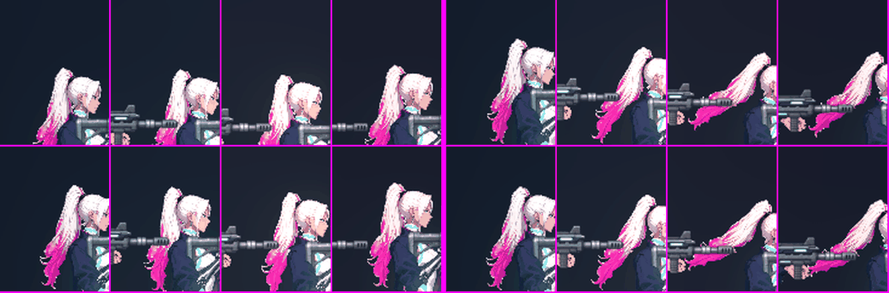

# [NE-396] 讓主角的頭髮飄逸不僵硬

> 狀態：完成

## 內文

### 需求
主角的馬尾是兩片硬的圖片：站著不動時完全靜止，跑起來時像一根硬棒整片往後抬。這張票讓頭髮從髮根到髮梢柔軟地彎，站著時也會緩慢飄動。

### 來源
2026-11-27，使用者指出主角的頭髮是硬的，希望做成飄逸的樣子。

### 驗收條件
- [x] 站著不動時頭髮持續緩慢飄動，髮梢的擺幅比髮根大；附修前修後的連續畫面
- [x] 髮根與髮梢、白色與洋紅兩片頭髮不是同一個節奏同步擺動，風的起伏不是固定週期重複
- [x] 跑步、跳躍、衝刺、受擊時頭髮往後流動並帶弧度，不是整片硬抬；髮梢不被壓扁或拉斷
- [x] 頭髮與頭部的接合處沒有裂縫或錯位；白髮在燈下不過曝（既有曝光檢查通過）
- [x] 背包立繪與過場裡的主角頭髮同樣會飄
- [x] 站著時的飄動緩慢且有上限（離靜止位置不超過 0.24 弧度、每秒不超過 0.6 弧度）；外套與胸口仍然站著不動
- [x] 彎曲量有上下限；資料損毀時指出是哪一項並退回原本的樣子
- [x] 受影響範圍的測試全過

### 測試流程
1. 進關卡站著不動十秒，看馬尾
2. 預期髮梢緩慢飄動，每次幅度不完全一樣
3. 起跑、跳躍、衝刺，預期頭髮帶著弧度往後流
4. 開背包看立繪，預期頭髮同樣在飄

---

# 跟其他票的關係

- Blocks：無
- Blocked by：無
- Related：NE-257（頭髮站著不動的規則由本票取代）、NE-393

---

# Commit-1

## 內文

主角的馬尾是兩片硬圖片掛在兩根骨頭上，而且微風的倍率是 0：站著不動時頭髮完全靜止，跑起來整片像硬棒一樣往後抬。
現在兩片頭髮各自從髮根到髮梢逐漸彎曲，越靠髮梢彎得越多；站著時有微風讓它持續緩慢飄動。髮根、白色髮束與洋紅髮梢各有自己的節奏與相位，風另外疊了一個較慢、不成整數比的起伏，所以不會整束同步、也不會固定週期重複。起跳、落地、衝刺與受擊會讓髮梢多甩一下再回來。跑步時大幅的後飄仍由原本的骨頭負責，彎曲只加上弧度，髮梢不會被壓扁。
背包立繪與過場用的是同一個骨架，頭髮同樣會飄。只有主角使用這份骨架，其他角色不受影響。
NE-257 原本規定站著不動時衣服與頭髮都不持續動、落地後 2 秒內停下。這次依使用者的新要求只放寬頭髮：改成緩慢、幅度與速度都有上限的飄動（離靜止位置不超過 0.24 弧度、每秒不超過 0.6 弧度）；外套與胸口維持原規則，站著完全不動。原本的檢查因此分成兩組，NE-257 上也補記了這個變更。

### 測試結果

| 項目 | 結果 |
|---|---|
| 受影響範圍的測試（61 個套件） | 71270 項檢查，第一輪有 4 項失敗：都是 NE-257「站著不動時衣髮不持續動、落地後 2 秒停下」的檢查，正是這張票要改變的規則。把檢查分成外套胸口與頭髮兩組、並把微風幅度收小後，重跑骨架動作、主角動作、動畫稽核、曝光、角色、網格、移動與介面八個套件共 12924 項全過 |
| 腳本錯誤 | 0 |
| 自動檢查（站著不動十秒） | 兩片頭髮的彎曲量都持續變化超過 0.06 弧度、不貼著上下限；髮梢與髮根的相關係數低於 0.95；站著時離靜止位置不超過 0.24 弧度、速度不超過每秒 0.6 弧度；外套與胸口的漂移為 0 |

### 截圖

每格上排修前、下排修後。左四格是站著不動的四個時間點，右四格是起跑的四個時間點（角色預覽工具，原生 Forward+）。

