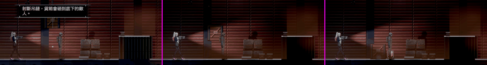

# [NE-397] 加入可以射下來砸敵人的吊掛貨箱

> 狀態：完成

## 內文

### 需求
戰鬥裡玩家能主動利用的場景物件只有油桶與可投擲物，其餘機關不是擋路就是傷害玩家，打法容易重複。這張票加入一種新的環境互動：用鏈條吊在半空的貨箱，射斷吊鏈就會砸到正下方的敵人，落地後變成掩體。

### 來源
2026-11-27，使用者要求在沒有票可做時，找出可以加入的不同玩法，增加多樣化的遊戲內容，不要讓人一直重複做一樣的事；一般設計選擇由實作者參考業界後決定。設計見[畫面活化與融入](../../design/22-living-scenes/DESIGN.md)的「玩法多樣性：讓場景變成武器」。

### 驗收條件
- [x] 吊著的貨箱不擋路也不擋子彈，角色可以從底下走過；地面上看得出它會砸在哪裡
- [x] 玩家的子彈、近戰或爆炸打到它就會鬆開往下掉；敵人的子彈打不動它
- [x] 落地時傷害正下方的敵人；玩家不會被砸傷，站在正下方時會被推到旁邊而不是卡在裡面
- [x] 落地後留在原地當掩體，擋路也擋子彈；不能再被打下來第二次
- [x] 掉下來了沒跟著檢查點保存：重生後維持落地，不重複造成傷害
- [x] 靠近時有一句提示講清楚怎麼用，中、日、英三種語言都有
- [x] 第一章倉庫放了第一個，位置在第一個敵人上方，玩家可以在安全距離試一次；原本的通關路線、敵人與拾取物不變
- [x] 高度、大小、傷害與提示寫在資料裡，新增一個只要在關卡地圖放一個字元；資料不合理時指出是哪一項
- [x] 附原生連續畫面（吊著、掉落中、落地）；受影響範圍的測試全過

### 測試流程
1. 進第一章倉庫，往右走到第一個清掃員附近
2. 預期看到上方吊著貨箱與一句提示
3. 朝貨箱開一槍，預期貨箱掉下來砸中底下的清掃員，之後留在地上
4. 躲到貨箱後面，預期敵人的子彈被貨箱擋住
5. 死掉重生後回到這裡，預期貨箱仍在地上

---

# 跟其他票的關係

- Blocks：無
- Blocked by：無
- Related：NE-254、NE-30

---

# Commit-1

## 內文

戰鬥裡玩家能拿來對付敵人的場景物件只有油桶與可投擲物，其餘機關不是擋路就是傷害玩家。
現在多了吊掛貨箱：鏈條吊著的貨箱，玩家的子彈、近戰或爆炸打到就鬆開往下砸，傷害正下方的敵人，落地後留在原地當掩體。吊著的時候不擋路也不擋子彈，地上有一塊淡影標出落點，靠近時有一句提示（中、日、英）。敵人的子彈打不動它；玩家不會被砸傷，站在正下方時會被推到旁邊。掉下來了沒會跟著檢查點保存。
第一章倉庫入口後的第一個清掃員上方放了第一個：玩家從左邊走過來，還沒被發現時就看得到提示，可以先試一次。在這個位置實際開一槍，清掃員的血量從 3 變成 0，貨箱留在地上。原本的地形、敵人與拾取物都沒有動；地圖上用 `!` 這個字元標記，關卡與地圖的預載索引同步更新。

### 測試結果

| 項目 | 結果 |
|---|---|
| 受影響範圍的測試（71 個套件） | 第一輪 94894 項有 34 項失敗，原因兩個：關卡資料改了之後關卡索引沒有重新產生（32 項），以及地圖字元和別的區域的人物撞到同一個字（1 項，連帶 1 項）。重新產生索引並改用沒有人用的字元後，第二輪 94893 / 94893 全過 |
| 腳本錯誤 | 0 |
| 原生情境（第一章倉庫實際打下來一次） | 貨箱落地，底下清掃員血量 3 → 0 |

### 截圖

由左到右：吊著（有提示）、掉落中、落地後（第一章倉庫，原生 Forward+；為了拍照讓清掃員站著不動，所以最後一格它還沒倒下）。

