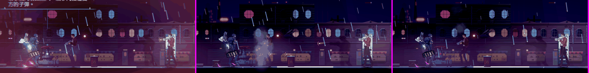

# [NE-398] 加入可以噴出蒸汽擋子彈的閥門

> 狀態：完成

## 內文

### 需求
槍戰時玩家能躲的只有固定的牆與箱子，沒有可以主動製造、會自己消失的掩護。這張票加入蒸汽閥：射中閥門，旁邊噴出一道蒸汽牆，幾秒內擋住雙方的子彈，讓玩家可以選時機推進或撤退。

### 來源
2026-11-27，使用者要求在沒有票可做時，找出可以加入的不同玩法，增加多樣化的遊戲內容；一般設計選擇由實作者參考業界後決定。設計見[畫面活化與融入](../../design/22-living-scenes/DESIGN.md)的「玩法多樣性：讓場景變成武器」。

### 驗收條件
- [x] 玩家的子彈、近戰或爆炸打到閥門會噴出蒸汽牆；敵人的子彈打不開；閥門本身不會壞
- [x] 蒸汽牆在的時候，從兩邊射進來的子彈都被擋下；角色可以走過去
- [x] 蒸汽持續一段時間後散去，最後一秒逐漸變淡；散去後要冷卻才能再用
- [x] 閥門上的燈看得出現在能不能用（可以用、冷卻中）；靠近時有一句提示，中、日、英三種語言都有
- [x] 穿牆的子彈不受影響；其他擋子彈的規則（牆、可破壞物、格擋）不變
- [x] 第一章街道兩名槍手的火線前放了第一個，旁邊是安全的位置；原本的路線、敵人與拾取物不變
- [x] 時間、大小、位置與提示寫在資料裡，新增一個只要在關卡地圖放一個字元；資料不合理時指出是哪一項
- [x] 附原生連續畫面（還沒打開、蒸汽擋子彈、散去之後）；受影響範圍的測試全過

### 測試流程
1. 進第一章街道，走到兩名槍手之前的閥門旁
2. 預期看到閥門與一句提示，閥門上的燈是青色
3. 朝閥門開一槍，預期噴出一道蒸汽牆，槍手的子彈打進蒸汽就消失
4. 從蒸汽裡走過去，預期不會被擋住
5. 等幾秒，預期蒸汽變淡散去、燈變暗紅，一段時間後回到青色

---

# 跟其他票的關係

- Blocks：無
- Blocked by：無
- Related：NE-397

---

# Commit-1

## 內文

槍戰時玩家能躲的只有固定的牆與箱子，沒有可以自己製造、會消失的掩護。
現在多了蒸汽閥：玩家的子彈、近戰或爆炸打到閥門，旁邊就噴出一道蒸汽牆，6 秒內雙方的子彈都打不穿，角色可以從蒸汽裡走過去；最後一秒逐漸變淡，散去後冷卻 8 秒才能再用。閥門上的燈青色代表可以用、暗紅代表冷卻中，靠近時有一句提示（中、日、英）。敵人打不開閥門，閥門也不會壞。子彈碰到蒸汽只是被吃掉，不算命中也不冒火花；穿牆的子彈與原本的牆、可破壞物、格擋規則都沒有變。
第一章街道兩名槍手之前放了第一個（地圖字元 `σ`：第一章其他區域的 `V` 是當舖，同一章的字元意思要一致），旁邊是還沒進入火線的位置。原生情境在這裡打開閥門，再從蒸汽另一邊朝主角發射 6 發槍手的子彈，6 發全部在蒸汽裡消失；6 秒後蒸汽散去、閥門進入冷卻。

### 測試結果

| 項目 | 結果 |
|---|---|
| 受影響範圍的測試（73 個套件） | 95285 項檢查，第一輪 1 項失敗：地圖字元 `V` 在第一章其他區域代表當舖，同一章的字元意思必須一致。改用沒有被任何區域用過的 `σ` 後，重跑地圖、可投擲物、機關、任務地圖、文字盤點與區域六個套件 4066 / 4066 通過，原生情境結果相同 |
| 腳本錯誤 | 0 |
| 原生情境（第一章街道） | 6 發敵方子彈全部被蒸汽擋下，6 秒後散去並進入冷卻 |

### 截圖

由左到右：還沒打開（有提示、閥門燈是青色）、蒸汽擋住從右邊射來的子彈、散去之後（第一章街道，原生 Forward+；為了拍照讓敵人停住）。

