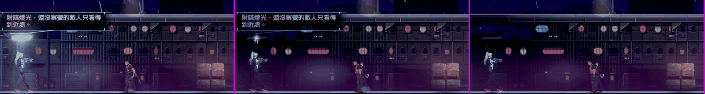

# [NE-399] 加入可以射暗的燈讓玩家摸黑靠近

> 狀態：完成

## 內文

### 需求
場景裡的燈只是氣氛，和戰鬥沒有關係；每一場戰鬥都是被敵人看到之後互射。這張票讓某些區域的燈可以射暗：燈下變暗，還沒察覺的敵人看不遠，玩家可以選擇摸黑靠近先開第一槍。

### 來源
2026-11-27，使用者要求在沒有票可做時，找出可以加入的不同玩法，增加多樣化的遊戲內容；一般設計選擇由實作者參考業界後決定。設計見[畫面活化與融入](../../design/22-living-scenes/DESIGN.md)的「玩法多樣性：讓場景變成武器」。

### 驗收條件
- [x] 只有關卡資料標記的區域，燈才可以射暗；其他區域的燈與既有的閃爍、停電、光源預算行為不變
- [x] 玩家的子彈、近戰或爆炸打中燈具就熄掉，有火花與碎裂聲，光池與光錐一起消失；敵人打不到燈
- [x] 燈下一段範圍變暗；還被別的燈照亮的地方不算暗
- [x] 還沒察覺的敵人，對站在暗處的玩家只看得到一半遠；被打中或被警報引來之後照常
- [x] 沒有任何燈被射暗時，敵人的視野檢查不多花成本
- [x] 射暗了沒跟著檢查點保存；燈上有一句提示（中、日、英），射暗後收起
- [x] 第二章裝卸區的燈可以射暗；原本的路線、敵人與拾取物不變
- [x] 附原生連續畫面（亮著、射暗那一刻、射暗之後）；受影響範圍的測試全過

### 測試流程
1. 進第二章裝卸區，站在燈下、離沒察覺的護衛一段距離
2. 預期燈上有一句提示
3. 朝燈開一槍，預期燈熄掉、掉火花
4. 站在燈下的暗處，預期護衛在原本看得到的距離看不到主角；走近到一半距離內才看到
5. 先開槍打護衛再躲進暗處，預期它照樣看得到

---

# 跟其他票的關係

- Blocks：無
- Blocked by：無
- Related：NE-397、NE-398、BG-35

---

# Commit-1

## 內文

場景裡的燈只是氣氛，和戰鬥沒有關係。
現在關卡可以標記「燈可以射暗」：玩家打中燈具，燈就熄掉，掉火花、玻璃碎裂聲，光池與光錐一起消失。燈下原本光池四分之三的範圍變暗（還被別的燈照到三成以上的地方不算），還沒察覺的敵人對站在暗處的玩家只看得到一半遠；被打中或被警報引來之後照常。敵人打不到燈。射暗了沒跟著檢查點保存，燈上有一句提示（中、日、英），射暗後收起。沒有任何燈被射暗時，敵人的視野檢查直接略過，不多花成本；沒有標記的區域完全不變。
第二章裝卸區的燈全部可以射暗。原生情境在那裡讓主角站在燈下、離沒察覺的護衛 152 像素（護衛平常看得到 240 像素）：射暗前看得到，射暗後看不到。

### 測試結果

| 項目 | 結果 |
|---|---|
| 受影響範圍的測試 | 通過 104186 / 104186（78 個套件） |
| 腳本錯誤 | 0 |
| 原生情境（第二章裝卸區） | 護衛距離 152 像素：射暗前看得到、射暗後看不到 |

### 截圖

由左到右：燈亮著（有提示）、射暗那一刻（火花）、射暗之後（第二章裝卸區，原生 Forward+；為了拍照讓敵人停住）。

