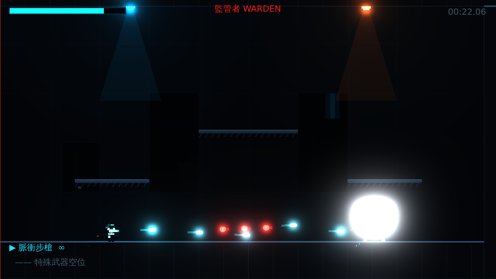

# [NE-3] 升級專案至 Godot 4.7

> 狀態：完成

## 內文

### 需求
專案要改用 Godot 4.7 開發，並使用新版引擎建議的寫法，避免沿用已不建議使用的功能。

### 來源
2026-10-02，使用者於開發對話中提出：「幫我改成 godot 4.7」。

### 驗收條件
- [x] 以 Godot 4.7 開啟專案沒有任何錯誤或升級提示
- [x] 原有遊戲功能全部正常
- [x] 改用 4.7 建議的視差背景、抽象基底類別與型別化資料寫法
- [x] 說明文件標示需要的引擎版本

### 測試流程
1. 以 Godot 4.7 匯入專案，確認無錯誤
2. 從主選單玩到頭目戰，確認畫面與操作正常
3. 執行完整測試套件，全部通過

---

# 跟其他票的關係

- Blocks：無
- Blocked by：無
- Related：NE-1

---

# Commit-1

## 內文

專案原本以 Godot 4.3 建立。
現在以 Godot 4.7 為準：專案設定與資源已升級，視差背景、抽象基底類別與型別化資料改用新版寫法，說明文件改標 4.7。
以 4.7 重新匯入無錯誤，完整測試全數通過，實際渲染確認頭目戰畫面正常。

### 測試結果

| 項目 | 結果 |
|---|---|
| 完整測試套件 | 通過 117 / 117 |
| 資料驗證 | 0 錯誤 |
| 執行 log | 無 ERROR |

### 截圖

