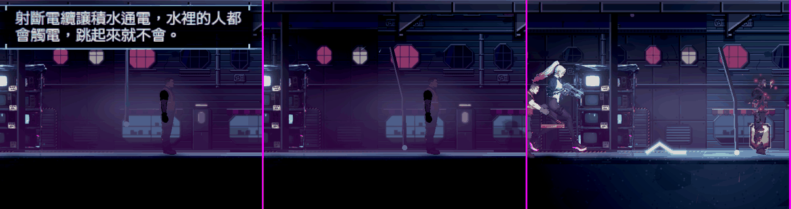

# [NE-400] 加入射斷後讓積水通電的電纜

> 狀態：完成

## 內文

### 需求
前三個環境機關（吊掛貨箱、蒸汽閥、可以射暗的燈）都不會傷到玩家，用起來只有好處。這張票加入一個有風險的：天花板垂下一條冒火花的電纜，下面是一灘積水；射斷電纜讓積水通電，水裡的敵人會觸電，玩家自己站在水裡也一樣，要先離開水面或跳起來。

### 來源
2026-11-27，使用者要求在沒有票可做時，找出可以加入的不同玩法，增加多樣化的遊戲內容，不要讓人一直重複做一樣的事；一般設計選擇由實作者參考業界後決定。設計見[畫面活化與融入](../../design/22-living-scenes/DESIGN.md)的「玩法多樣性：讓場景變成武器」。

### 驗收條件
- [x] 電纜從天花板或雨棚垂下並偶爾冒火花，下面有看得出來的積水；靠近時有一句提示（中、日、英），講清楚會電到自己、跳起來就不會
- [x] 玩家的子彈、近戰或爆炸打中電纜就斷；敵人打不斷
- [x] 電纜落水後水面先閃一下預警，接著通電幾秒；通電時水面發亮並放出電弧
- [x] 通電時站在水裡的敵人與玩家都會觸電，格擋擋不住；跳起來腳離開水面就不會
- [x] 時間到停止通電，之後只是一灘普通的水；電纜不能再用第二次
- [x] 死在觸電有自己的敗北卡片
- [x] 「減少閃光」時水面不快速閃爍、電弧變少
- [x] 第二章市集入口兩名護衛之間放了第一個；原本的路線、敵人與拾取物不變
- [x] 時間、寬度、傷害與提示寫在資料裡，新增一個只要在關卡地圖放一個字元；資料不合理時指出是哪一項
- [x] 附原生連續畫面（吊著、落水預警、通電中）；受影響範圍的測試全過

### 測試流程
1. 進第二章市集入口，走到兩名護衛之前
2. 預期看到雨棚下垂著冒火花的電纜、下面一灘水與一句提示
3. 站在水外朝電纜開一槍，預期電纜掉進水裡、水面閃一下後通電，水裡的護衛觸電
4. 再試一次站在水裡開槍，預期自己也會觸電；在水面閃的時候跳起來就不會

---

# 跟其他票的關係

- Blocks：無
- Blocked by：無
- Related：NE-397、NE-398、NE-399

---

# Commit-1

## 內文

前三個環境機關用起來都只有好處，沒有需要小心的地方。
現在多了斷電纜：雨棚下垂著一條偶爾冒火花的電纜，下面是一灘積水。玩家的子彈、近戰或爆炸打中電纜就斷，掉進水裡後水面先閃 0.45 秒預警，接著通電 3 秒，水面發亮並放出電弧。通電時站在水裡的人都會觸電——敵人與玩家都一樣，格擋擋不住，跳起來腳離開水面就不會。時間到之後只剩一灘普通的水。敵人打不斷電纜。提示（中、日、英）直接講「水裡的人都會觸電，跳起來就不會」，死在這裡有自己的敗北卡片「腳下的電」。「減少閃光」時水面不快速閃爍、電弧變少。
第二章市集入口兩名護衛之間放了第一個（地圖字元 `φ`），電纜吊在上方的雨棚底下。原生情境在這裡讓一名護衛站在水裡、主角站在水外開槍：護衛的血量 6 → 0，主角沒有被電到。

### 測試結果

| 項目 | 結果 |
|---|---|
| 受影響範圍的測試 | 通過 95182 / 95182（72 個套件） |
| 腳本錯誤 | 0 |
| 原生情境（第二章市集入口） | 水裡的護衛血量 6 → 0；水外的主角被電到 0 次 |
| 自動檢查 | 水裡的敵人與玩家都觸電；跳到水面上方不觸電；格擋擋不住；時間到之後不再觸電 |

### 截圖

由左到右：吊著（有提示）、落水中、通電中（水裡的護衛觸電）。第二章市集入口，原生 Forward+；最後一格左邊另一名護衛正在攻擊主角，和電纜無關。

