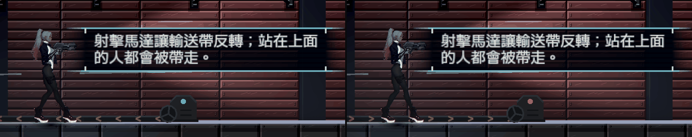

# [NE-401] 加入射中馬達就反轉的輸送帶

> 狀態：完成

## 內文

### 需求
前四個環境機關都是「打一下就造成傷害或掩護」。這張票加入一個改變移動的：工廠地面上的輸送帶，站在上面的人（玩家與敵人都一樣）會被往同一個方向帶走；射中一端的馬達讓它反轉，把衝過來的敵人送回去，或把自己送過去。

### 來源
2026-11-27，使用者要求在沒有票可做時，找出可以加入的不同玩法，增加多樣化的遊戲內容，不要讓人一直重複做一樣的事；一般設計選擇由實作者參考業界後決定。設計見[畫面活化與融入](../../design/22-living-scenes/DESIGN.md)的「玩法多樣性：讓場景變成武器」。

### 驗收條件
- [x] 輸送帶貼在地面上，帶面箭頭跟著方向移動，一端有馬達與方向燈；機殼與滾輪不是方塊
- [x] 站在帶面上的玩家與敵人都會被帶走；跳起來或走出帶子端點就不受影響，不會被推進牆裡
- [x] 玩家的子彈、近戰或爆炸打中馬達就反轉，方向燈換色；敵人打不轉；反轉後 1 秒內不能再反轉
- [x] 玩家走近或站上帶子時有一句提示（中、日、英），講清楚射馬達會反轉
- [x] 方向跟著檢查點保存；「減少介面動態」時箭頭不動
- [x] 第四章工廠中繼區的地面放了第一條；原本的路線、敵人與傳送點不變
- [x] 長度、速度、冷卻與提示寫在資料裡，新增一條只要在關卡地圖放一個字元；資料不合理時指出是哪一項
- [x] 附原生畫面（原方向、反轉後）；受影響範圍的測試全過

### 測試流程
1. 進第四章工廠中繼區，往右走上輸送帶
2. 預期腳下被往左帶、走起來變慢，並看到一句提示
3. 朝右端的馬達開一槍，預期方向燈由青轉橘、箭頭往右，自己被往右帶
4. 跳起來，預期在空中不被帶走

---

# 跟其他票的關係

- Blocks：無
- Blocked by：無
- Related：NE-397、NE-398、NE-399、NE-400

---

# Commit-1

## 內文

前四個環境機關都是打一下就造成傷害或掩護，沒有改變移動的。
現在多了輸送帶：貼在地面上的一條帶子，站在上面的人每個物理影格被往帶子的方向推一段（撞牆就停，跳起來或走出端點就不推），玩家與敵人都一樣。右端是切角機殼的馬達，玩家的子彈、近戰或爆炸打中它就反轉，方向燈由青轉橘、箭頭換方向；敵人打不轉，反轉後 1 秒內不能再反轉。提示（中、日、英）在玩家走近或站上帶子時出現——帶子很長，站在另一端時最需要知道可以反轉。方向跟著檢查點保存，「減少介面動態」時箭頭不動。
第四章工廠中繼區的地面放了第一條（地圖字元 `Ω`，18 格長、預設往入口方向帶），在掃地機與砍刀兵之前。原生情境在這裡讓主角站在帶子上：1 秒被往左帶 55 px；射中馬達後 1 秒被往右帶 55 px。

### 測試結果

| 項目 | 結果 |
|---|---|
| 受影響範圍的測試 | 通過 94531 / 94532（69 個套件）；唯一一項「同時最多兩名敵人預告攻擊」是平行負載下的時序抖動，單獨重跑 AttackTokensSuite 23 / 23 通過，和輸送帶無關 |
| 腳本錯誤 | 0 |
| 原生情境（第四章工廠中繼區） | 原方向 1 秒 −55 px；反轉後 1 秒 +55 px；方向燈由青轉橘 |
| 自動檢查 | 帶子上的玩家被帶走、反轉後反向；敵人打不轉；冷卻中不反轉；端點外不推；空中不推；檢查點還原方向 |

### 截圖

左：原方向（箭頭往左、青燈、提示）；右：射中馬達後（箭頭往右、橘燈）。第四章工廠中繼區，原生 Forward+。

