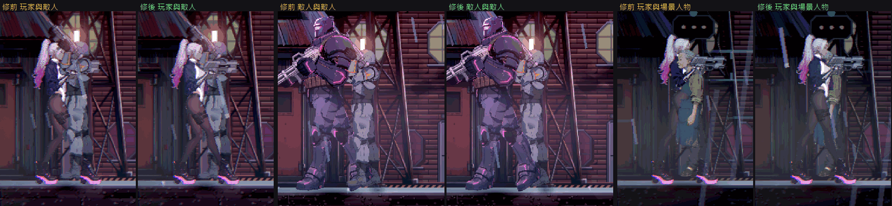
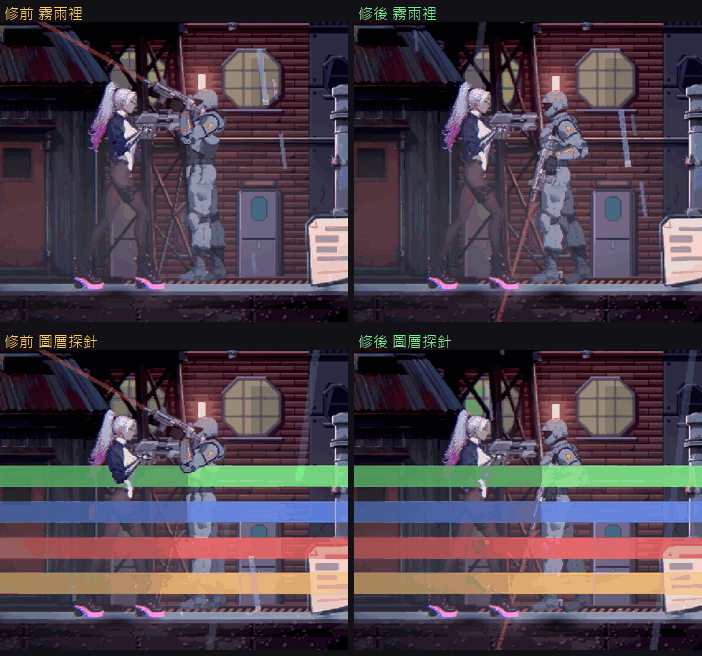
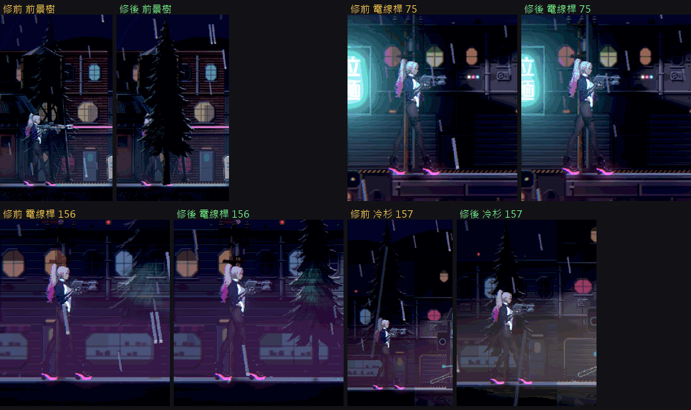

# [NE-402] 修正角色之間與特效前景的圖層穿插

> 狀態：完成

## 內文

### 需求
關卡裡兩個角色重疊時，零件會互相交錯：一個角色的手臂蓋住另一個的身體，腿卻在對方的腿後面。子彈、特效、霧與雨也夾在角色的零件中間，前景擺設則是半透明又被角色的手臂與武器蓋住。這張票讓每個角色是一個完整的層，並把特效、天氣與前景擺設排到正確的前後。

### 來源
2026-11-27，使用者提供另一款像素風遊戲同一個場景的兩張參考畫面（主光沒被遮住、被遮住比較多），說這種效果很好、前景與後景做得很好，並指出本專案的前景與後景有問題、沒有類似的效果，敵人與 NPC 的圖層甚至有問題。設計與現況調查見[景深、圖層與主光](../../design/22-living-scenes/DEPTH_AND_KEY_LIGHT.md)。

### 驗收條件
- [x] 任兩個角色（玩家、敵人、NPC）重疊時，整個角色在另一個的前面或後面，沒有零件對零件交錯；附修前修後的重疊近拍（玩家與敵人、玩家與 NPC、敵人與敵人）
- [x] 玩家永遠畫在其他角色前面；其他角色之間的前後固定，重疊時不跳動、不閃爍
- [x] 同時在場的角色多到圖層不夠分時不崩潰、不出錯，並記錄是哪個區域
- [x] 子彈、命中特效、霧與雨畫在所有角色之上；接觸陰影與拾取物在所有角色之下；附角色站在霧與雨裡的近拍
- [x] 前景擺設畫在所有角色之上並且不透明；附角色站在前景擺設後面的近拍。既有的四件前景擺設逐一看過位置，會擋住戰鬥判讀的移開或改回背景
- [x] 過場舞台的演員圖層、角色自己的零件順序（手、武器、外套、頭髮）、提示框與對話氣泡的位置都和修前相同
- [x] 角色很多的戰鬥場面影格時間不比修前差（數字記在票上）
- [x] 既有的圖層順序檢查全過，並新增「角色之間不交錯」的自動檢查；受影響範圍的測試全過

### 測試流程
1. 進第一章街道，走到敵人身上重疊站著
2. 預期主角完整地在敵人前面，沒有手腳交錯
3. 走到場景人物身上、走進霧與雨裡
4. 預期霧與雨蓋在整個角色上，不會被手臂或武器切開
5. 走到前景擺設後面，預期整個角色被它擋住，擺設不是半透明

---

# 跟其他票的關係

- Blocks：BG-68
- Blocked by：無
- Related：NE-222、BG-67、BG-68

---

# Commit-1

## 內文

關卡裡所有角色共用同一組圖層，零件依自己的前後次序排：兩個角色重疊時，一個角色的手臂蓋住另一個的身體、腿卻在對方的腿後面；主角走到場景人物身上，人物的身體反而蓋住主角的腿。子彈、命中特效、霧與雨的圖層也落在角色零件中間，霧會蓋住腿卻被手臂和槍切開。標成前景的擺設是半透明，又被角色的手臂與槍蓋住，看起來像鬼影。

現在關卡裡每個角色佔一整組圖層，重疊時一定是整個角色在另一個前面：主角永遠在最前面，敵人與場景人物依出現的先後排（後出現的在前），活著的期間不換組，別人離開也不會跳動；同時在場的角色多到分不完時共用最後一組，不會出錯，並記下是哪個區域、哪個角色。子彈、命中特效、蒸汽幕、霧、雨、前景擺設、前景層、互動提示、對話氣泡依序排在所有角色之上；接觸陰影、牆上的影子、拾取物、看板、衝刺殘影維持在所有角色之下；水坑的水面蓋過整個角色。所有場景燈的照射範圍跟著涵蓋新的圖層，角色的受光不變。

前景擺設改成不透明、畫在所有角色之上。原本的四種前景擺設在第一章街道逐一放主角到正下方看過：兩處電線桿、開場的松樹、中段的冷杉是全身高的不透明物，會把主角整個擋住，改成背景（樹換成同一張圖的背景版本）；垂掛電線在頭頂上方 84 像素，不擋戰鬥，留在前景。

同一格鏡頭修前修後的近拍（第一章街道，原生 Forward+，固定瞄準方向）：玩家與敵人、敵人與敵人、玩家與場景人物重疊時不再交錯；在霧、雨、子彈、特效四個圖層各放一條半透明的圖層探針橫條穿過角色，修前手臂與槍浮在橫條上，修後四條都完整蓋住兩個角色。提示框、對話氣泡的位置與角色自己的零件次序（手、槍、外套、頭髮）和修前相同；過場舞台的演員圖層沒有變動，原有的演員不交錯檢查照常通過。

角色最多的關卡（第一章示範街區二，35 個敵人與人物）邊跑邊打 10 秒，修前修後交替各量三輪，每影格耗時沒有變差。

自動檢查新增：關卡裡任兩個角色畫出來的圖層範圍不重疊、玩家在所有角色之前、除了角色沒有任何東西落在角色的圖層範圍裡、角色離開後其他人不換組、超過組數不出錯、提示與前景擺設在角色之上且不透明、接觸陰影在角色之下、場景燈照得到每一層。把角色改回共用圖層時這些檢查確實會失敗。

### 測試結果

| 項目 | 結果 |
|---|---|
| 受影響範圍的測試（77 個套件，6 個程序平行） | 95717 項檢查，1 項失敗：攻擊令牌「同時預兆的敵人不超過 2 個」（峰值 3，令牌本身從未超過 2）。這是既有的計時不穩：修前的程式單獨跑 4 次失敗 1 次，修後單獨跑 2 次失敗 1 次；與圖層無關 |
| 腳本錯誤 | 平行執行時骨架網格套件載入「蘇」的零件圖失敗（新工作目錄的匯入路徑與存庫裡的匯入設定不同，與本票無關）；重新匯入後單獨重跑通過，0 錯誤 |
| 圖層順序檢查 | 全過；角色改回共用圖層時新檢查會失敗 |
| 影格時間（示範街區二，邊跑邊打，三輪中位數） | 中位數 10.34 → 10.19 毫秒；第 95 百分位 12.86 → 12.52；第 99 百分位 14.33 → 14.34；最長一格 16.3 → 18.2（其中一輪機器較忙）；繪製次數 529 → 496 |
| 原生截圖（修前、修後） | 無錯誤 |

### 截圖

角色重疊（左修前、右修後）：玩家與敵人、敵人與敵人、玩家與場景人物。

角色站在霧與雨裡（上排自然畫面；下排在霧、雨、子彈、特效四個圖層各放一條探針橫條，由上到下是綠、藍、紅、黃）。

左上：在開闊處臨時放一棵前景樹蓋住主角（只為示範，正式地圖不這樣擺）：修前樹是半透明、主角的手臂與槍浮在樹上，修後整個角色在不透明的樹後面。其餘三組：原本在走道上的電線桿與前景冷杉改成背景後，主角不再被整個擋住。

