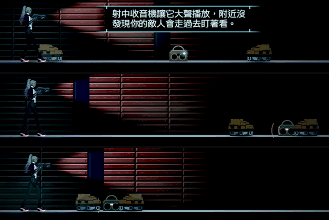

# [NE-402] 加入把敵人引開的誘餌收音機

> 狀態：完成

## 內文

### 需求
前五個環境機關都是正面打的時候用。這張票加入第一個潛行用的：地上一台手提收音機，射中就大聲播放幾秒，附近還沒發現玩家的敵人會走過去盯著它看；盯著看的時候看不到背後，玩家可以繞過去或從背後靠近。

### 來源
2026-11-28，使用者要求繼續做原本排好的下一個機關，之後照玩法多樣性清單往下做；一般設計選擇由實作者參考業界後決定。原本排的是滑索，改做這個的理由寫在[畫面活化與融入](../../design/22-living-scenes/DESIGN.md)「玩法多樣性：讓場景變成武器」的表格：現有地圖每段地面都連續、沒有斷口或高低差，滑索沒有非走不可的地方，而且要另做主角吊掛的骨架姿勢；誘餌是潛行遊戲常見的聲響誘敵，和既有的「射暗燈」能組合。

### 驗收條件
- [x] 收音機放在地上，暗場裡也看得到（待機燈）；靠近時有一句提示（中、日、英）
- [x] 玩家的子彈、近戰或爆炸打中就播放；敵人打不開；播完就壞、只能用一次
- [x] 播放中範圍內還沒進入戰鬥的敵人走到收音機前停下來盯著看，播完再多盯一下才回去巡邏；已經在打的敵人不理會
- [x] 盯著看的敵人看不到背後，面前也只看得到一半遠；被打到或近距離看到玩家就醒來
- [x] 播放時有雜訊聲與少量往外擴的聲波；「減少介面動態」時機身不震
- [x] 第三章泵室兩台抽水巡檢器之間放了第一台；原本的路線、敵人與機關不變
- [x] 範圍、時間與提示寫在資料裡，新增一台只要在關卡地圖放一個字元；資料不合理時指出是哪一項
- [x] 附原生連續畫面（射中前、兩台被引過去、主角在背後）；受影響範圍的測試全過

### 測試流程
1. 進第三章泵室，往右走到兩台抽水巡檢器之前
2. 預期看到地上有一台亮著小燈的收音機與一句提示
3. 在巡檢器發現你之前朝收音機開一槍，預期它開始播放，兩台巡檢器走過去盯著看
4. 走到左邊那台背後，預期它不會轉身；朝它開一槍，預期它醒來照常戰鬥

---

# 跟其他票的關係

- Blocks：無
- Blocked by：無
- Related：NE-397、NE-398、NE-399、NE-400、NE-401

---

# Commit-1

## 內文

前五個環境機關都是正面打的時候用，沒有幫助潛行的。原本排的下一個是滑索，但現有地圖沒有斷口或高低差可以讓它派上用場，還得新做吊掛姿勢，所以改做誘餌收音機，滑索記在設計表格裡暫緩。
現在地上可以放一台手提收音機：玩家打中就播放 6 秒，期間每 0.4 秒叫一次左右 240、上下 64 像素內還沒進入戰鬥的敵人，走到收音機前停下來盯著看，播完再多盯 2.5 秒。盯著看的敵人背後看不到、面前只看得到一半遠；被打到或近距離看到玩家就醒來。播完就壞，只能用一次。命中時的頓格會讓那一瞬間時間停住，所以開始播放的當下就先叫一次，不等下一影格。
收音機的待機燈、刻度窗與聲波畫在自發光的一層，暗場也找得到；提示（中、日、英）在 240 像素內出現。敵人這邊只加了「被吸引」一個狀態（`lure_to`），沿用既有的警報聚集移動；抽水巡檢器的巡邏範圍限制在被吸引時暫停。
第三章泵室兩台抽水巡檢器之間放了第一台（地圖字元 `ψ`）。

### 測試結果

| 項目 | 結果 |
|---|---|
| 受影響範圍的測試 | 通過 104086 / 104087（77 個套件）；唯一一項是 NE-400 的「跳到水面上方不觸電」在平行負載下的時序問題（移開後觸電範圍的重疊晚一格才更新），單獨重跑兩次都過，並把該檢查改成移開後先等重疊更新再量；改後 PropsSuite 201 / 201 |
| 腳本錯誤 | 0 |
| 原生情境（第三章泵室） | 兩台巡檢器都被吸引、走到收音機前盯著看；主角站到左邊那台背後，兩台都沒有進入戰鬥 |
| 自動檢查 | 敵人打不開；被吸引的敵人走向收音機並面向它；背後看不到、面前一半遠；被打就醒；播完就壞 |

### 截圖

由上到下：射中前（待機燈與提示；為了同框拍到收音機，這一張巡檢器先停住）、播放中兩台被引過去、主角在左邊那台背後。第三章泵室，原生 Forward+。

