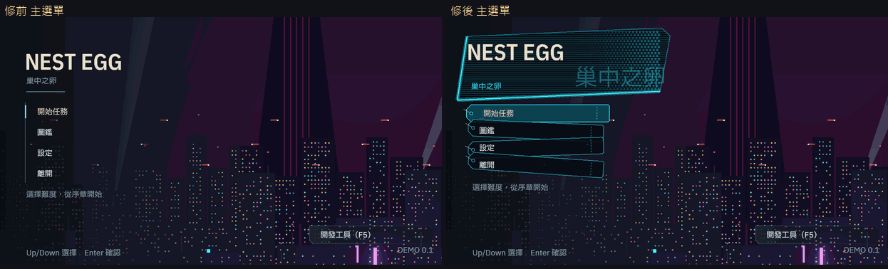
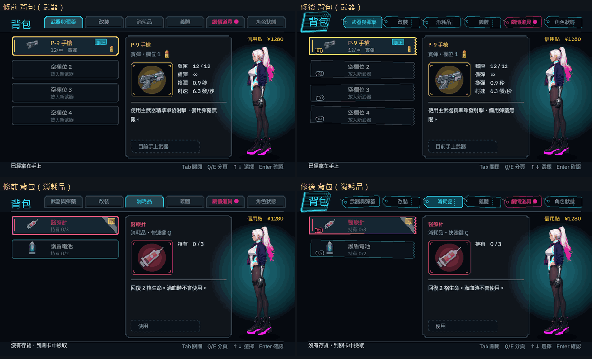
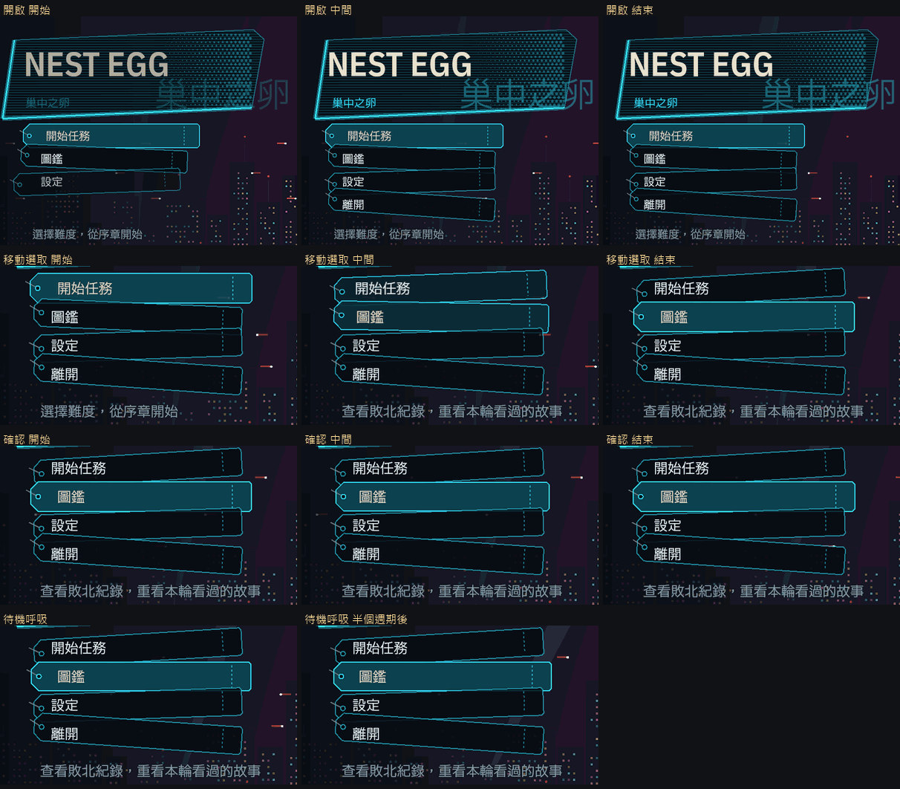
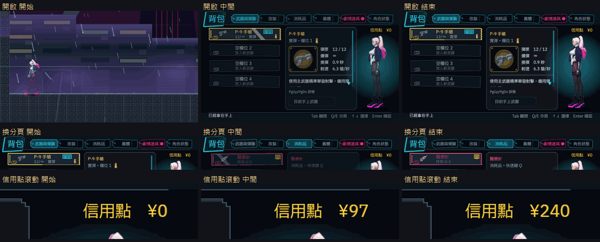
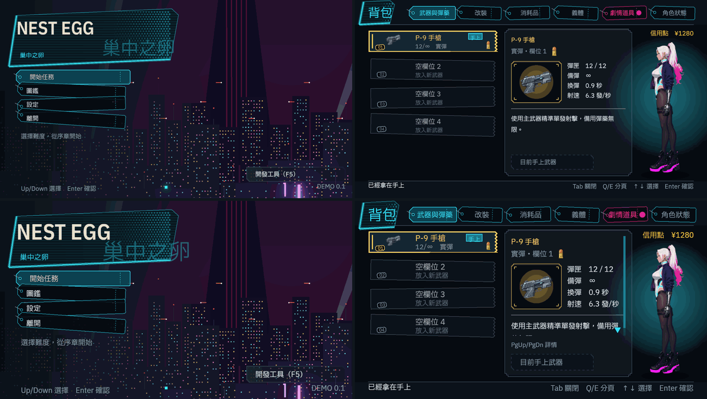

# [NE-403] 讓主選單與背包的版面更有趣並加上動畫

> 狀態：完成

## 內文

### 需求
所有畫面都是水平垂直對齊的清單與方框，選單開關與換頁大多直接出現，介面功能正確但無聊。這張票以主選單與背包當樣板：標題放大、主要項目微微傾斜並互相重疊、卡片像貼了當票與吊牌的實物，並補上開啟、移動選取、確認與待機的動畫。

### 來源
2026-11-27，使用者提供另一款遊戲的調酒選單當參考，說有些介面可以做得類似這樣、有趣一點，要符合現在的遊戲風格，介面可以有更多動畫。設計見[介面：更有趣的版面與更多動畫](../../design/22-living-scenes/UI_COLLAGE.md)。

### 驗收條件
- [x] 主選單：遊戲名與選項不再是左上角的四行小字；標題放大並壓在斜切的底板上，選項是傾斜、互相重疊一點的標籤，選到的那一項轉正並往前。附修前修後截圖
- [x] 背包：畫面標題放大；武器與道具卡片像貼了標籤的實物，分類用吊牌；選到的卡片轉正並往前。附修前修後截圖
- [x] 形狀與質感來自這個世界（當票、貨運吊牌、封條、霓虹招牌、掃描線、半色調），顏色沿用既有的青色強調與深藍灰底，不是把參考畫面的美術搬過來
- [x] 動畫：畫面開啟時標題切入、項目依序彈入；移動選取時項目轉正與退回；確認時壓下再彈回；待機時選到的項目緩慢呼吸；數字變化會滾動。各附開始、中間、結束三格
- [x] 所有動畫 300 毫秒內完成、不擋輸入，連續快速操作以最後一次為準、不殘留傾斜或半透明；「減少動態」開啟時直接到位
- [x] 內文一律水平、最小字級與對比不變；傾斜只用在標題與主要項目的外框
- [x] 鍵鼠與手把的焦點順序與修前相同；滑鼠的點擊範圍跟著畫面上看到的形狀
- [x] 720p、1080p、21:9 與文字放大都不截字、不重疊（既有的版面檢查通過）
- [x] 靜止不動時沒有每影格重畫的成本（待機呼吸除外，且離開畫面即停）；受影響範圍的測試全過

### 測試流程
1. 開主選單，上下移動再確認
2. 預期標題很大、選項是傾斜的標籤，選到的轉正往前，確認時有壓下的回饋
3. 開背包，切換分頁與卡片
4. 預期卡片像貼了標籤的實物，換頁與選取都有動畫
5. 開啟「減少動態」重複一次，預期直接到位

---

# 跟其他票的關係

- Blocks：無
- Blocked by：無
- Related：NE-228、NE-389、NE-392

---

# Commit-1

## 內文

主選單是左上角四行小字加一條細線，背包標題小、分頁是一排方框、卡片是水平垂直對齊的方框；開關與換頁大多直接出現。

主選單：遊戲名放大到原本的一倍半，壓在一塊微微傾斜、斜切的霓虹招牌底板上（底邊與左邊有青色燈管、右半部印著半色調網點、整塊有很淡的掃描線），後面疊一層錯位的大副標「巢中之卵」。選項是一張張微微傾斜（2～4 度、方向交錯）、互相壓住一點的貨運吊牌：左端切角、有打孔與穿出去的繩子、靠右一條像當票存根的撕線。選到的那一張轉正、放大一點、文字往前一步；確認時壓下再彈回；選到後待機時很慢地呼吸。開啟時招牌底板斜切進來、標題滑入、吊牌依序彈入並帶一點過衝。

背包：標題放大並壓在同樣的招牌底板上；分頁改成一排吊牌，目前所在的那一張轉正往前，有新東西的分頁吊牌是洋紅色；武器與道具卡片改成當票（右邊撕線的鋸齒），左下角斜貼一張編號貼紙，待機時微微傾斜、選到時轉正、浮起、掃過一道光，之後很慢地呼吸；信用點改變時數字滾動到新的值。開啟時標題底板切入、分頁吊牌依序彈入。

形狀都來自這個世界的實物（貨運吊牌、當票、霓虹招牌、掃描線、半色調），顏色沿用既有的青色強調、深藍灰底，洋紅只用在提醒。所有文字一律水平，只有外框與底板傾斜；字級、顏色與對比沒有改。每個動畫在 300 毫秒內完成（依序彈入的最後一張也是）、不擋輸入；連續快速移動以最後一次為準，不殘留傾斜或半透明；「減少動態」開啟時直接到位、不呼吸。開場動畫等畫面真的開始繪製後才播（第一個影格常因為載入背景很長，原本會被那一格一次吃掉）。焦點順序、按鍵與手把操作和修前相同；滑鼠只有指在畫面上看得到的吊牌或當票形狀裡才算（切掉的角與撕線的凹處不算）。靜止時沒有任何東西在重畫，只有選到的那一項在呼吸，畫面藏起來就停。

自動檢查新增：動畫時間都在 300 毫秒內、連按三次只有最後一張轉正且其他回到傾斜、待機時沒選到的項目沒有動畫、選到的在呼吸且畫面藏起來就停、點擊範圍跟著形狀、文字節點不轉動、「減少動態」直接到位；背包卡片的點擊範圍與靜止時不重畫。既有的檢查有兩項配合新設計調整：主選單原本檢查左側細線指到焦點，改成檢查焦點那一張吊牌直接轉正；背包扣款後的信用點等數字滾完再檢查。

### 測試結果

| 項目 | 結果 |
|---|---|
| 受影響範圍的測試（6 個程序平行） | 17005 項檢查，0 失敗，腳本錯誤 0 |
| 版面（720p、1080p、21:9、文字放大 120%） | 主選單與背包都不截字、不重疊；既有的版面與文字放大檢查通過 |
| 原生截圖 | 無錯誤 |

### 截圖

主選單修前修後。

背包修前修後（武器、消耗品）。

主選單的動畫：開啟、移動選取、確認、待機呼吸（各三格或兩格）。

背包的動畫：開啟、換分頁、信用點滾動。開啟的「中間」那一格存檔較慢，拍到時已接近停好。

21:9（上）與文字放大 120%（下）。

