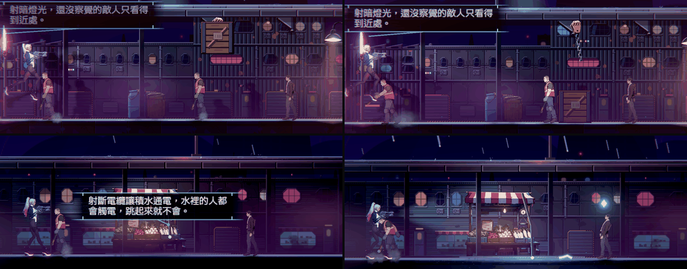

# [NE-405] 把環境機關擺進第二章並做出組合

> 狀態：完成

## 內文

### 需求
每種環境機關目前只出現一次。照「引入 → 練習 → 組合」的順序，第二章要讓已經學過的機關再出現：第一章學過的吊掛貨箱在第二章和可以射暗的燈組合；第二章自己的斷電纜在市集入口後段再練習一次。

### 來源
2026-11-28，使用者指示：「接下來就一直做，如果票都做完了就看還有什麼可以做，持續精進遊戲內容跟畫面。」後續清單見[畫面與玩法的後續待辦](../../design/22-living-scenes/BACKLOG.md)玩法第 1 項（一章一張）；擺放原則見 skill `chapter-design` 的「每個新機制走四步」。

### 驗收條件
- [x] 第二章裝卸區第二段：走道底下吊著一個貨箱，正下方是巡邏的護衛；這一區的燈可以射暗，可以摸黑靠近再射斷吊鏈
- [x] 第二章市集入口第二段：護衛與丟鈔票的人之間有第二條斷電纜與積水，電纜吊在雨棚底下
- [x] 貨箱可以吊在單向走道底下（以前只能吊在實心天花板下）；第一章倉庫原本的貨箱位置與高度不變
- [x] 原本的路線、敵人與拾取物不變；地圖字元在整章意思一致
- [x] 有檢查每一處擺放位置的自動測試；附兩處的原生畫面（觸發前、觸發後）；受影響範圍的測試全過

### 測試流程
1. 進第二章裝卸區第二段，往右走到走道下
2. 預期看到走道底下吊著貨箱與提示，旁邊的燈可以射暗
3. 等護衛走到貨箱下面，射斷吊鏈，預期貨箱砸中護衛
4. 進第二章市集入口第二段，預期護衛與丟鈔票的人之間有一條垂下的電纜和積水；射斷後積水通電

---

# 跟其他票的關係

- Blocks：無
- Blocked by：無
- Related：NE-397、NE-399、NE-400

---

# Commit-1

## 內文

每種環境機關原本只出現一次，學過就不再用到。
第二章現在多兩處：裝卸區第二段的走道底下吊著一個貨箱（地圖字元 `!`，和第一章倉庫同一份資料），兩名護衛在下面巡邏，這一區的燈本來就可以射暗——射暗燈光摸黑靠近、等護衛走到下面再射斷吊鏈，是吊掛貨箱和射暗燈的第一次組合。市集入口第二段在護衛與丟鈔票的人之間放了第二條斷電纜（`φ`），吊在雨棚底下，練習「先離開水面再開槍」。
為了讓貨箱能吊在走道底下，找吊點時也把單向平台的底面算進去；第一章倉庫那個貨箱上方沒有平台，位置與高度不變。
新增一個可重用的原生情境 `mechanic_placements`（`--chapter=ch2`），之後第三、四章的擺放加一行就能拍；也新增一項自動檢查，逐一確認每一處擺放的區域、資源與格子。

### 測試結果

| 項目 | 結果 |
|---|---|
| 受影響範圍的測試 | 通過 94554 / 94554（69 個套件） |
| 腳本錯誤 | 0 |
| 原生情境（第二章兩處） | 裝卸區：站在貨箱下的護衛血量 6 → 2；市集入口：積水邊的丟鈔票的人 5 → 3 |
| 自動檢查 | 三處擺放（含原本市集入口第一段的電纜）的區域、資源與格子都對 |

### 截圖

上排：裝卸區第二段，觸發前（走道下吊著貨箱，左上是這一區射暗燈的提示）、射斷吊鏈後（貨箱落地，護衛被砸中退開）。下排：市集入口第二段，觸發前（雨棚下的電纜與提示）、射斷後（電纜落水、水面通電）。原生 Forward+；為了同框拍到，觸發前敵人先停住，一名護衛被放到貨箱下。

