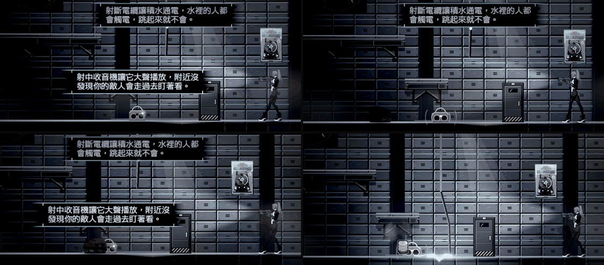

# [NE-406] 把環境機關擺進第三章並做出組合

> 狀態：完成

## 內文

### 需求
第三章泵室第一次出現誘餌收音機之後，下一個區域要讓它再出現一次，並和學過的斷電纜組合：用收音機把敵人引進積水，再射斷電纜。

### 來源
2026-11-28，使用者指示：「接下來就一直做，如果票都做完了就看還有什麼可以做，持續精進遊戲內容跟畫面。」後續清單見[畫面與玩法的後續待辦](../../design/22-living-scenes/BACKLOG.md)玩法第 1 項（一章一張）；擺放原則見 skill `chapter-design` 的「每個新機制走四步」。

### 驗收條件
- [x] 第三章夾層第二段（泵室之後的區域）：入口那台抽水巡檢器的巡邏範圍外有一台收音機，收音機底下是一灘積水，天花板垂下一條斷電纜
- [x] 射中收音機，巡檢器會離開巡邏範圍走進積水裡盯著收音機；這時射斷電纜，巡檢器觸電
- [x] 巡檢器平常巡邏時不會走進這灘水（只能靠收音機把它引進去）
- [x] 原本的路線、敵人、門與拾取物不變；地圖字元和第二、三章其他區域意思一致
- [x] 擺放位置有自動檢查；附原生畫面（收音機觸發前後、電纜觸發前後）；受影響範圍的測試全過

### 測試流程
1. 進第三章夾層第二段（從泵室或右邊的門進來）
2. 預期看到入口附近巡邏的巡檢器、地上的收音機、上方垂下的電纜與提示
3. 射中收音機，預期巡檢器走到收音機前、站進積水
4. 射斷電纜，預期水面閃一下後通電，巡檢器觸電

---

# 跟其他票的關係

- Blocks：無
- Blocked by：無
- Related：NE-400、NE-404、NE-405

---

# Commit-1

## 內文

誘餌收音機只在泵室出現過一次，第三章沒有任何地方把兩種機關一起用。
夾層第二段現在有一台收音機（地圖字元 `ψ`，和泵室同一份資料）與一條從天花板垂下的斷電纜（`φ`，和第二章同一份資料），收音機就放在積水裡。入口那台抽水巡檢器平常只在出生點左右 80 像素內巡邏，碰不到這灘水；射中收音機後它會走過去盯著看，正好站進水裡，這時射斷電纜就能一次解決——第一次把「引誘」和「環境殺」接在一起。
自動檢查加上第三章的三處擺放（泵室的收音機、夾層的收音機與電纜）。原生情境 `mechanic_placements` 加上 `--chapter=ch3`，並可以讓主角站在機關右邊拍（夾層左邊有一台天花板上的絕緣巡檢器，主角站左邊會先被它發現）。

### 測試結果

| 項目 | 結果 |
|---|---|
| 受影響範圍的測試 | 通過 63409 / 63409（58 個套件） |
| 腳本錯誤 | 0 |
| 原生情境（第三章夾層第二段） | 收音機：兩台巡檢器都被吸引；電纜：站在收音機旁積水裡的抽水巡檢器血量 7 → 擊倒 |
| 自動檢查 | 第二、三章共六處擺放的區域、資源與格子都對 |

### 截圖

上排：收音機觸發前（收音機、上方的電纜與兩句提示）、觸發後（巡檢器往收音機走）。下排：電纜觸發前（巡檢器站在收音機旁的積水裡）、觸發後（電纜落水，巡檢器觸電）。第三章夾層，原生 Forward+；電纜那一組為了同框，巡檢器事先被放到收音機旁。

