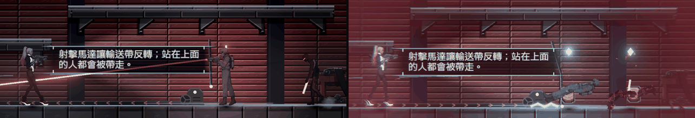

# [NE-407] 把環境機關擺進第四章並做出組合

> 狀態：完成

## 內文

### 需求
第四章工廠中繼區第一次出現輸送帶，但它只會改變移動，沒有和其他機關接在一起。這張票在輸送帶的馬達那一端放一灘斷電纜的積水：反轉輸送帶，把站在上面的敵人送進水裡，再射斷電纜。

### 來源
2026-11-28，使用者指示：「接下來就一直做，如果票都做完了就看還有什麼可以做，持續精進遊戲內容跟畫面。」後續清單見[畫面與玩法的後續待辦](../../design/22-living-scenes/BACKLOG.md)玩法第 1 項（一章一張）；擺放原則見 skill `chapter-design` 的「每個新機制走四步」。

### 驗收條件
- [x] 第四章中繼區第一段：輸送帶馬達那一端的走道下垂著一條斷電纜，下面一灘積水
- [x] 輸送帶反轉後，站在上面的人被送到馬達那一端，正好落在積水裡（自動檢查算出帶子末端在積水範圍內）
- [x] 射斷電纜後，積水裡的清掃兵與衝進水裡的切割者都會觸電
- [x] 原本的路線、敵人與傳送點不變；地圖字元和其他章意思一致
- [x] 擺放位置有自動檢查；附原生畫面（觸發前、觸發後）；受影響範圍的測試全過

### 測試流程
1. 進第四章工廠中繼區，往右走上輸送帶
2. 預期看到輸送帶右端馬達旁的走道下垂著一條電纜，下面一灘水
3. 射中馬達讓輸送帶反轉，預期站在帶子上的敵人被往右送進積水
4. 射斷電纜，預期水裡的敵人觸電

---

# 跟其他票的關係

- Blocks：無
- Blocked by：無
- Related：NE-400、NE-401、NE-405、NE-406

---

# Commit-1

## 內文

輸送帶只出現在第四章中繼區，而且只會改變移動。
中繼區第一段現在在輸送帶馬達那一端多了一條斷電纜（地圖字元 `φ`，和第二、三章同一份資料），吊在上方走道底下。輸送帶反轉時，站在上面的人被送到右端停下來，那一點正好在積水範圍內；清掃兵的巡邏點本來就在水邊，切割者衝向主角時也會踩進水裡。
自動檢查加上第四章的兩處擺放，並另外算出輸送帶右端落在積水範圍內（右端 496 px、積水 520 ± 72 px）。原生情境 `mechanic_placements` 加上 `--chapter=ch4`。

### 測試結果

| 項目 | 結果 |
|---|---|
| 受影響範圍的測試 | 通過 63319 / 63319（58 個套件） |
| 腳本錯誤 | 0 |
| 原生情境（第四章中繼區第一段） | 射斷電纜 1.2 秒後：清掃兵血量 3 → 0、切割者 5 → 0 |
| 自動檢查 | 第二到四章共八處擺放的區域、資源與格子都對；反轉後的帶子末端在積水內 |

### 截圖

左：觸發前（輸送帶、右端馬達、走道下的電纜；清掃兵已經發現主角並開始瞄準）。右：射斷電纜後（水面通電，兩名敵人觸電倒下；畫面泛紅是主角先前被清掃兵打中）。第四章中繼區，原生 Forward+。

