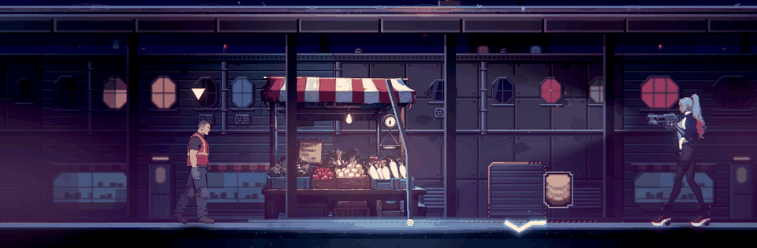

# [NE-408] 讓敵人不走進通電的積水

> 狀態：完成

## 內文

### 需求
斷電纜的積水通電時，敵人像沒看到一樣照樣走進去。敵人要知道避開：預警開始後，水外的敵人（巡邏、被警報或收音機引過去、追擊、後退都一樣）走到水邊就停下或回頭；已經站在水裡的照樣觸電，被打飛的照樣會飛進水裡。

### 來源
2026-11-28，使用者指示：「接下來就一直做，如果票都做完了就看還有什麼可以做，持續精進遊戲內容跟畫面。」後續清單見[畫面與玩法的後續待辦](../../design/22-living-scenes/BACKLOG.md)玩法第 2 項「敵人會利用或害怕環境」（這張只做積水；落地貨箱當掩護、被蒸汽擋住換位置另開）。

### 驗收條件
- [x] 電纜剪斷（預警開始）之後，水外的敵人自己走到水邊就停下或回頭，不會踩進去；通電結束後恢復正常
- [x] 巡邏、被警報或收音機引過去、追擊與後退都適用；被打飛、硬直中不受影響，玩家還是可以把敵人打進水裡
- [x] 剪斷時已經站在水裡的敵人照樣觸電（預警是給玩家看的，不是給敵人逃的）
- [x] 收音機先把敵人引進水裡、再剪電纜的組合照常有效
- [x] 沒有任何通電積水時，敵人不多花成本；危險範圍跟著電纜用完或離開區域撤掉
- [x] 自動測試在拿掉避讓後會失敗；附原生畫面；受影響範圍的測試全過

### 測試流程
1. 進第二章市集入口第二段，站在積水右邊
2. 射斷電纜，等押運手朝你衝過來
3. 預期它走到水邊就停下，不會踩進通電的水
4. 通電結束後，預期它照常追過來

---

# 跟其他票的關係

- Blocks：無
- Blocked by：無
- Related：NE-400、NE-404、NE-405、NE-406

---

# Commit-1

## 內文

通電的積水以前只對玩家有意義：敵人追擊、巡邏時會直接走進去觸電，看起來像沒看到。
現在電纜一剪斷（預警開始），就把積水範圍登記成「危險範圍」，用完或離開區域時撤掉。敵人每一影格在行為決定好水平移動之後，如果下一步會踩進危險範圍、而自己還在範圍外，就停在原地；巡邏時改成回頭。只攔行為自己的移動：被打飛、硬直時不攔，所以還是可以把敵人打進水裡；已經站在水裡的不逃，照樣觸電。收音機引敵人進水發生在剪斷之前，不受影響。
危險範圍是共用的小登記表（`HazardZones`），之後其他會傷到人的機關也能用；沒有任何登記時敵人這一步直接略過。

### 測試結果

| 項目 | 結果 |
|---|---|
| 受影響範圍的測試 | 通過 94804 / 94804（65 個套件） |
| 腳本錯誤 | 0 |
| 自動檢查 | 朝積水巡邏的敵人在水邊回頭、沒有觸電；用完後範圍撤掉（電纜被移除時也會撤掉，這一條沒有單獨的自動檢查）。暫時拿掉避讓時「回頭」與「沒有觸電」兩項都會失敗 |
| 原生情境（第二章市集入口第二段） | 被警報叫向主角的押運手停在離水邊 11 px，通電期間沒有踩進去，血量 6 → 6；剪斷時身體已經壓到水邊的票據投手觸電 5 → 0 |

### 截圖

通電中：左邊的押運手（頭上是警報標記）被叫向右邊的主角，停在發亮的水邊；右邊的票據投手剪斷時已經壓到水邊，觸電倒下後掉出信用點。第二章市集入口第二段，原生 Forward+；押運手事先被放到水的左邊並觸發警報。

