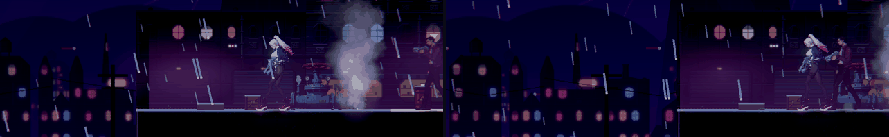

# [NE-409] 讓敵人被蒸汽擋住時穿過蒸汽推進

> 狀態：完成

## 內文

### 需求
蒸汽閥噴出的蒸汽牆擋得住雙方的子彈，但敵人看得穿：隔著蒸汽照樣瞄準、對著蒸汽一直開槍，像沒看到。敵人要知道蒸汽擋住了視線：隔著蒸汽看不到玩家、不開槍，改成往玩家那一頭推進（蒸汽擋子彈不擋人），穿出蒸汽之後照常打。

### 來源
2026-11-28，使用者指示：「接下來就一直做，如果票都做完了就看還有什麼可以做，持續精進遊戲內容跟畫面。」後續清單見[畫面與玩法的後續待辦](../../design/22-living-scenes/BACKLOG.md)玩法第 2 項「敵人會利用或害怕環境」（這張做蒸汽；積水是 NE-408，落地貨箱另開）。

### 驗收條件
- [x] 蒸汽牆升起時，牆另一邊的敵人看不到玩家，不會開始瞄準或開槍
- [x] 只因為蒸汽而看不到時，敵人知道玩家在那一頭，往那裡推進；穿出蒸汽、看得到玩家之後照常攻擊
- [x] 蒸汽散了就恢復正常；沒有蒸汽時敵人的視線判斷和以前一樣
- [x] 自動測試在拿掉這項之後會失敗；附原生畫面；受影響範圍的測試全過

### 測試流程
1. 進第一章街道，走到蒸汽閥旁邊、槍手的火線前
2. 射開閥門，預期蒸汽牆另一邊的槍手停止瞄準
3. 預期槍手穿過蒸汽朝你走過來，出了蒸汽才開槍
4. 蒸汽散去後，預期一切照常

---

# 跟其他票的關係

- Blocks：無
- Blocked by：無
- Related：NE-398、NE-408

---

# Commit-1

## 內文

蒸汽牆只擋子彈，敵人的視線判斷只看地形，所以敵人隔著蒸汽還是「看得到」玩家，一直瞄準、對著蒸汽開槍。
現在敵人判斷看不看得到玩家時，在地形不擋、距離也夠的情況下多打一條只看蒸汽的射線；中間有蒸汽就算看不到，並且觸發 1.5 秒的警報（還擋著就一直延長），讓它往玩家剛才的位置推進。蒸汽不擋角色，所以敵人會穿過蒸汽靠近，出來之後看得到就照常攻擊。玩家因此得到的是幾秒的喘息與「敵人會從蒸汽裡衝出來」的預期，而不是一面讓敵人永遠打不到的牆。
沒有蒸汽時，這條多的射線只有在原本就看得到的時候才打，成本很小。

### 測試結果

| 項目 | 結果 |
|---|---|
| 受影響範圍的測試 | 通過 94805 / 94805（65 個套件） |
| 腳本錯誤 | 0 |
| 自動檢查 | 沒有蒸汽時看得到；蒸汽升起後看不到、進入警報、1 秒內往玩家推進。暫時拿掉這項時這三項都會失敗 |
| 原生情境（第一章街道蒸汽閥） | 蒸汽升起後，牆外的槍手瞄準 0 影格，往主角推進 162 px，穿出蒸汽才靠近主角 |

### 截圖

左：蒸汽中（右邊的槍手頭上是警報標記，正走進蒸汽，沒有瞄準）。右：穿出蒸汽（槍手走到主角身邊）。第一章街道，原生 Forward+；只留這一名槍手，蒸汽升起後才叫醒它。

