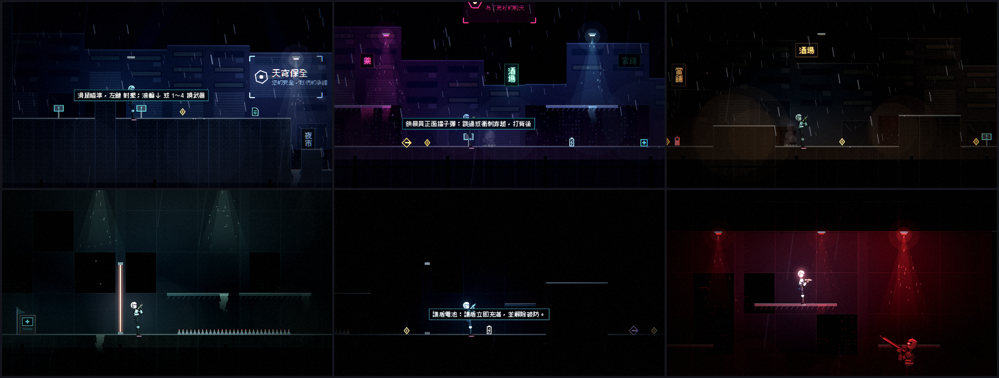
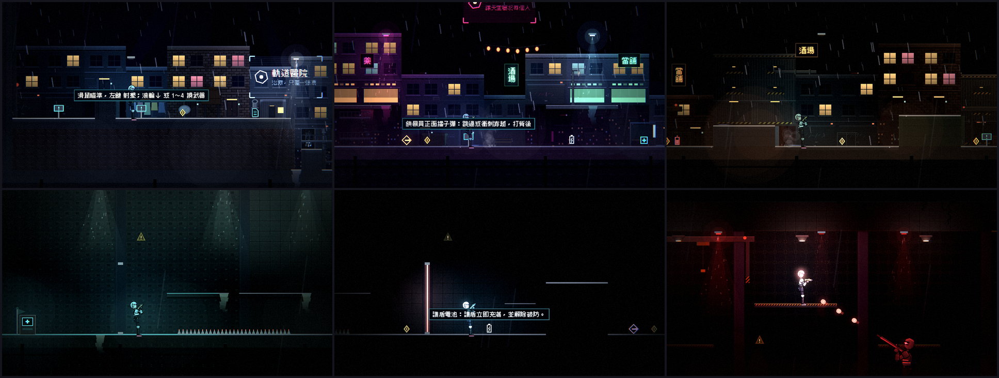
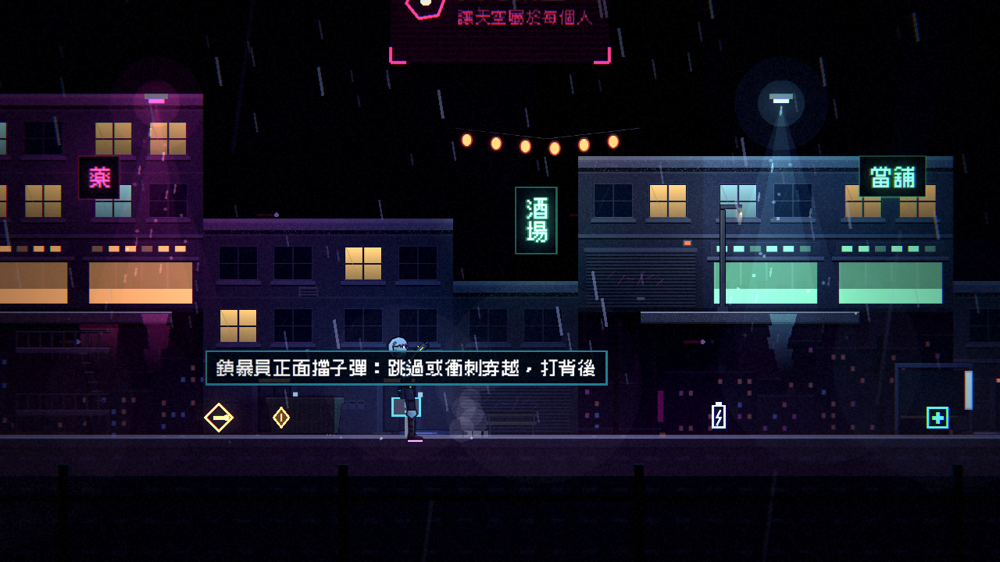

# [NE-40] 重做第一章場景

> 狀態：完成

## 內文

### 需求
第一章的地圖是色塊，看不出是屋頂、夜市、貨運站還是設施。需要用環境元件重做六個區段的美術與地圖，做成「像一個真的地方」。

### 來源
2026-10-03，使用者於開發對話中提出：「把第一關的地圖設計的更實際一點，最好是用高解析度的元件來替代掉現在的色塊設計」；「這些都可以去看看目前業界有哪一些最佳實例可以參考，我們盡可能設計的貼近完整實際的 Demo」。設計見 `design/10-presentation/DESIGN.md`、`design/04-story/`。

### 驗收條件
- [x] 屋頂巷弄、霓虹市集、貨運站、設施入口、停電走廊、頭目機庫六個區段，各有對應的材質、立面與道具
- [x] 加入更多垂直結構（逃生梯、疊起來的貨櫃、屋頂之間的高低差），地圖仍通過可通行檢查，每個檢查點站得穩
- [x] 可以站的地方看得出來可以站，單向平台有明顯的邊緣
- [x] 裝飾不遮住敵人、子彈與危險物
- [x] 麵攤、工人休息室等對話點有對應的場景物件
- [x] 暗場可讀性量測每個區段都通過
- [x] 原有的教學、敵人配置、檢查點、劇情觸發點與收集品功能不變

### 測試流程
1. 從頭到尾玩一遍第一章，確認每個區段的外觀與路線
2. 執行暗場可讀性量測
3. 截圖比較重做前後
4. 執行完整測試套件，全部通過

---

# 跟其他票的關係

- Blocks：無
- Blocked by：NE-39
- Related：NE-25

---

# Commit-1

## 內文

原本第一章的地圖是色塊，看不出是屋頂、夜市、貨運站還是設施。
現在第一章套用環境主題：屋頂巷弄（磚牆與混凝土的樓房、屋頂碎石、水塔、晾衣架、天線、逃生梯）、街道、霓虹市集（店面與公寓立面、燈籠、麵攤、販賣機、候車亭、路燈、電線桿）、貨運站（紅藍綠三色貨櫃、起重機、堆高機、柵欄、工人休息室）、設施入口與停電走廊（面板牆、管線、攝影機、控制台、機櫃、應急燈）、頭目機庫（龍門吊、機庫燈、燃料槽、警示標線）。屋頂以下是建築本體，貨櫃與天花板各用自己的材質；單向平台與逃生梯有明顯的邊緣，地形頂端的亮邊顏色依區段材質變化。前層道具與平台不遮住敵人、危險物，也不卡進地形（測試驗證）。原有的教學、敵人配置、檢查點、劇情觸發點與收集品位置完全沒有改動。
暗場可讀性量測改成連續取樣取平均（警報與霓虹會閃爍，單張截圖不穩定），第一章六個區段與第二章都通過。

### 測試結果

| 項目 | 結果 |
|---|---|
| 完整測試套件 | 通過 2373 / 2373 |
| 資料驗證 | 0 錯誤 |
| 執行 log | 無 ERROR |

### 截圖

