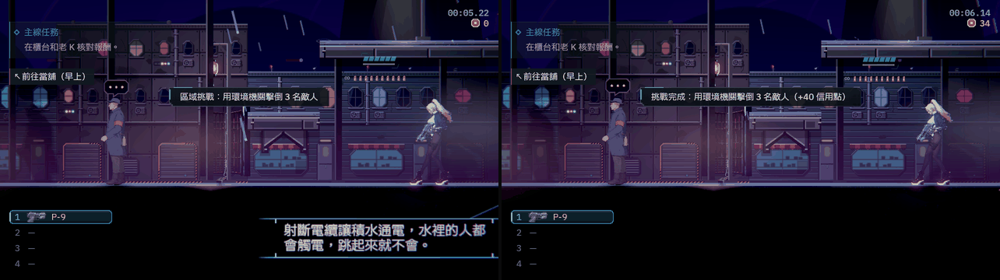

# [NE-410] 加入區域可選小挑戰（只用環境擊倒）

> 狀態：完成

## 內文

### 需求
同一段路走第二次時沒有新的玩法目標。加入區域可選小挑戰：進區域時提示一句要做什麼（例如「用環境機關擊倒 3 名敵人」），達成時給一次信用點並提示；不做也不影響主線。第一個放在有兩條斷電纜的第二章市集入口。

### 來源
2026-11-28，使用者指示：「接下來就一直做，如果票都做完了就看還有什麼可以做，持續精進遊戲內容跟畫面。」後續清單見[畫面與玩法的後續待辦](../../design/22-living-scenes/BACKLOG.md)玩法第 4 項「區域裡的可選小挑戰」（這張做「只用環境擊倒」；限時、不被發現另開）。

### 驗收條件
- [x] 進到有挑戰的區域，標題卡淡出後跳一句提示（中、日、英），講清楚要做什麼
- [x] 只有玩家觸發的環境機關（落下的貨箱、通電的積水）造成的擊倒算數；開槍、近戰的擊倒不算
- [x] 達成時給一次信用點並提示「挑戰完成」與獲得多少；之後不再提示、不會重複領
- [x] 進度跟著檢查點：死了回到檢查點，進度與信用點一起回到存檔那一刻
- [x] 挑戰寫在資料裡（目標數、獎勵、說明），新增一個不用改程式；資料不合理時指出是哪一項
- [x] 第二章市集入口放了第一個：用環境機關擊倒 3 名敵人，獎勵 40 信用點
- [x] 有自動測試；附原生畫面（挑戰提示、完成提示）；受影響範圍的測試全過

### 測試流程
1. 進第二章市集入口
2. 預期標題卡淡出後跳出「區域挑戰：用環境機關擊倒 3 名敵人」
3. 用兩條電纜電倒三名敵人，預期跳出「挑戰完成……（+40 信用點）」，信用點增加 40
4. 用槍擊倒敵人，預期不算進挑戰

---

# 跟其他票的關係

- Blocks：無
- Blocked by：無
- Related：NE-400、NE-405

---

# Commit-1

## 內文

環境機關用不用都可以過關，走過一次的區域沒有理由用不同的方式再打一次。
現在每個區域可以掛幾個可選小挑戰（`LevelData.challenges`，一份 `AreaChallengeData` 一個）。第一種是「用環境機關擊倒 N 名敵人」：傷害資料多了一個「來自環境機關」的標記，落下的貨箱與通電的積水會帶上它；帶著這個標記被擊倒的敵人會發出一個事件，挑戰收到就加一。進區域 4.2 秒後（等標題卡淡出）用既有的提示列講一次要做什麼；達成時用 `Progression.add_credits` 給獎勵並提示一次。進度存在檢查點的世界狀態裡，死了回到檢查點時和信用點一起回去，不會重複領。
第二章市集入口掛上第一個：用環境機關擊倒 3 名敵人，獎勵 40 信用點（約四堆小信用點）；這一區有兩條斷電纜，兩名押運手與票據投手都在積水附近。

### 測試結果

| 項目 | 結果 |
|---|---|
| 受影響範圍的測試 | 通過 105004 / 105004（78 個套件）。第一輪抓到一個回歸：新加的兩行插在敵人掉落信用點的呼叫前面，讓一般擊倒不再掉錢；已改回原位後重跑全過 |
| 腳本錯誤 | 0 |
| 自動檢查 | 槍殺不算；電倒一名就完成（目標 1）並給 25 信用點；完成後不再給；檢查點還原會回到未完成；狀態鍵固定 |
| 原生情境（第二章市集入口） | 進區域後提示出現；兩條電纜電倒三名敵人，挑戰 3 / 3 完成，信用點 0 → 40 |

### 截圖

左：進區域後的挑戰提示。右：完成提示（右上角信用點正在往 40 跳）。第二章市集入口，原生 Forward+，保留 HUD；完成那張為了同時電到三人，敵人先被停在原地、票據投手被放進第二灘水。

