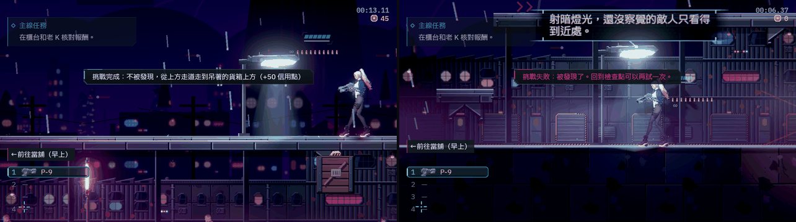

# [NE-411] 加入「不被發現」的區域挑戰

> 狀態：完成

## 內文

### 需求
區域挑戰目前只有「用環境擊倒」一種。加入第二種「不被發現」：走到指定位置之前，附近的敵人沒有一個發現你就完成；被發現就失敗，回到檢查點可以再試。第一個放在第二章裝卸區：上方有一條走道可以從敵人頭上通過，下面的燈可以射暗。

### 來源
2026-11-28，使用者指示：「接下來就一直做，如果票都做完了就看還有什麼可以做，持續精進遊戲內容跟畫面。」後續清單見[畫面與玩法的後續待辦](../../design/22-living-scenes/BACKLOG.md)玩法第 4 項「區域裡的可選小挑戰」（這張做「不被發現」；「只用環境擊倒」是 NE-410，限時另開）。

### 驗收條件
- [x] 進到裝卸區，標題卡淡出後跳一句提示（中、日、英），講清楚要不被發現走到哪裡
- [x] 走到終點之前，終點附近的敵人都沒有進入戰鬥（沒有被打、沒有被警報叫來、沒有看到玩家）就完成，給一次信用點並提示
- [x] 被發現就提示「挑戰失敗」，之後不會再完成也不給獎勵；回到更早的檢查點可以重來
- [x] 從上方走道走過去實際可以完成；走地面會被發現而失敗
- [x] 終點與獎勵寫在資料裡；「不被發現」卻沒寫終點時指出是哪一項
- [x] 有自動測試；附原生畫面（完成、失敗）；受影響範圍的測試全過

### 測試流程
1. 進第二章裝卸區，等標題卡淡出，預期跳出挑戰提示
2. 從左邊的平台跳上上方走道，一直往右走到吊著的貨箱上方
3. 預期跳出「挑戰完成……（+50 信用點）」
4. 重新進區域，改走地面，預期被敵人發現時跳出「挑戰失敗」

---

# 跟其他票的關係

- Blocks：無
- Blocked by：無
- Related：NE-399、NE-405、NE-410

---

# Commit-1

## 內文

區域挑戰原本只有一種；第二章裝卸區明明有一條能從敵人頭上通過的走道、還有可以射暗的燈，卻沒有理由去潛行。
現在區域挑戰多了「不被發現」：資料寫一個終點格，挑戰每 0.2 秒看一次終點右邊 160 像素以內的敵人，只要有一個進入戰鬥（被打、被警報叫來、看到玩家）就失敗並提示；玩家先走到終點就完成並給獎勵。失敗也存進檢查點狀態，回到更早的檢查點會重置。
裝卸區掛上第一個：不被發現，從上方走道走到吊著的貨箱上方（終點格 73，獎勵 50 信用點）。原生情境實際按住「往右」走兩趟：走道那趟完成、地面那趟被發現而失敗。

### 測試結果

| 項目 | 結果 |
|---|---|
| 受影響範圍的測試 | 通過 94537 / 94537（69 個套件） |
| 腳本錯誤 | 0 |
| 自動檢查 | 從敵人頭上越過終點就完成並給 30 信用點；敵人被警報叫來就失敗、不給錢；回到更早的檢查點會重置；沒寫終點會被指出 |
| 原生情境（第二章裝卸區） | 走道：完成，信用點 0 → 50；地面：被發現而失敗，信用點 0 |

### 截圖

左：走上方走道到吊著的貨箱上方，挑戰完成（右上角信用點正在往 50 跳）。右：走地面被押運手發現，挑戰失敗。第二章裝卸區，原生 Forward+，保留 HUD；主角是實際按著「往右」走過去的。

