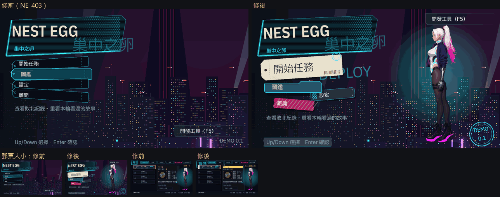
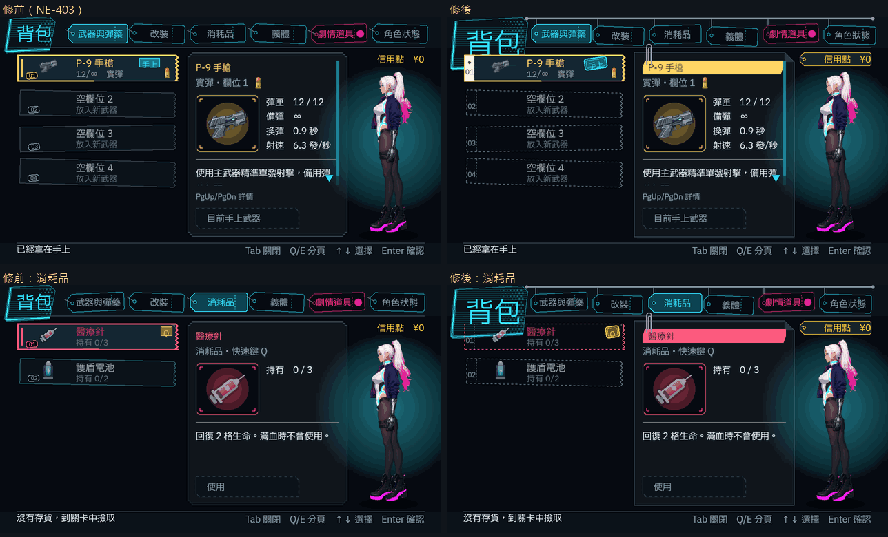
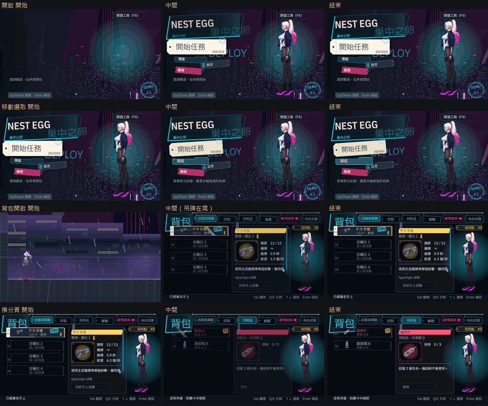
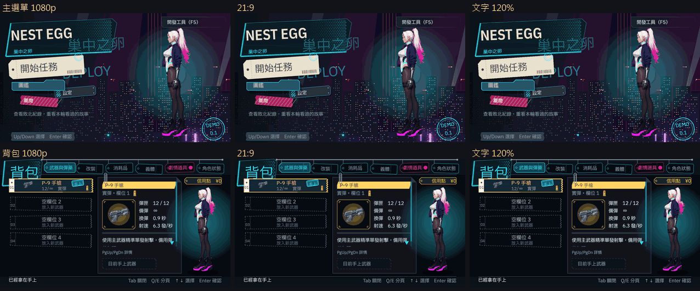

# [NE-412] 把主選單與背包的拼貼做得更大膽

> 狀態：完成

## 內文

### 需求
NE-403 把主選單與背包的框架做對了（標籤按鈕、標題底板、動畫時間、減少動態、點擊範圍），但畫面太保守：主選單的四個選項是四條幾乎一樣的深色細長條，讀起來是「排歪的清單」不是拼貼，沒有大小層級、沒有材質差別、全部擠在左上角；背包修前修後乍看一樣。這張票做第二輪：主要動作巨大、每樣東西形狀與材質不同、互相壓住、有實色的紙面。

### 來源
2026-11-28，主 session 驗收 NE-403 後轉述使用者「介面可以更有趣」的要求，並放寬「只有外框傾斜」的限制：主選單選項與畫面標題的字跟著標籤一起斜（6 度以內），內文與說明仍然水平。

### 驗收條件
- [x] 主選單：主要動作（開始任務；有存檔時是繼續遊戲）是實色的當票，面積至少是其他選項的 2.5 倍，後面疊一層錯位的大外文字；其他選項各是不同的東西、不同寬度（圖鑑＝檔案夾標籤、設定＝維修貼紙、離開＝洋紅的封條膠帶）
- [x] 主選單：選項左右錯開、正負交替傾斜（-6 到 +6 度）、互相壓住一角、有投影；選到的轉正、放大、浮到最上面
- [x] 主選單：選單群佔左邊約 45%，右邊是主角的骨架立繪（含呼吸與小動作）站在城市前面；版本號是圓形戳章，操作提示是一條膠帶
- [x] 材質：實色紙面、打孔與繩子、條碼、圓形戳章、警示斜紋膠帶、半色調；色盤只用深藍灰、米白、青，洋紅只給離開與危險
- [x] 背包：物品卡片是有米白票根（編號、打孔線）的當票，選到的轉正、浮起、有投影；空欄位是淡的虛線空白票
- [x] 背包：分頁是從一條橫桿垂下來、繩長不同的吊牌，開啟時輕輕晃一下再停；「手上」是斜蓋的橡皮章；信用點是價格吊牌；右邊的說明面板是夾著迴紋針的檔案紙、標題條實色；標題底板約是 NE-403 的兩倍
- [x] 主選單選項與畫面標題的字跟著標籤斜（6 度以內）；內文與說明水平；最小字級與對比不變
- [x] 焦點順序不變；點擊範圍跟著看到的形狀；動畫 300 毫秒內、不擋輸入、連按以最後一次為準；「減少動態」直接到位
- [x] 720p、1080p、21:9 與文字放大都不截字、不重疊（既有的版面檢查通過）；不用方框、不用新的外部素材；受影響範圍的測試全過
- [x] 主選單與背包各附修前（NE-403 的現況）修後、開啟動畫三格、選取移動三格、三種解析度；縮成郵票大小也認得出和修前不同

### 測試流程
1. 開主選單：預期「開始任務」是一張很大的米白當票，其他選項各是不同的實物，錯開斜放互相壓住，右邊站著主角
2. 上下移動：選到的轉正放大浮到最上面
3. 開背包：分頁吊牌從橫桿垂下晃一下停住；卡片是有票根的當票；空欄位是淡的虛線票

---

# 跟其他票的關係

- Blocks：無
- Blocked by：無
- Related：NE-403、NE-389、NE-392

---

---

# Commit-1

## 內文

NE-403 的主選單是四條一樣的深色細長條擠在左上角，背包修前修後乍看一樣。

主選單：主要動作（開始任務；有存檔時是繼續遊戲）是一張很大的米白當票，面積是其他選項的 3 倍以上，左邊票根有打孔線與打孔、右下角條碼與半色調、右上角一個圓戳章，後面從右下方伸出一層錯位的大外文字（DEPLOY／RESUME）。其他選項各是不同的東西、不同寬度：圖鑑是檔案夾標籤、設定是左端有警示斜紋的維修貼紙、離開是兩端撕開的洋紅封條膠帶（洋紅只用在這裡）。選項左右錯開、正負交替傾斜（3～5 度）、互相壓住一角、都有投影，字跟著選項一起斜；選到的轉正、放大、浮到最上面。選單群佔左邊不到一半，右邊是主角的骨架立繪（和背包同一個，會呼吸與做小動作）站在城市前面、朝左看著選單；版本號是右下角斜蓋的圓形戳章，操作提示貼在一條膠帶上，開發工具按鈕移到右上角。標題的字跟著招牌底板一起斜。

背包：標題約放大成原本的兩倍，字跟著底板斜。分頁吊牌從上方一條橫桿用繩子垂下來、繩長不同，開啟時輕輕晃一下再停。物品卡片左邊多了一段米白票根（印著編號、打孔線與打孔），選到時轉正、浮起並拉出投影；空欄位是淡的虛線空白票（選到時虛線換成項目顏色）。「手上」這類徽章改成斜蓋的橡皮章，信用點貼在一張價格吊牌上。右邊的說明面板是一張檔案紙：右上角折角、後面再露出一張紙、上緣夾著迴紋針，名稱壓在項目顏色的實色標題條上（字改成深色）。

內文、說明與數值仍然水平；最小字級不變，深色字壓在米白或項目顏色上、白字壓在洋紅上，對比都在 4.5 以上。焦點順序照清單（上下鍵與 Tab 依序移動，左右不會跳到別的選項），點擊範圍跟著看得到的形狀；所有動畫 300 毫秒內、不擋輸入、連按以最後一次為準，「減少動態」直接到位、不晃不呼吸。沒有新的外部素材，全部是程式繪製。

自動檢查新增：主要動作的面積至少是每個其他選項的 2.5 倍、每個選項是不同的東西且只有離開用封條、相鄰選項傾斜方向相反、選項的字跟著斜而且不超過 6 度、焦點往下與 Tab 照清單順序、選到的放大並浮到最上面、吊牌晃動在 300 毫秒內停。原本「文字節點不轉動」的檢查依新規則改寫。截圖腳本拍開場動畫時改成看實際進度並放慢時間（存圖會卡住主執行緒，原本「中間」那一格常拍到已經停好）。

### 測試結果

| 項目 | 結果 |
|---|---|
| 受影響範圍的測試（6 個程序平行，28 組） | 17139 項檢查，0 失敗，腳本錯誤 0 |
| 修改按鈕後重跑介面相關的 4 組 | 3685 項檢查，0 失敗 |
| 版面（720p、1080p、21:9、文字放大 120%） | 主選單與背包都不截字、不重疊；既有的版面與文字放大檢查通過 |
| 原生截圖 | 無錯誤 |

### 截圖

主選單修前修後，下排是縮成郵票大小的比較（主選單、背包）。

背包修前修後（武器、消耗品）。

動畫：主選單開啟、移動選取，背包開啟（分頁吊牌晃動）、換分頁，各三格。

1080p、21:9 與文字放大 120%。

