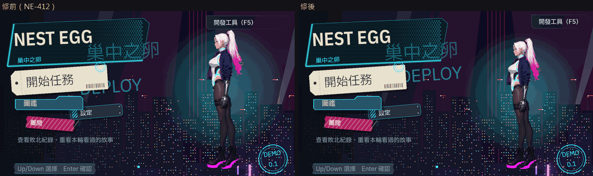

# [NE-413] 讓主選單外文字完整露出並移開開發按鈕

> 狀態：完成

## 內文

### 需求
NE-412 的主選單有兩個小地方：當票後面的錯位外文字（DEPLOY／RESUME）被當票和主角夾住，只露出半截、讀不出來；「開發工具（F5）」按鈕壓在主角頭頂上。開發按鈕只在開發版出現，但截圖與試玩都會看到。

### 來源
2026-11-28，主 session 驗收 NE-412 時提出。

### 驗收條件
- [x] 錯位外文字至少完整露出四個字母，讀得出是哪個字，不壓到主角也不壓到其他選項的字
- [x] 開發工具按鈕在不擋主角立繪與選單的角落
- [x] 720p、1080p、21:9 與文字放大都不截字、不重疊；受影響範圍的測試全過
- [x] 附修前修後截圖

### 測試流程
1. 開主選單：預期當票旁邊讀得出 DEPLOY，開發工具按鈕不在主角身上

---

# 跟其他票的關係

- Blocks：無
- Blocked by：無
- Related：NE-412

---

# Commit-1

## 內文

錯位外文字原本從當票右下方伸出、被當票與下面的選項夾住只剩半截；改成從當票右緣伸出去，只有第一個字母的邊壓在當票底下，DEPLOY（有存檔時是 RESUME）整個字露在當票與主角之間，不碰到主角也不碰到其他選項。

開發工具按鈕原本是固定寬度、貼在右上角，剛好蓋在主角頭頂；改成寬度只跟字一樣、仍在右上角，主角立繪的上緣往下讓一點，兩者不再重疊。曾試過放在左下角的說明與操作提示之間，文字放大 120% 且有「繼續遊戲」時塞不下，所以留在右上角。

自動檢查新增：文字放大 120% 時開發工具按鈕在畫面內、不和主角立繪重疊。

### 測試結果

| 項目 | 結果 |
|---|---|
| 受影響範圍的測試（6 個程序平行，28 組） | 17141 項檢查，0 失敗，腳本錯誤 0 |
| 原生截圖 | 無錯誤 |

### 截圖

