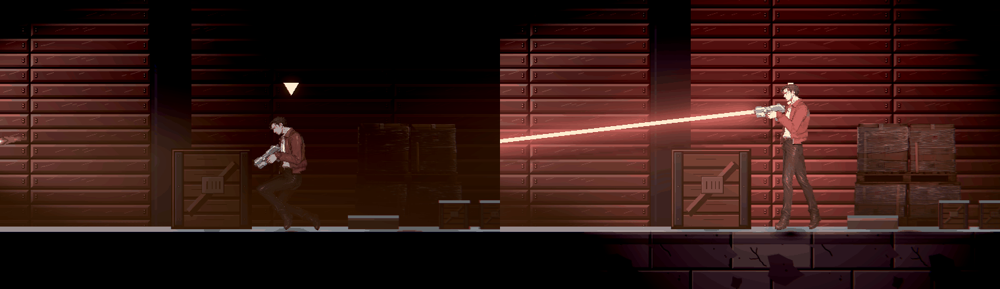

# [NE-415] 遠程敵人躲到落地的貨箱後面

> 狀態：完成

## 內文

### 需求
吊掛貨箱落地後會變成擋子彈的掩體，但敵人當它不存在。讓基礎遠程槍手（天穹保全、精銳保全、清掃兵、收帳人·槍手，同一套行為）會利用它：交戰時跑到落地貨箱遠離玩家的那一側蹲下，冷卻好了站起來越過箱頂開槍；玩家繞到同一側就不再算掩護。打下貨箱前要多想一步：砸到人是好事，留下的箱子也可能變成對方的掩體。

### 來源
2026-11-28，使用者指示：「接下來就一直做，如果票都做完了就看還有什麼可以做，持續精進遊戲內容跟畫面。」後續清單見[畫面與玩法的後續待辦](../../design/22-living-scenes/BACKLOG.md)玩法第 2 項「敵人會利用或害怕環境」（繞開積水 NE-408、蒸汽 NE-409，這張做落地貨箱當掩護）。

### 驗收條件
- [x] 交戰中的基礎遠程槍手找得到 150 像素內、同一層地面上、隔在自己和玩家之間的落地貨箱時，跑到遠離玩家的那一側蹲下
- [x] 蹲著時身體判定只到箱頂，從身體高度打過去的子彈被貨箱擋下；越過箱頂只打得到頭
- [x] 冷卻好了站起來，從箱頂上方瞄準開槍（瞄準線照常預告），再蹲回去
- [x] 玩家繞到同一側、走遠或貨箱不見了，就站起來回到平常的巡邏與射擊；不會為了躲而穿過貨箱
- [x] 還吊著的貨箱不算掩體；沒有落地貨箱時行為和原本完全一樣
- [x] 有自動測試；附原生畫面（蹲在箱後、越過箱頂瞄準）；受影響範圍的測試全過

### 測試流程
1. 進第一章倉庫，射斷吊鏈讓貨箱落地
2. 站在貨箱一側，讓槍手在另一側發現你
3. 預期槍手跑到貨箱後面蹲下，過一會兒站起來越過箱頂瞄準開槍，再蹲回去
4. 繞到槍手那一側，預期它站起來照常巡邏與射擊

---

# 跟其他票的關係

- Blocks：無
- Blocked by：無
- Related：NE-397、NE-408、NE-409

---

# Commit-1

## 內文

落地的吊掛貨箱擋路也擋子彈，可是敵人看不見它，打下貨箱只有好處沒有代價。
現在落地的貨箱會把自己的範圍登記成掩體（`CoverSpots`，和危險範圍的登記方式一樣，貨箱被移除就撤掉）。基礎遠程槍手這套行為（天穹保全、精銳保全、清掃兵、收帳人·槍手都用它）在發現玩家或被警報叫來時，找 150 像素內、同一層地面上、玩家在另一側的落地貨箱，跑到遠離玩家那一側箱邊 12 像素處蹲下。蹲著時身體判定縮成站姿的 72%：骨架外觀本來就比判定高約 1.4 倍，跪姿外觀換算回判定剛好到箱頂，所以越過箱頂只打得到跟著骨架的頭部判定；槍口朝下，不露出槍身。冷卻好了站起來，槍口抬到箱頂上方 6 像素以上，照常預告瞄準線後開槍，收招後蹲回去。玩家繞到同一側、走到射程 1.6 倍以外，或貨箱不見了，就回到原本的巡邏。沒有任何落地貨箱時判斷順序與原本完全相同（冷卻好、有令牌才看玩家），不多打射線。回到巡邏就忘掉上一個掩體，之後的射擊從原本的槍口出去。

### 測試結果

| 項目 | 結果 |
|---|---|
| 受影響範圍的測試 | 通過 64673 / 64673（43 個套件：挑選工具選出的 10 個，加上所有用到這套槍手、吊掛貨箱或第一章倉庫的套件；行為改到很多敵人共用的腳本，挑選工具在敵人資料那一層停下，所以手動補齊）。過程中抓到三件事都已處理：一、覆寫骨架蹲下的方式會蓋掉別人設定的蹲姿（受擊判定的測試抓到），改成只在躲著時強制蹲下；二、巡邏時每一格都多打一條視線射線，改回「沒有落地貨箱時和原本完全一樣」；三、通電積水測試在高負載下偶爾晚幾格才離開觸電範圍，改成等重疊真的消失再量 |
| 腳本錯誤 | 0 |
| 自動檢查 | 掩體位置在玩家另一側、換邊會跟著換；玩家在同側、站在箱上、不同層、太遠都不算；吊著的貨箱不算、落地才算、移除就撤掉；槍手蹲在箱邊、身體判定不高於箱頂；探頭時槍口在箱頂上方；開完槍蹲回去；從身體高度打過去的子彈打不到它；玩家繞到同側就站起來離開。把找掩體關掉時，「躲到貨箱後面」與「蹲回去」兩項會失敗 |
| 原生情境（第一章倉庫） | 打下貨箱後槍手跑到箱後蹲下（離箱邊 16 像素、身體判定 32 像素＝箱高），之後站起來越過箱頂瞄準 |

### 截圖

左：收帳人·槍手蹲在落地的貨箱後面，槍口朝下。右：冷卻好了站起來，從箱頂上方瞄準主角。第一章倉庫，原生 Forward+；為了畫面只留這一名槍手，其他敵人先停下並隱藏。

