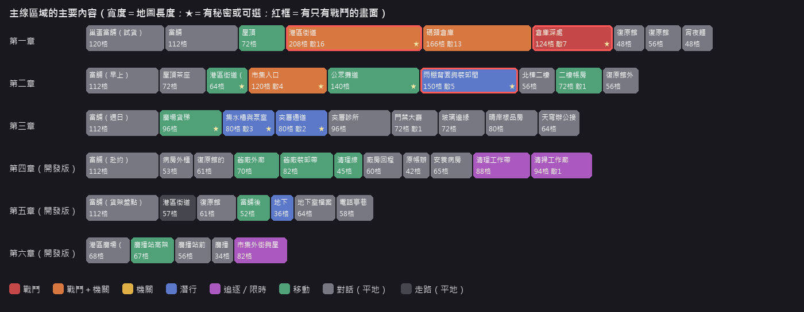

# [NE-416] 盤點各章區域的玩法多樣性

> 狀態：完成

## 內文

### 需求
地圖線開始逐章改動線之前，要先知道哪裡單調。每一章每個區域列一行：長度、有沒有高低差、有幾條路線、有哪些機關、遭遇幾場、有沒有秘密或可選內容、玩家「除了開槍還做了什麼」。標出連續三個以上只有戰鬥的段落、主線上連續三個以上內容相同的區域，以及每章最單調的三個區域；最後排出逐章的修改順序。數字要從地圖資料與程式算出來，改了地圖可以重跑，不憑印象。

### 來源
2026-11-28，使用者指示：「故事、遊戲玩法、地圖、關卡細節、敵人、Boss 動作等等的，可以開多個 Session 同時做。關卡的玩法跟內容可以更多變一點，不要只有枯燥的射擊。」見[畫面與玩法的後續待辦](../../design/22-living-scenes/BACKLOG.md)地圖第 1 項。

### 驗收條件
- [x] 有一支可以重跑的盤點工具，讀正式關卡資料，輸出每章每區一行的表
- [x] 每一行有：長度、高低差、上下兩層的比例與第二路線段數、梯子與升降梯、機關與危險地形、潛行、追逐或限時、遭遇場數與敵人數、鎖場、秘密與可選、人物與調查、主要內容、除了開槍還做了什麼
- [x] 文件寫清楚每一欄怎麼算、算不到什麼
- [x] 標出連續三個以上只有戰鬥的段落（區域層級與畫面層級），沒有就寫沒有與判斷標準
- [x] 標出主線上連續三個以上主要內容相同的區域
- [x] 每章列出最單調的三個區域與理由
- [x] 排出逐章的修改順序，每章寫要改的區域與方向，並列出每種機關目前出現在哪些章
- [x] 文件放在 `design/22-living-scenes/LEVEL_VARIETY.md`；待辦清單地圖第 1 項改成這張票

### 測試流程
1. 跑盤點工具，預期輸出每章的表，沒有腳本錯誤
2. 對照文件裡的表與工具輸出，數字一致
3. 任挑一區打開地圖資料，核對機關、遭遇與梯子的數量

---

# 跟其他票的關係

- Blocks：無
- Blocked by：無
- Related：NE-405、NE-406、NE-407、NE-410、NE-411

---

# Commit-1

## 內文

地圖線要逐章改動線，但沒有一份「哪裡單調」的清單，只能憑印象。
現在有一支盤點工具，從正式關卡資料算出每章每區的長度、可達的高低層、上下兩層的比例、第二路線、機關、潛行、限時、遭遇、秘密與人物，並給每區一個「主要內容」與單調分數；結果與算法寫成[關卡多樣性盤點](../../design/22-living-scenes/LEVEL_VARIETY.md)。
盤點的結論：沒有任何地方連續三個畫面以上只有戰鬥（區域與畫面兩個層級都查過，嚴格標準也沒有）；真正的單調是平的對話區連成一串——第三章後半連續 5 區、第四章兩段各 3 區、第一章章末 3 區。真正藏起來的秘密只有第一章兩面裂牆；蒸汽閥、可射暗的燈、輸送帶等多數機關只出現在一章。修改順序排為第三章 → 第四章 → 第一章 → 第二章，第五、六章等故事線定下流程再排。

### 測試結果

| 項目 | 結果 |
|---|---|
| 盤點工具跑完六章 56 區 | 0 腳本錯誤 |
| 受影響範圍的測試 | 只新增工具與文件，選測工具挑出 0 個套件 |
| 抽查 | 第二章裝卸間的吊掛貨箱、可射暗的燈、「不被發現」挑戰，第一章倉庫的開關、閘門、水坑，第三章泵室的誘餌收音機，與地圖資料一致 |

### 截圖

各章主線區域依序排開，寬度是地圖長度、顏色是主要內容；灰色是平地對話，第三章後半的一整串灰色就是最需要改的地方。

