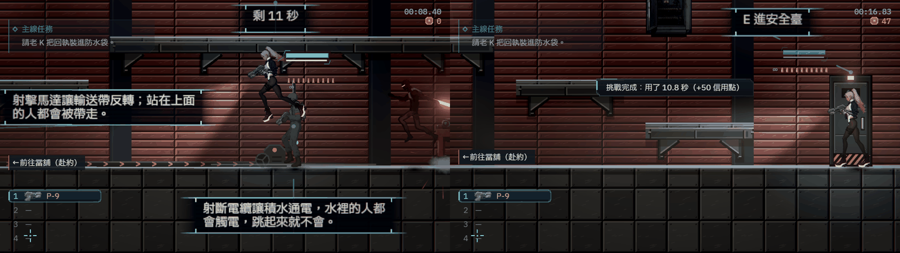

# [NE-418] 加入「限時抵達」的區域挑戰

> 狀態：完成

## 內文

### 需求
區域挑戰已有「用環境擊倒」與「不被發現」，還缺「限時」。加入第三種「限時抵達」：越過起點開始倒數，時間內走到終點就完成並給一次信用點；時間到就失敗，回到檢查點可以重來。倒數做成跟著主角的世界提示，不是 HUD 方框。第一個放在第四章廠房接線廊：起點旁的輸送帶預設往回帶，射馬達讓它反轉是比較快的跑法。

### 來源
2026-11-28，使用者指示：「接下來就一直做，如果票都做完了就看還有什麼可以做，持續精進遊戲內容跟畫面。」後續清單見[畫面與玩法的後續待辦](../../design/22-living-scenes/BACKLOG.md)玩法第 4 項「區域裡的可選小挑戰」（「只用環境擊倒」NE-410、「不被發現」NE-411，這張做限時）。

### 驗收條件
- [x] 進區域、標題卡淡出後跳一句提示（中、日、英），講清楚幾秒內要到哪裡
- [x] 越過起點才開始倒數（讀提示的時間不算），開始時提示一次；倒數中主角頭頂有「剩 N 秒」的全像字幕，不和頭頂的生命、彈藥列互相推擠
- [x] 時間內走到終點就完成：提示用了幾秒與獲得的信用點，只給一次，倒數字幕收起
- [x] 時間到就提示「時間到」並失敗，不給獎勵、字幕收起；倒數不存進檢查點，回到檢查點就回到還沒開始
- [x] 起點、終點、限時寫在資料裡；終點不在起點右邊、限時太短時指出是哪一項
- [x] 第四章廠房接線廊放了第一個：越過起點後 14 秒內抵達出口，獎勵 50 信用點；逆著輸送帶直衝來得及，反轉輸送帶多出約 2 秒餘裕
- [x] 有自動測試；附原生畫面（倒數中、完成提示）；受影響範圍的測試全過

### 測試流程
1. 進第四章廠房接線廊，等標題卡淡出，預期跳出挑戰提示
2. 往右越過起點，預期提示「計時開始：14 秒」，主角頭頂出現倒數
3. 射起點旁輸送帶的馬達讓它反轉，一路往右跑到出口，預期提示「挑戰完成：用了 N 秒（+50 信用點）」
4. 重新進區域，越過起點後停著不動，預期 14 秒後提示「挑戰失敗：時間到」

---

# 跟其他票的關係

- Blocks：無
- Blocked by：無
- Related：NE-401、NE-407、NE-410、NE-411

---

# Commit-1

## 內文

區域挑戰只有擊倒與潛行兩種，沒有考速度與路線的；第四章廠房接線廊是一條長走廊，起點旁的輸送帶往回帶，平常走過去只是慢一點，沒有理由去用它。
現在區域挑戰多了「限時抵達」：資料寫起點格、終點格與限時。玩家越過起點才開始倒數並提示一次；倒數中頭頂上方 100 像素有一行「剩 N 秒」的全像字幕（沿用世界提示，每過一秒才更新文字）；先走到終點就完成，提示用了幾秒並給獎勵；時間到就失敗。倒數不存進檢查點：回到檢查點就回到還沒開始，失敗與完成照舊跟著檢查點。
廠房接線廊掛上第一個：越過格 10 起算 14 秒內抵達出口（格 89），獎勵 50 信用點。限時依實測決定：按住「往右」直衝、途中照常挨打，逆著輸送帶 13.1 秒、先射馬達讓帶子反轉 10.8 秒；14 秒讓直衝也來得及，但只有反轉輸送帶才有餘裕吸收一兩次被擊退。

### 測試結果

| 項目 | 結果 |
|---|---|
| 受影響範圍的測試 | 通過 64038 / 64038（58 個套件；改到關卡與索引，挑選工具選出的全部） |
| 探針檢查 | 24 個中 22 個第一次就通過。`bubble_source` 54 項全過，但 4 個同時跑時在結束時多印一行「1 個 ObjectDB 實例洩漏」而判失敗；單獨重跑兩次都通過（它跑第一章休息室，沒有區域挑戰）。`controller_storage` 在 Windows 上不改程式也一樣失敗（見 NE-414） |
| 腳本錯誤 | 0 |
| 自動檢查 | 起點前不計時；越過起點開始倒數並出現頭頂字幕；時間內到終點完成並給一次獎勵、字幕收起；時間到失敗、不給獎勵、字幕收起；回到檢查點回到還沒開始；終點不在起點右邊會被指出。把「時間到就失敗」拿掉時，失敗那一項會失敗 |
| 原生情境（第四章廠房接線廊） | 逆著輸送帶：13.1 秒完成（剩 0.9 秒）；反轉輸送帶：10.8 秒完成（剩 3.2 秒），信用點 0 → 50 |
| 關卡索引 | 重建後驗證通過（59 區域） |

### 截圖

左：反轉輸送帶後往出口跑，頭頂倒數「剩 11 秒」，帶面箭頭已經朝右。右：抵達出口，提示「挑戰完成：用了 10.8 秒（+50 信用點）」，右上角信用點正在往 50 跳。第四章廠房接線廊，原生 Forward+，保留 HUD；主角是實際按著「往右」跑過去的。

