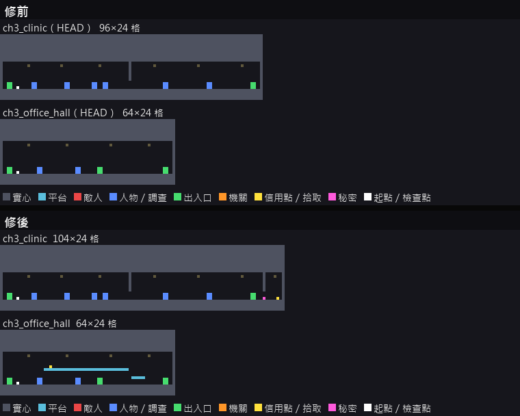
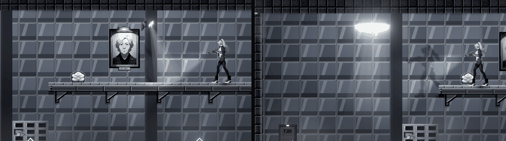
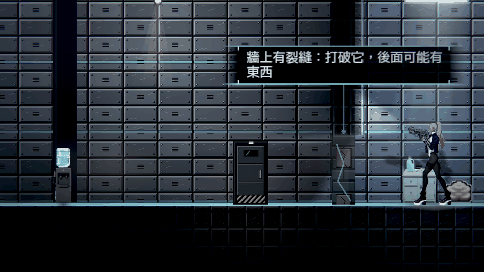
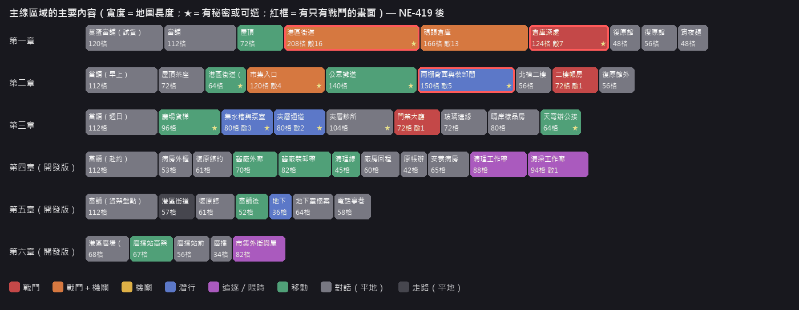

# [NE-419] 改第三章的動線與秘密

> 狀態：完成

## 內文

### 需求
盤點（NE-416）裡第三章最單調：主線上三分之二的長度是一條平地，後半的玻璃邊緣、樣品房與辦公接待廊連成一串平地對話區，整章沒有一個藏起來的房間。這張票改第三章的動線：在不擋劇情與頭目戰的前提下加高低差與第二條路線、至少一條回頭路，加至少兩個秘密或可選角落（獎勵用既有的信用點、圖鑑、改裝），讓主線上同一種內容不連續超過兩個區域。

第三章的地圖產生器先修到「重跑只有想改的區域有差異」再用（待辦清單的工具債）。

### 來源
2026-11-28，使用者指示：「關卡的玩法跟內容可以更多變一點，不要只有枯燥的射擊。」見[畫面與玩法的後續待辦](../../design/22-living-scenes/BACKLOG.md)地圖第 2 項與[關卡多樣性盤點](../../design/22-living-scenes/LEVEL_VARIETY.md)的修改順序。

### 驗收條件
- [x] 重跑第三章產生器，沒有改到的區域沒有內容差異（只容許資源編號與鍵順序這類不影響遊戲的差異）
- [x] 至少一區加上第二條路線與高低差，並有一條回頭路或捷徑
- [x] 至少兩個秘密或可選角落，獎勵用既有的信用點、圖鑑或改裝，不擋主線
- [x] 主線上同一種主要內容不連續超過兩個區域（盤點工具量）
- [x] 劇情觸發點、任務目標、地圖標記、檢查點與出入口位置不變或仍指到對的地方（任務與地圖稽核）
- [x] 第三章流程探針、場景合理性與可達性檢查、導航索引通過；新路線玩家走得到、秘密拿得到
- [x] 暗場可讀性檢查通過
- [x] 附修前修後的整區俯覽圖與兩三張實機截圖；受影響範圍的測試 0 個新失敗

### 測試流程
1. 跑盤點工具，看第三章的主要內容順序與秘密數
2. 跑第三章流程探針、任務與地圖稽核、場景報告
3. 實機進天穹辦公接待廊，從右段的矮台上到維修廊，走到左端拿到信用點再落回取件格旁
4. 實機進夾層診所，打破裂縫牆拿到裡面的獎勵

---

# 跟其他票的關係

- Blocks：無
- Blocked by：無
- Related：NE-416、NE-406

---

# Commit-1

## 內文

第三章三分之二的主線長度是一條平地；守門人戰之後的玻璃邊緣、樣品房與辦公接待廊連成三區平地對話，整章沒有一個藏起來的房間。另外第三章的地圖產生器重跑會改到其他區域，沒辦法放心用。

產生器先修好：一律寫 LF 換行、環境主題補上天空飄移、第一章的主光與景深不再套到第三章的當舖、NE-406 手擺的誘餌收音機與斷電纜寫回產生器。重跑後沒改到的區域只剩資源編號、鍵順序、清單換行這類不影響遊戲的差異；當舖的傘架從第 76 欄移到第 79 欄，和第一章同一個店面一致。

天穹辦公接待廊：右段多一個矮台，踩上去可以上到天花板下的空調維修廊，往左走過等候臺上方，盡頭有一包信用點（從地面看得到、跳不上去），再從左端落回取件格旁，是一條和迴廊平行的回頭路。迴廊原本的擺設都留在地面上。

夾層診所：往門禁大廳的門右邊多一面裂縫隔牆，打破之後是舊的備品間，裡面有床邊櫃與一包信用點。不擋主線，靠近時有一句提示。

一開始先在玻璃邊緣加了門頂的花台步道，但玻璃邊緣是畫面線的光影樣板：主光的光柱、花台邊、中景與地面剖面都把每一欄最上面的可站面當成走道，步道一加，光柱停在步道上、地面剖面畫到步道底下，畫面檢查有 5 項失敗。所以玻璃邊緣維持原樣，平台改放在室內的辦公接待廊。

主線上的主要內容現在是：對話 → 移動 → 潛行 → 潛行 → 對話 → 守門人戰 → 對話 → 對話 → 移動，同一種不連續超過兩區。盤點工具同時修正兩個算法（門禁大廳是小頭目戰，原本被算成平地對話；要爬上去才拿得到的信用點也算可選），並加上每區的敵人種類與同一種敵人連續出現的段落；[關卡多樣性盤點](../../design/22-living-scenes/LEVEL_VARIETY.md)已用新數字重跑。

### 測試結果

| 項目 | 結果 |
|---|---|
| 受影響範圍的測試（59 個套件） | 64719 項，1 項新失敗：第一章倉庫的閘門提示在 0.2 秒內淡入（實際時間計時，兩個程序同時跑時偏慢）；第一章地圖沒有改動，單獨重跑該套件 2142 / 2142 通過 |
| 畫面線的檢查（EnvironmentSuite、SceneSanitySuite） | 玻璃邊緣加步道的版本 5 項失敗；改放辦公接待廊後 8941 / 8941 通過 |
| 第三章流程探針 | 完整路線、最短主線都是 0 失敗（任務全部完成、主線 340 信用點） |
| 任務與地圖稽核 | 通過，入口只有當舖 |
| 場景合理性與可達性（診所、辦公接待廊、當舖） | 0 錯誤、0 警告（新獎勵都走得到） |
| 暗場可讀性 | 診所櫃檯、工作廊、備品間，辦公接待廊等候臺、維修廊全部達標 |
| 主光原生檢查（玻璃邊緣） | 主角頭部過曝 1.4%，提示對比 12.0，與改動前一致（玻璃邊緣沒有改） |
| 重跑產生器 | 沒改到的區域只有資源編號、鍵順序、清單換行的差異 |

### 截圖

修前修後的俯覽：診所右邊多了裂牆（粉紅）後的備品間，辦公接待廊多了右段的矮台與整段維修廊，左端是信用點。

辦公接待廊：左是維修廊中段（擺設都留在地面上），右是走到左端的信用點。原生 Forward+。

夾層診所：往門禁大廳的門右邊，裂縫牆的提示與牆後的備品間。原生 Forward+。

各章主線區域的主要內容（改完後重跑）：第三章已經沒有連續三區同一種內容。

