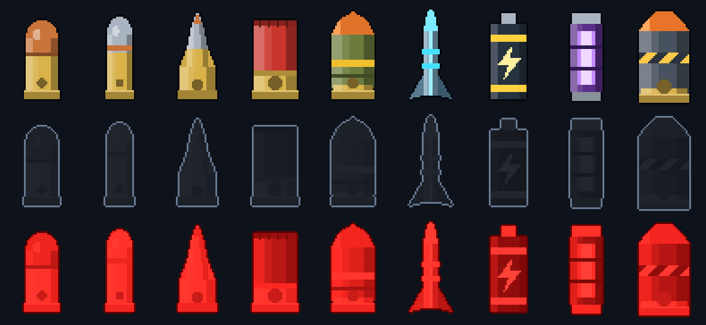
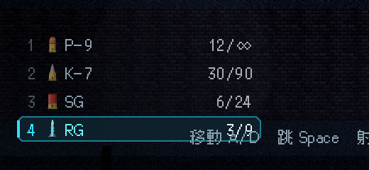
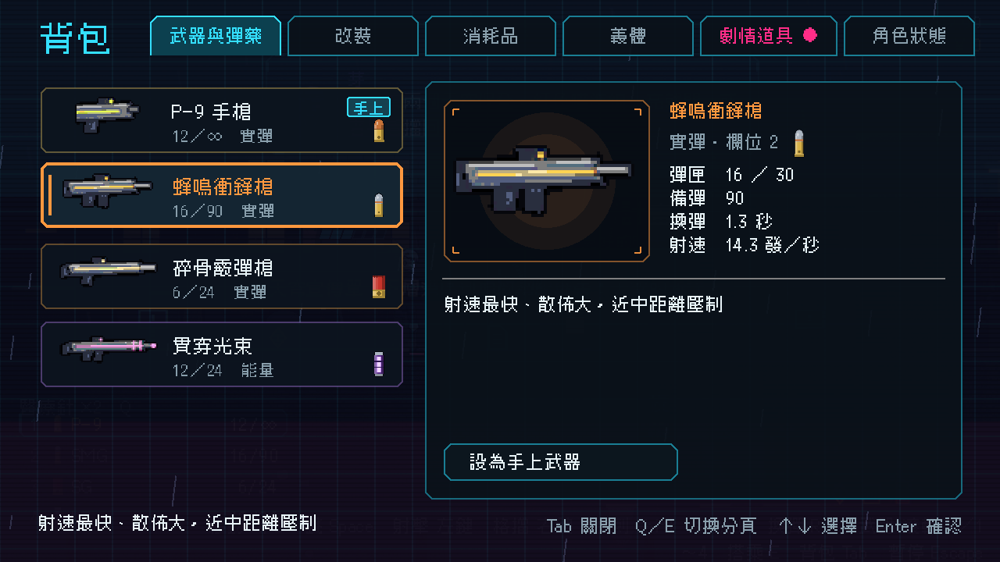

# [NE-41] 設計彈藥高解析圖示

> 狀態：完成

## 內文

### 需求
子彈目前只用準星旁的數字與弧線表示，看不出是什麼子彈。需要每種武器專屬的高解析度彈種圖示。

### 來源
2026-10-03，使用者於開發對話中提出：「子彈可以的話就用高解析度的Icon來代替，然後用dynamic ui放在主角旁邊」；「這些都可以去看看目前業界有哪一些最佳實例可以參考，我們盡可能設計的貼近完整實際的 Demo」。設計見 `design/10-presentation/DESIGN.md`、`design/04-story/`。

### 驗收條件
- [x] 每把武器有專屬的彈種圖示（手槍彈、步槍彈、霰彈、榴彈、電磁軌道彈、能量電池、雷射電池、機甲砲彈，至少 8 種），高解析度
- [x] 每個圖示有滿、空、彈量低三種狀態
- [x] 武器資料指定彈種圖示；缺圖時顯示替代圖並記錄具體路徑
- [x] 背包的武器頁與 HUD 的武器欄也使用彈種圖示

### 測試流程
1. 開預覽畫面檢查所有圖示與三種狀態
2. 換一把沒有圖示的武器，確認有替代圖與錯誤訊息
3. 執行完整測試套件，全部通過

---

# 跟其他票的關係

- Blocks：NE-42
- Blocked by：無
- Related：NE-16

---

# Commit-1

## 內文

原本子彈只用準星旁的數字與弧線表示，看不出是什麼子彈。
現在每種武器有專屬的彈種圖示：手槍彈、衝鋒槍彈、步槍彈、霰彈、榴彈、電磁軌道彈、能量電池、雷射電池、機甲砲彈共 9 種，以 4 倍解析度繪製，每種有滿、空槽、彈量低三種狀態。武器資料指定圖示 id，沒指定時能量武器用電池、實彈武器用手槍彈；缺圖時顯示替代圖並記錄具體路徑。背包武器頁的卡片與詳情、HUD 的武器欄（欄號、彈種圖示、名稱、彈匣／備彈，手上武器高亮，彈量低或空匣時圖示與數字變色）都使用彈種圖示。附彈種圖示的繪製工具。
驗收：新增彈種圖示測試套件（圖示與三種狀態、尺寸、各武器指定圖示、缺圖容錯、HUD 武器欄狀態、背包卡片），並用圖示總覽、武器欄與背包截圖。

### 測試結果

| 項目 | 結果 |
|---|---|
| 完整測試套件 | 通過 2464 / 2464 |
| 資料驗證 | 0 錯誤 |
| 執行 log | 無 ERROR |

### 截圖

