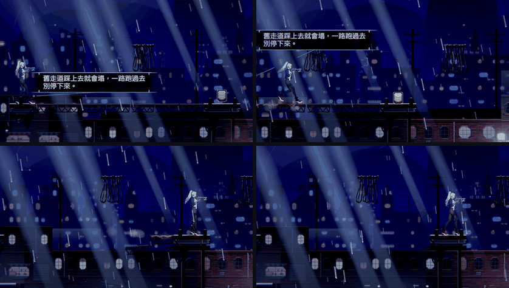
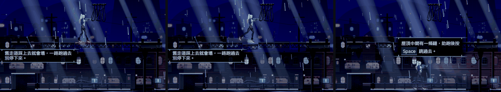

# [NE-420] 加入踩上去會塌的走道

> 狀態：完成

## 內文

### 需求
地圖上的移動只有走、跳、衝刺，地面又大多連續，沒有一段要求玩家「改變移動方式」。這張票加入需要落差的移動機關：架在落差上的舊鐵走道，有人站上哪一片，那一片先抖、裂開，過一下就掉下去；站著不動就會跟著掉，所以要一路跑過去。掉下去不會死，只會落到下層、要繞回去再試；空出來的片過一陣子補回來。敵人站上去也一樣會塌。

選這一種而不是滑索或可以盪的纜繩：三者裡只有它不需要新做主角舉手吊掛的骨架姿勢（肩部接縫是畫面最容易出事的地方），而且之後的逃離段落可以直接沿用。

### 來源
2026-11-28，使用者指示「關卡的玩法跟內容可以更多變一點，不要只有枯燥的射擊」，玩法線依[後續待辦](../../design/22-living-scenes/BACKLOG.md)玩法第 3 項（需要落差的移動機關）開票；設計見[畫面活化與融入](../../design/22-living-scenes/DESIGN.md)的「玩法多樣性」。

### 驗收條件
- [x] 走道分成幾片，外觀是有格柵、側樑與底下桁架的舊鐵走道，兩端有斜撐，不是一塊平板
- [x] 玩家或敵人站上某一片，那一片先預警（抖動、裂痕變亮），預警時間過後掉下去並在原處淡出；只有被站上的那一片會塌
- [x] 一路往前跑可以從一端跑到另一端不掉下去；站著不動會跟著掉到下層，不會死
- [x] 掉下去的片過一段時間補回；那一片上方有人時先不補，不會把人卡在平台裡
- [x] 可以從底下跳上去，也可以按下加跳穿下去（和地圖上的單向平台一樣）
- [x] 「減少介面動態」時不抖，只靠裂痕與變色預警，照樣會塌、照樣能玩；預警不閃爍
- [x] 從檢查點重來（關卡重建）時走道一律完整；有存檔來回的自動測試
- [x] 玩家靠近走道時有一句提示（中、日、英），講清楚會塌、要一路跑過去
- [x] 長度、每片長度、預警與補回時間、提示寫在資料裡，新增一段只要在關卡地圖放一個字元；資料不合理時指出是哪一項與哪一格
- [x] 第一章屋頂放了第一段，當作安全的示範：底下是屋頂地面，掉下去走回起點再試；走道盡頭是原本就有的那一小筆信用點，只能走走道拿到；屋頂原本的路線、縫、人物與出口不變
- [x] 附原生畫面：起點的提示、跑在走道上時身後一片片塌掉、抵達對面、站著不動跟著掉下去；受影響範圍的測試全過，把「站上去會塌」關掉時測試會失敗

### 測試流程
1. 進第一章屋頂，往右走到盤子天線旁，跳上天線頂的踏板，再跳上走道起點
2. 預期看到一句提示，走道對面的平台上有信用點
3. 一路往右跑，預期腳下的片在身後一片片抖、裂、掉下去，自己跑到對面拿到信用點
4. 回來站在走道中間不動，預期那一片抖一下就掉，自己落到屋頂地面上，沒有受傷
5. 等幾秒，預期掉下去的片補回來，可以再走一次

---

# 跟其他票的關係

- Blocks：無
- Blocked by：無
- Related：NE-401、NE-405

---

# Commit-1

## 內文

地圖上的移動只有走、跳、衝刺，沒有一段要求玩家改變移動方式；屋頂、街道雖然有高低差，但沒有「非得這樣走」的地方。
現在有會塌的走道：架在落差上的舊鐵走道（鋼格柵走道面、生鏽側樑、底下三角桁架、兩端斜撐），每 2 格一片。玩家或敵人踩上某一片，那一片抖動、裂痕由短變長、邊緣轉成琥珀色，0.5 秒後掉下去並在 0.8 秒內淡出；用跑的一片只踩約 0.2 秒，所以一路跑過去不會掉，停下來就會跟著落到下層（不受傷）。掉下去的片 3 秒後補回，上方有人時先不補。可以從底下跳上去，也可以按下加跳穿下去。「減少介面動態」時不抖，只靠裂痕與變色；預警不閃爍。不存進檢查點，重來時一律完整。
第一段放在第一章屋頂（地圖字元 `┅`，14 格）：從盤子天線頂的新踏板上去，跨過屋頂的縫上方到對面的小平台；平台上是原本放在屋頂地面上的那一小筆信用點，比屋頂高 6 格、離其他平台 12 格以上，不走走道拿不到。屋頂原本的縫、提示、人物、出口與燈都不變。場景檢查的可達性分析把走道當成可以站的平台，信用點不會被誤報成「走不到」。
原生情境在這裡跑過一次：一路往右跑，主角最低點始終在走道面上（704），7 片全部在身後塌掉並拿到信用點；站在走道中間不動，0.5 秒後落到屋頂地面（落差 96 像素），生命不變。

### 測試結果

| 項目 | 結果 |
|---|---|
| 受影響範圍的測試（69 個套件，3 個程序） | 95572 項中 1 項失敗：場景檢查把對面平台的信用點報成「走不到」（可達性分析還不認得走道）；修正後重跑 PropsSuite、SceneSanitySuite、Chapter1MapSuite 3126 / 3126 通過 |
| 新行為的自動檢查 | 站著不動會塌、只塌被踩的那片、人跟著掉；一路跑過去不掉且身後的片塌掉；敵人踩上去也塌、敵人跟著掉；上方有人不補、離開才補；減少介面動態不抖但照樣塌；不在檢查點快照裡、從檢查點重建後全部完整 |
| 把「站上去會塌」關掉 | 走道的 10 項檢查失敗（確認測試抓得到） |
| 受影響的流程探針 | 23 / 24 通過；`run_controller_storage` 在 Windows 本機跑不了（它要求 Linux 的獨立使用者資料夾，和改動無關，CI 會跑） |
| 腳本錯誤 | 0 |

### 截圖

第一章屋頂，原生 Forward+。上：起點的提示與對面的信用點 → 跑到一半 → 抵達對面時身後最後一片在預警、前一片在掉 → 全部塌完。下：站在中間不動 → 裂開 → 掉下去落在屋頂上。

