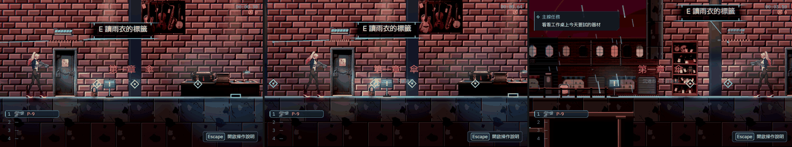
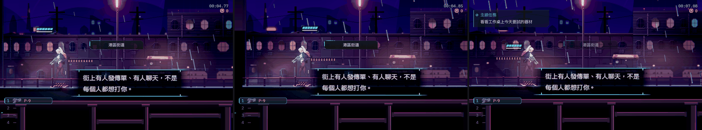
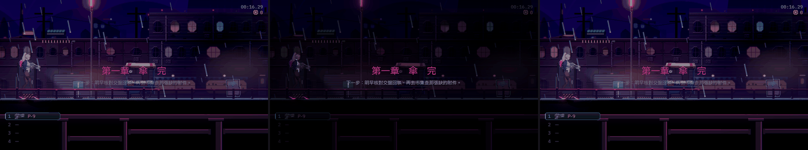
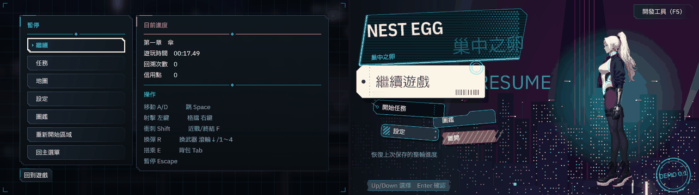
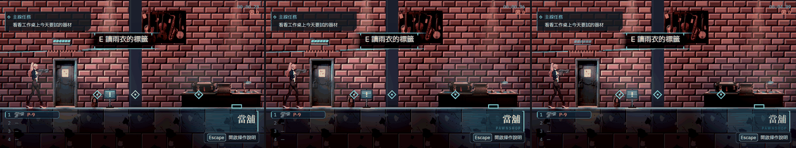
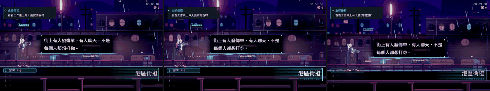
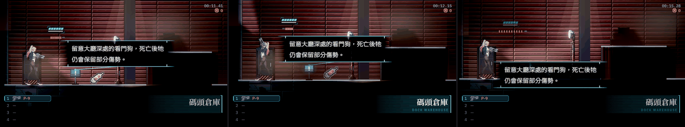
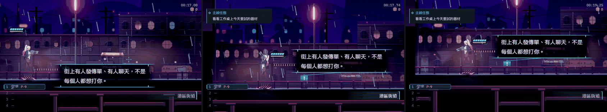
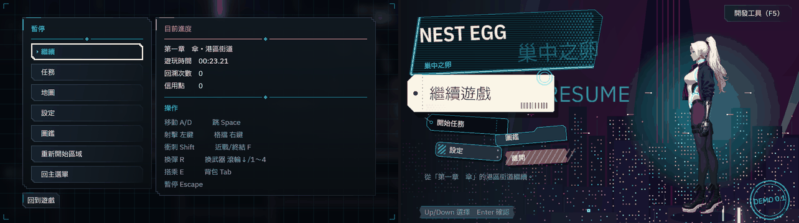

# [NE-421] 改寫章節與地點名稱的呈現

> 狀態：完成

## 內文

### 需求

進入章節時，粉紅色的「第一章　傘」直接疊在關卡畫面正中央，下面灰色小字被場景物件壓住；字體、版面與美術都很簡陋。穿過出入口時，地名是畫面中央一塊方框橫幅，會壓到教學提示。

改成：
- 進入章節不再把「第幾章　標題」疊在遊戲畫面上。章節名稱只出現在整理內容的地方：暫停畫面、主選單的「繼續遊戲」說明、任務與地圖。
- 進入地點時，地名用融入這個世界的方式出現：畫面角落一小塊像雙語路牌的標示，保留淡入淡出；不壓在角色、敵人、提示與場景重點上；回訪同一地點只顯示較短的版本。
- 全片只在章節結束時保留一張完整的章節卡，而且是設計過的專屬畫面（黑底、序號、章名與印的層級），不是字疊在關卡上。
- 地名與章名用專屬的標題字體，與內文有層級差別。

做法與參考依據寫在 `design/22-living-scenes/PRESENTATION.md`。

### 來源

2026-11-28 使用者看到「第一章　傘／沉港市・下層港區」的標題卡後的意見（見 `design/22-living-scenes/BACKLOG.md` 的「演出」）：淡入淡出不錯，但字體、表現形式與美術簡陋；進入章節不一定要顯示章節標題，很多遊戲只在存檔之類的地方顯示；不要有濫竽充數的東西。

### 驗收條件

- [x] 從新遊戲進入第一章第一個區域時，畫面中央不出現章節標題；改為右下角的地點標示淡入、停留、淡出
- [x] 穿過出入口進入新地點時，地點標示出現在同一個角落；畫面中央不再出現地名橫幅
- [x] 回訪同一地點時只顯示較小、較短的版本（沒有第二行外文地名）
- [x] 讀檔接續時顯示目前地點；從檢查點重生時不顯示
- [x] 地點標示不壓在角色、敵人、教學提示與世界提示上：放在可走地面以下的角落，世界提示會避開它；亮的與暗的場景都讀得清楚
- [x] 暫停、背包、通訊時地點標示藏起來並凍結，不在看不到的時候播完
- [x] 「減少動態」時不滑動、不畫出細軌，只淡入淡出；不擋任何輸入
- [x] 章節結束時是全黑的專屬畫面：章節序號、大字章名、「完」印、下一步提示依序出現；確認或取消鍵可提早收尾；收尾後黑底接到結算畫面，不閃出關卡
- [x] 暫停畫面寫出「章節・目前地點」；主選單「繼續遊戲」的說明寫出會回到哪一章、哪個地點
- [x] 地名與章名使用開放授權（SIL OFL）的標題字體，來源、授權與版本已登記；只收錄用得到的字，檔案大小有量；自動測試確認所有地名與章名都有收錄，缺字時指出是哪一筆資料
- [x] 文字放大 1.2 倍時地點標示與章末畫面不超出畫面
- [x] 票上附修前與修後的淡入、停留、淡出三格截圖；地點標示亮場景、暗場景、回訪各一組；暫停與主選單的章節名
- [x] 受影響的測試 0 個新失敗

### 測試流程

1. 開新遊戲，走完序章進入當舖：右下角出現「當舖／PAWNSHOP」，約四秒後淡出；畫面中央沒有章節標題
2. 走到港區街道、碼頭倉庫，再回到港區街道：前兩次是完整版，回訪是只有地名的短版
3. 地點標示出現時按暫停：標示消失；關閉暫停後接著播完
4. 設定開啟「減少動態」再換一次區域：只有淡入淡出
5. 打完第一章：黑底上依序出現「第一章」、「傘」、「完」印與下一步提示，之後進結算
6. 遊戲中按暫停：進度第一行是「第一章　傘・港區街道」；回主選單，「繼續遊戲」的說明是「從「第一章　傘」的港區街道繼續。」

---

# 跟其他票的關係

- Blocks：無
- Blocked by：無
- Related：無

---

# Commit-1

## 內文

進入章節時，「第一章　傘」用內文字型直接疊在關卡正中央，小字被告示牌與互動標記壓住；穿過出入口時，地名是中央一塊方框橫幅，壓到教學提示；章節結束是同一種字疊在變暗的關卡上。

現在進入章節不再打章節標題。進入地點時，右下角（可走地面以下的地層，角色、敵人與提示都不會在那裡）像雙語路牌的標示淡入：一條青色細軌由上往下畫出，明體粗體的地名從右邊滑入，下面一行是外文地名，後面只有往左淡掉的暗色襯底；約四秒後淡出。回訪同一地點只顯示較小的地名、停留較短。從主選單接續存檔時也會標示目前地點，死亡重生不標示。暫停、背包、通訊時標示藏起來並凍結；「減少動態」時只淡入淡出。

章節名改放在整理內容的地方：暫停畫面的進度第一行是「第一章　傘・港區街道」，主選單「繼續遊戲」的說明是「從「第一章　傘」的港區街道繼續。」，地圖的世界頁本來就有章節名。

全片只在章節結束保留一張章節卡，改成全黑的專屬畫面：「第　一　章」小字、大字章名「傘」、朱色「完」印像當票上的章一樣蓋下去，接著細線與下一步的提示；開始 0.8 秒後可按確認或取消提早收尾；收尾後黑底留給結算畫面接手。

地名與章名用新的標題字體（Noto Serif TC／JP 粗體，SIL OFL 1.1，只收錄用得到的字：繁中 175 KB、日文 224 KB）；遊戲語言是日文時用日文字形。參考了 Hollow Knight、Blasphemous、Celeste、Katana ZERO、Limbo／Inside、Dead Cells、The Last of Us Part II 的做法，依據與取捨寫在 `design/22-living-scenes/PRESENTATION.md`。

### 測試結果

| 項目 | 結果 |
|---|---|
| 受影響套件（呈現、介面元件、介面畫面、過場、第一章地圖、區域、存檔、任務地圖、轉場） | 7895 項檢查，0 個新失敗 |
| 標題字體涵蓋所有地名與章名（中文、日文） | 通過 |
| 截圖情境執行 log | 無 ERROR |
| 文字放大 1.2 倍 | 地點標示（85×59 像素，右下角）與章末畫面都在畫面內 |

### 截圖

修前：章節開始（淡入、停留、淡出）——字疊在關卡正中央，小字被告示牌壓住。

修前：穿過出入口進港區街道——中央方框橫幅。

修前：章節結束——字疊在變暗的關卡上。

修前：暫停畫面與主選單。

修後：章節開始（當舖）——右下角地點標示淡入、停留、淡出。

修後：亮的場景（港區街道）。

修後：暗的場景（碼頭倉庫）。

修後：回訪港區街道——只有地名的短版。

修後：地點標示放大看——掃描線與襯底往左淡掉，沒有方框的硬邊。

修後：章節結束——序號、章名、「完」印、提示依序出現，最後內容淡出、黑底留著。

修後：暫停畫面的「章節・地點」與主選單「繼續遊戲」的說明。

修後：文字放大 1.2 倍的地點標示與章末畫面。

