# [NE-422] 建立全遊戲共用的字體階層

> 狀態：完成

## 內文

### 需求

預設字體直接疊在畫面上是簡陋感的主要來源：畫面標題、時刻標題與內文都是同一款黑體，只靠字級區分，沒有層級。要有全遊戲一致的字體階層——標題、內文、數字與標籤各自的字體與字級——寫成一份共用設定，所有畫面從同一份設定取用。

先接上章節與地點的呈現、橫幅通知，再把各畫面的標題換成標題字體；選單與 HUD 的版面（位置、外框大小）不動，只換字體與字級。

同時修正 NE-421 交付後主 session 驗收列出的不足：

1. 地點標示的英文那一行對比太低。
2. 地點標示的掃描線帶太明顯，搶在字前面。
3. 地點標示和右下角的操作說明擠在一起，看起來像疊在一起。
4. 玩家掉進右下角時，地點標示沒有讓開。
5. 章末卡的章名在整個畫面裡偏小、偏空，四層（章數、章名、印、預告）層級不夠；英文章名沒有印，不是完整版。
6. 舊的「標題疊在關卡上」模式要移除，工具與測試不留引用。

### 來源

- 2026-11-28 使用者：字體、表現形式與美術很簡陋；不要濫竽充數（`design/22-living-scenes/BACKLOG.md` 演出第 3 項）。
- 2026-11-28 主 session 驗收 NE-421 的意見（上面六項）。

### 驗收條件

- [x] 有一份共用的字體設定，列出每個角色（時刻標題、畫面標題、段落標題、內文、說明小字、外文標籤、數字）的字體、字級與字距；設定檔遺失或內容損毀時記錄錯誤（指出檔案與欄位）並用內建預設，不讓遊戲崩潰
- [x] 字體階層與使用規則寫進設計文件，含每個角色用在哪裡、最小字級與文字對比標準
- [x] 地點標示、章末畫面、橫幅通知從共用設定取字體與字級
- [x] 畫面標題（死亡、結算、圖鑑、設定、難度、覆寫確認、手把斷線）與過場的置中旁白改用標題字體；版面位置與外框大小不變
- [x] 標題字體涵蓋遊戲裡所有會出現的文字（缺的只有符號，退回內文字型）；檔案大小與載入的記憶體有量並記錄
- [x] 地點標示的英文行對比至少 4.5:1，地名的對比明顯更高（弱一階）；有自動檢查
- [x] 地點標示的掃描線要放大看才看得到，不搶在字前面；亮場與暗場各附一張放大圖
- [x] 地點標示出現時，和右下角的操作說明之間有固定間距並右緣對齊，不重疊
- [x] 玩家（或敵人）進到地點標示所在的區域時，標示淡到很低；離開後恢復
- [x] 章末卡的章名約為 NE-421 的兩倍大，章數、章名、印、預告四層的大小與間距拉開；英文章名也有印與完整的層級
- [x] 舊的疊字模式移除，程式、工具與測試沒有殘留引用
- [x] 完整的介面版面檢查通過：主要畫面在 720p、1080p、21:9 與文字放大 1.2 倍下沒有超出或被裁切的文字
- [x] 受影響的測試 0 個新失敗；票上附修前修後截圖

### 測試流程

1. 開新遊戲進入當舖：地點標示的英文行清楚可讀，掃描線只有近看才看得到；標示和「開啟操作說明」上下分開、右緣對齊
2. 走到畫面右下角站著：標示淡到幾乎看不見；走開後恢復
3. 開啟死亡、結算、圖鑑、設定、難度畫面：標題是明體粗體，版面位置不變
4. 打完第一章：章末卡的「傘」約佔畫面高度的三分之一，四層層級清楚；英文語言下也有印
5. 設定文字大小 1.2 倍重看以上畫面：文字不超出、不被裁切

---

# 跟其他票的關係

- Blocks：無
- Blocked by：無
- Related：NE-421

---

# Commit-1

## 內文

畫面標題、時刻標題與內文原本都是同一款黑體，只靠字級區分；NE-421 的地點標示與章末畫面另有六處不足。

現在全遊戲有一份共用的字體階層（`data/ui/typography.json`，規則寫在 `design/22-living-scenes/TYPOGRAPHY.md`）：時刻大標、時刻標題、畫面標題、標題小字用明體粗體；段落標題、內文、說明小字用內文黑體；外文標籤用窄體加字距；數字用等寬字。設定檔遺失或欄位錯誤時記錄是哪個檔案、哪個角色、哪個欄位，退回內建預設。

- 標題明體改成收錄遊戲裡所有文字（繁中 1.6 MB、日文 1.7 MB，一次只載入目前語言的一份），任何標題都能用，不會一個字明體一個字黑體。
- 死亡、結算、圖鑑、設定、難度、覆寫確認、手把斷線的畫面標題，以及過場的置中旁白換成明體；位置、外框與字級不變。
- 地點標示、章末畫面、通知橫幅改從共用設定取字體與字級。

NE-421 的六項：

1. 地點標示的外文行改成淺青色，壓在中灰背景的襯底上對比 5.6:1（標準 4.5:1），地名 8.7:1，弱一階。
2. 掃描線降到近看才看得到（亮場、暗場都放大看過）。
3. 標示的右緣和「開啟操作說明」對齊，下緣固定在它上方 10 像素。
4. 玩家或敵人進到標示的範圍時，標示淡到 12%，離開後恢復。
5. 章末畫面的章名放大到 104（約為原本兩倍、畫面高度的三分之一），序號、章名、印、提示四層字級是 14／104／42／14；英文也拆成「CHAPTER 1」與章名、一樣蓋「完」印，太長的章名縮小到畫面寬度內，印有最小尺寸。
6. 舊的「標題疊在關卡上」模式移除；工具改用演出層的共用群組清掉畫面上的演出，測試改驗地點標示。

### 測試結果

| 項目 | 結果 |
|---|---|
| 受影響套件（呈現、介面元件、介面畫面、過場、區域、轉場） | 3814 項檢查，0 個新失敗 |
| 文字放大 1.2 倍版面檢查（設定四個分頁、商店） | 0 個問題 |
| 任務與地圖放大文字版面 | 0 個問題 |
| 主要畫面 720p、1080p、21:9、文字放大 1.2 倍截圖 | 逐張看過，沒有超出或被裁切的文字 |
| 截圖情境執行 log | 無 SCRIPT ERROR |

### 截圖

畫面標題修前（左）與修後（右）：死亡、結算、設定、難度、圖鑑。位置與字級不變，只有字體換成明體。

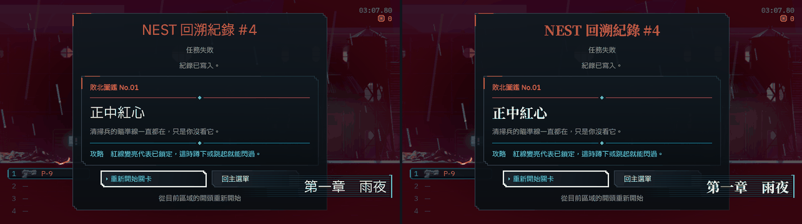

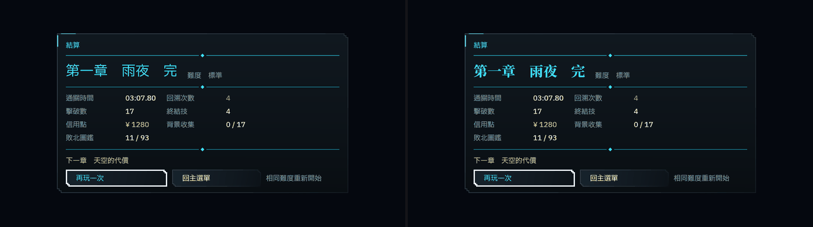

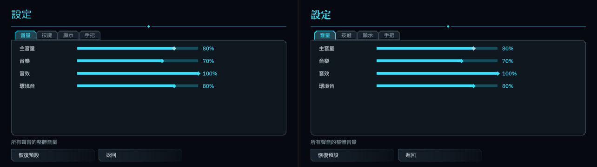

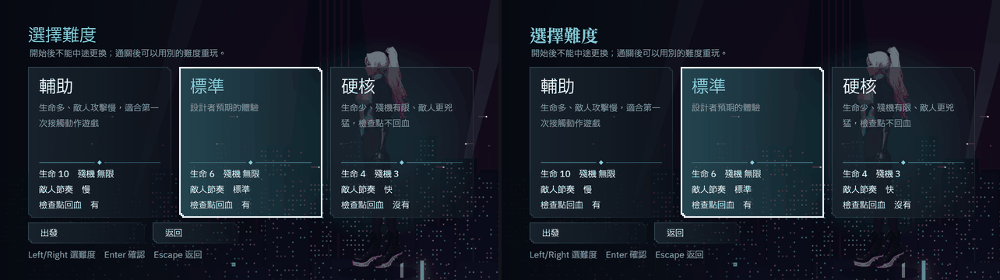

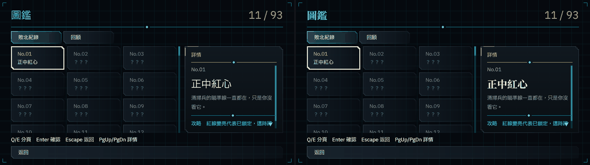

版面：21:9（死亡、設定）、1080p（死亡、結算）、文字放大 1.2 倍（結算、難度、圖鑑）。

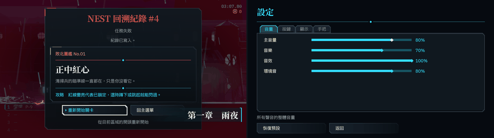

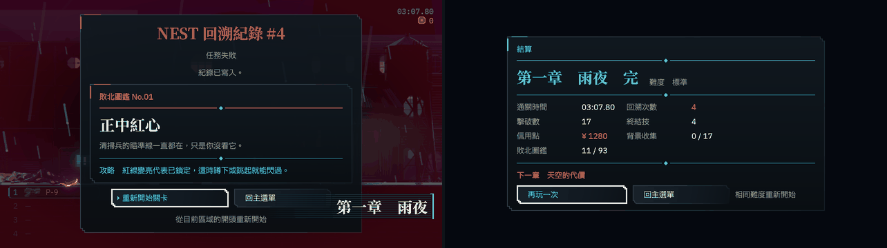

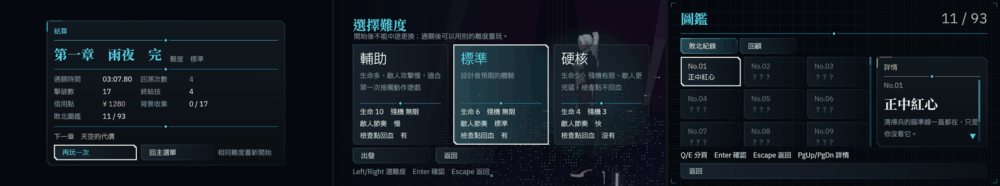

地點標示：章節開始（淡入、停留、淡出）——右緣和操作說明對齊、上下分開。

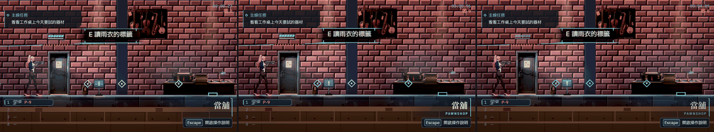

地點標示放大：亮場（港區街道）、暗場（碼頭倉庫）。外文行清楚，掃描線近看才看得到。

判讀優先：主角站進標示的範圍時（右），標示淡到 12%。

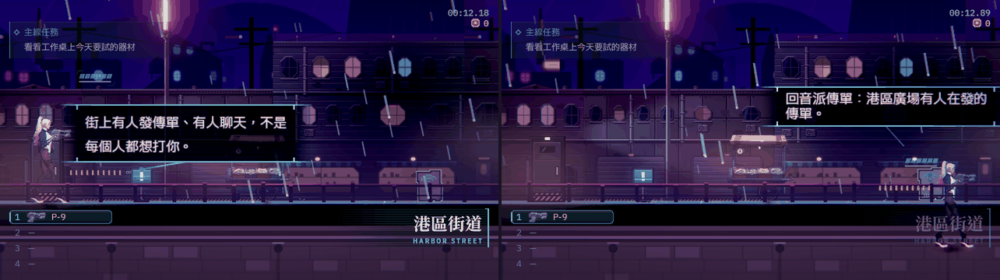

章末畫面修前（左，NE-421）與修後（右）。

章末畫面修後（淡入、停留、淡出）。

英文章末：「Kasa」與縮小到畫面寬度內的「The Paymaster」，都有序號與印。

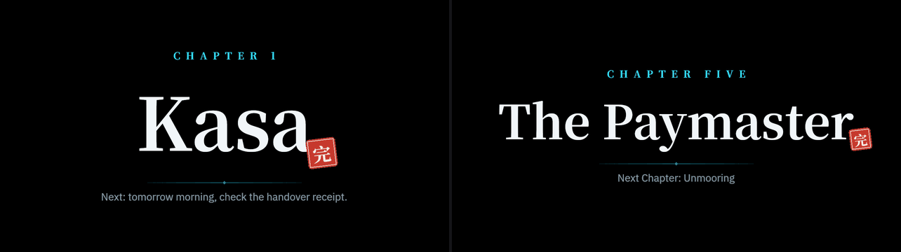
