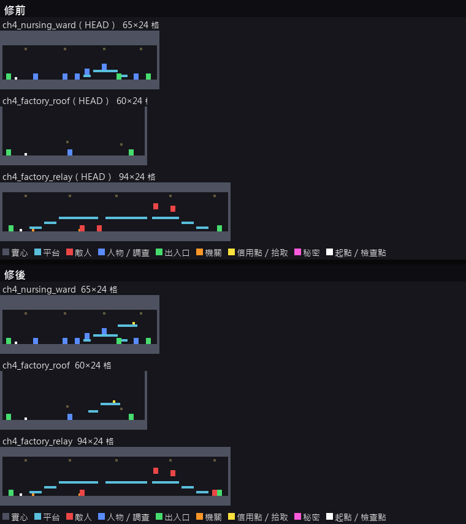
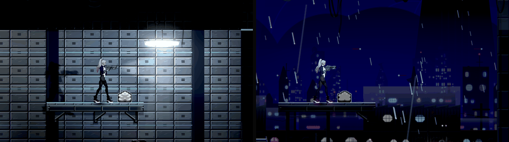

# [NE-423] 改第四章的動線與秘密

> 狀態：完成

## 內文

### 需求
盤點（NE-416）排的第二章要改的是第四章：照劇情的遊玩順序，開頭的當舖、病房外櫃檯、安養病房、復原館連續四區都是平地對話；整章沒有一個秘密或可選角落。這張票在不擋劇情的前提下，讓主線上同一種內容不連續超過兩區，並加至少兩個秘密或可選角落（獎勵用既有的信用點、圖鑑、改裝）。

第四章的地圖產生器先核對「重跑只有想改的區域有差異」再用；盤點工具照劇情的遊玩順序排區域，第一次必經的通道算主線。

### 來源
2026-11-28，使用者指示：「關卡的玩法跟內容可以更多變一點，不要只有枯燥的射擊。」見[畫面與玩法的後續待辦](../../design/22-living-scenes/BACKLOG.md)地圖第 2 項與[關卡多樣性盤點](../../design/22-living-scenes/LEVEL_VARIETY.md)的修改順序。

### 驗收條件
- [x] 重跑第四章產生器，沒有改到的區域沒有內容差異（只容許資源編號與鍵順序這類不影響遊戲的差異）
- [x] 主線上（照劇情的遊玩順序）同一種主要內容不連續超過兩個區域（盤點工具量）
- [x] 至少兩個秘密或可選角落，獎勵用既有的信用點、圖鑑或改裝，不擋主線
- [x] 劇情互動點、任務目標、地圖標記、檢查點與出入口位置不變（任務與地圖稽核）
- [x] 第四章的流程探針、場景合理性與可達性檢查、導航索引通過；新路線玩家走得到、獎勵拿得到
- [x] 暗場可讀性檢查通過
- [x] 附修前修後的整區俯覽圖與兩三張實機截圖；受影響範圍的測試 0 個新失敗

### 測試流程
1. 跑盤點工具，看第四章的主要內容順序與秘密數
2. 跑第四章的流程探針、任務與地圖稽核、場景報告
3. 實機進安養病房，從靠窗的收音座再往上，沿備品頂架走到盡頭拿到信用點、落回內廊門旁
4. 實機上廠房屋頂，從欄杆後踩上冷卻機的維修平台拿到信用點

---

# 跟其他票的關係

- Blocks：無
- Blocked by：無
- Related：NE-416、NE-419、NE-407、NE-418

---

# Commit-1

## 內文

照劇情的遊玩順序，第四章開頭的當舖、病房外櫃檯、安養病房、復原館連續四區都是平地對話，整章沒有秘密或可選角落。盤點工具原本照經濟帳本的最短路排順序，那條路會走鎖著的員工捷徑，所以第四章的順序一直是錯的；現在改照章節設計資料的劇情順序，第一次必經的接線廊也算主線。

安養病房：靠窗的收音座再往上多一層備品頂架，走到盡頭有一包信用點（從地面看得到、跳不上去），再從頂架右端落回內廊門旁。推車留在地板上。

廠房屋頂：欄杆後面踩一階上冷卻機的維修平台，平台上有一包信用點，從右端落回屋頂。欄杆留在屋頂地面上。

產生器：第四章重跑原本只有接線廊不一致（玩法線手擺的輸送帶、斷電纜與限時挑戰），現在都寫回產生器，重跑後只剩資源編號的差異。共用的產生器多一道檢查：「站在地上」的擺設頭上有平台時直接報錯，指出是哪一件、哪一欄，因為遊戲會把它放到平台上（第三章辦公接待廊、第四章病房與屋頂都踩過）；第一到第四章的產生器都通過這道檢查。

廠房接線廊：切割者現在會從主角頭上翻到背後（NE-424），但只在頭頂沒有走道的地方翻得起來；原本站在第 40 欄的走道底下，只會正面撲。改成東端出口前的開闊地（第 87 欄）單獨一場「出口看守」，右邊是盡頭的牆，玩家可以背靠牆化解；下層巡查剩清掃兵，仍然站在斷電纜的積水裡。

主線上的主要內容現在是：對話 → 對話 → 移動 → 對話 → 移動 → 移動 → 戰鬥 → 移動 → 限時 → 限時 → 對話 → 移動，同一種不連續超過兩區。新路線用一支實走工具驗過：用真的跳躍與左右移動一階一階走上去、撿到信用點、走回地面；第三章的兩條路線（辦公接待廊的維修廊、診所開槍打破裂縫牆進備品間）也一起實走。

### 測試結果

| 項目 | 結果 |
|---|---|
| 受影響範圍的測試（59 個套件） | 64447 / 64447 通過，0 個新失敗 |
| 第四章流程探針（病房→舊廠→接線廊→安全臺，寫檔與冷讀檔） | 寫檔、讀檔都是 0 失敗 |
| 新路線實走（真的跳躍與移動輸入） | 安養病房備品頂架、廠房屋頂維修平台、第三章辦公接待廊維修廊、第三章診所裂縫牆後的備品間，四條都走得上去、撿到信用點、走回地面 |
| 任務與地圖稽核 | 通過 |
| 場景合理性與可達性（安養病房、廠房屋頂、接線廊） | 0 錯誤、0 警告 |
| 暗場可讀性 | 安養病房床位、收音座、備品頂架，屋頂收訊箱、維修平台全部達標 |
| 重跑產生器 | 第一到第四章都通過「擺設頭上不能有平台」的新檢查；第四章沒改到的區域沒有差異 |

屋頂的回程路線（屋頂 → 安全臺 → 當舖）的流程探針要接在原帳辦公室的存檔之後，這次沒有跑；屋頂只加了平台與一包信用點，出入口、劇情互動點與人物都沒有動，由場景稽核、任務稽核與實走確認。

### 截圖

修前修後的俯覽：安養病房收音座右上的備品頂架，屋頂欄杆後的踏階與維修平台，接線廊的切割者從走道底下移到東端出口前。

左：安養病房的備品頂架與盡頭的信用點。右：廠房屋頂冷卻機的維修平台。原生 Forward+。

