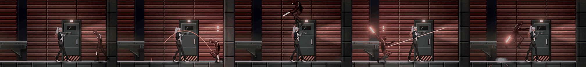

# [NE-424] 讓切割者繞到玩家背後出手

> 狀態：完成

## 內文

### 需求
盤點（NE-417）發現章節裡的近戰敵人都是同一種節奏：預兆 → 往前衝 → 長收招，切割者和收帳人·打手用的是同一套行為，只差數字；整個專案也沒有會繞到玩家背後的敵人。讓切割者變成「繞後者」：玩家正面看著牠時不正面衝，而是保持距離對峙，等時機從玩家頭上翻到背後再出手；玩家背對牠時直接從背後貼近。對付方法一句話講得清楚，而且不是「打更多子彈」：背靠牆站，牠就繞不到後面；看到牠蹲下要翻就轉身，閃開或格擋落地後那一斬。不做新美術，用切割者現有的外觀。

### 來源
2026-11-28，使用者指示：「關卡的玩法跟內容可以更多變一點，不要只有枯燥的射擊。」後續清單見[畫面與玩法的後續待辦](../../design/22-living-scenes/BACKLOG.md)「敵人與頭目」第 1 項；缺少的角色與排序見[敵人與頭目盤點](../../design/22-living-scenes/ENEMY_ROSTER.md)。

### 驗收條件
- [x] 玩家正面看著切割者時，牠不正面撲斬，而是在一段距離外對峙並跟著玩家移動
- [x] 對峙一段時間後，牠蹲下預告（地上畫出從腳下到玩家背後的弧線與落點），再從玩家頭上翻過去，落在背後；翻越途中撞到玩家不算傷害
- [x] 落地後從背後蓄力撲斬，從背後出手的預兆比正面長
- [x] 玩家背對牠時，牠直接從背後貼近出手；要整個人進到畫面裡才開始蓄力，不從畫面外偷砍
- [x] 玩家背後沒有落腳處時翻不過去，只能從正面出手：背靠牆、背後是懸崖、背後是通電的積水、頭頂有走道或太低
- [x] 圖鑑卡片的攻略寫出新的對付方法
- [x] 有自動測試；把切割者換回舊行為時，對峙、翻越、從背後出手與正面退路的檢查會失敗
- [x] 附第四章中繼站的連續實機畫面（對峙、預告、翻越、背後蓄力、撲斬）；受影響範圍的測試沒有新的失敗

### 測試流程
1. 進第四章中繼站，找到切割者，面向牠站著
2. 預期牠在一段距離外停住，過一下蹲下、地上出現一條弧線，然後從頭上翻到背後，落地蓄力撲斬
3. 轉身面對牠，閃開或格擋那一斬
4. 背靠牆再試一次，預期牠翻不過去，只能從正面撲斬

---

# 跟其他票的關係

- Blocks：無
- Blocked by：無
- Related：NE-417、NE-408、NE-415

---

# Commit-1

## 內文

切割者原本和收帳人·打手是同一套行為：看到玩家就蹲下、往前撲斬、落地硬直。章節裡沒有任何敵人會跑到玩家背後。
現在切割者發現玩家後先看玩家面向哪邊。玩家看著牠時，牠在 76～120 像素外對峙，跟著玩家前後移動；對峙約 1.4 秒（再乘難度的冷卻倍率）後，蹲下 0.4 秒預告，地上出現一條從腳下長到玩家背後的紅色弧線與落點刻痕，接著從玩家頭上翻過去（最高點離地約 50 像素、翻越時縮成一團、不帶撞擊傷害），落在玩家背後 44 像素處，立刻蓄力撲斬。從背後出手的蓄力比正面多 0.2 秒。玩家背對牠時，牠直接快步貼近，但要整個人在畫面裡（離畫面邊緣至少 40 像素）才開始蓄力：鏡頭往瞄準方向看，玩家背後只有約 50 像素的畫面，第一次實機截圖時就抓到牠從畫面邊緣出手，因此加上這條。
翻越前先檢查落點：玩家和落點之間有牆、落點沒有地面、落點在通電的積水裡、或翻越路線上方的空間不夠（含單向走道；走道的鋼樑畫在碰撞下方，所以用外觀身高計算），就不翻，改從正面出手。實機截圖時也抓到兩件事並修好：翻越時是站姿飄在空中，補了縮腿的翻越姿勢；在走道下方翻越會擦到鋼樑，改成走道下方不翻。
圖鑑卡片「一刀兩斷」的說明與攻略改成新的對付方法（三種語言）。對峙中的切割者算「已經發現玩家」：戰鬥配樂會切換，「不被發現」的區域挑戰也會判定失敗（原本名叫「潛行」的狀態一律被當成放鬆，第一次跑測試前就抓到並修正）。存檔或死亡重來時切割者照原本的方式重新生成，對峙與翻越都是當下的狀態，不需要保存。

### 測試結果

| 項目 | 結果 |
|---|---|
| 受影響範圍的測試 | 通過 72485 / 72485（74 組：挑選工具選出的套件，加上會生成所有敵人的攻擊令牌、突擊、偵察、異形敵人套件），0 個新失敗 |
| 流程探針 | 挑選工具選出 24 個，23 個通過；手把存檔探針兩次都在進遊戲前停在自己的設定檔路徑檢查（「需要隔離的執行設定檔」），沒有載入任何遊戲內容，和這張票無關 |
| 自動檢查 | 正面看著時不撲斬；對峙中算已經發現玩家；對峙後翻越；翻越中不傷人；翻越高度越過主角的頭；落在背後並從背後出手；背後出手的預兆較長、開始時在畫面裡；背靠牆、背後是積水、頭頂有走道時不翻，背靠牆時改從正面出手；舊有的蓄力、撲斬、收招、暈眩中斷照常 |
| 負控制 | 把切割者換回舊行為後跑同一套測試：6 項失敗（背後預兆、不正面衝、翻越、翻越高度、從背後出手、正面退路） |
| 原生情境（第四章中繼站東端） | 對峙 63 像素、預告弧線、翻越最高 53 像素、在主角背後 49 像素蓄力、撲斬；放大看過翻越與蓄力的關節，沒有破圖 |

### 截圖

由左到右：對峙、蹲下預告（地上弧線與落點）、翻過主角頭頂、落在背後蓄力、撲斬。第四章中繼站東端，原生 Forward+；為了畫面只留這名切割者，其他敵人先停下並隱藏，旁邊電纜的操作提示也先關掉。

