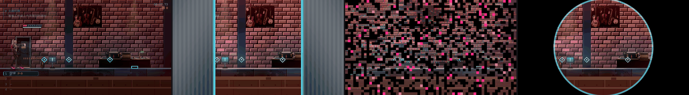
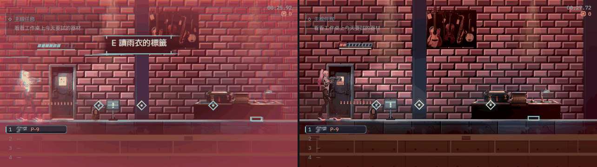
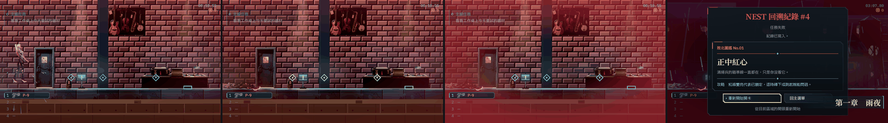
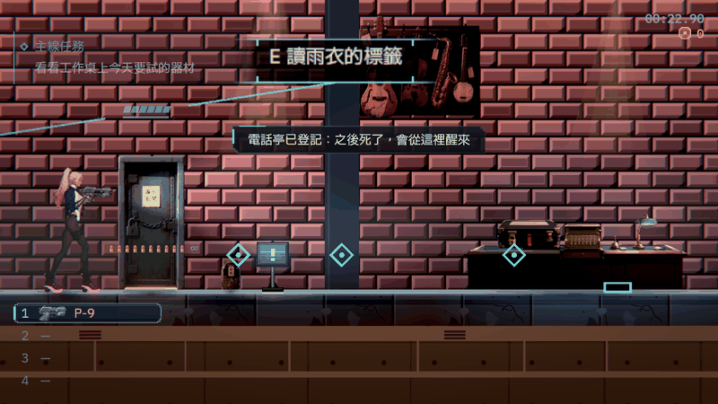
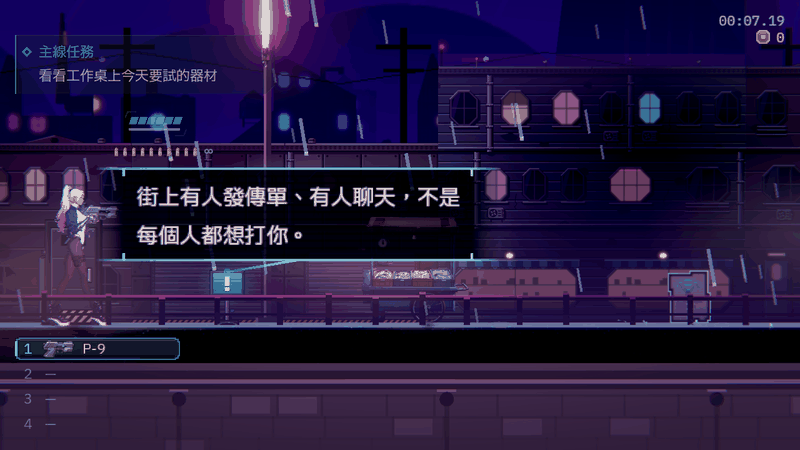
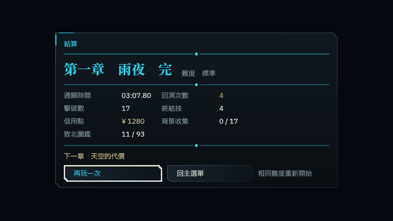
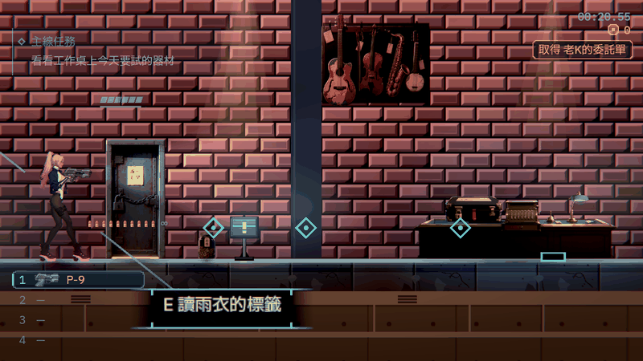
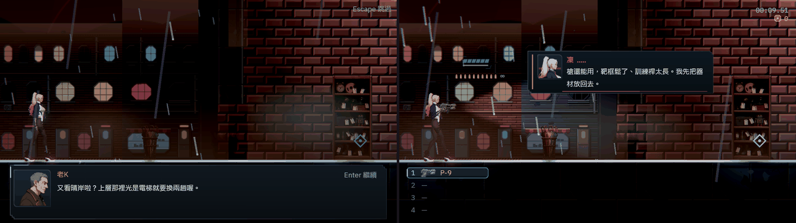
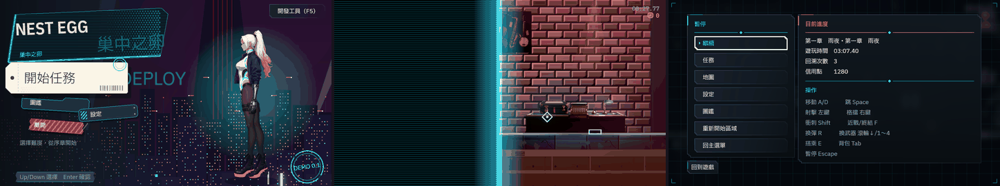

# [NE-425] 盤點玩家看到的每個演出時刻

> 狀態：完成

## 內文

### 需求

使用者在意整個遊戲的美術與演出手法，不要有濫竽充數的東西，要求完整看一輪。要把玩家從開新遊戲到第一章結束會看到的每一個時刻與畫面拍一輪（之後擴到其餘章節），逐項評等並寫出處理方式，作為演出線後續逐項處理的依據；不屬於演出線的項目標上負責的線。

時刻包含：開場與標誌、主選單進遊戲、序章、章節與地點、轉場與讀取、教學提示、拾取與任務更新、對話與氣泡、通訊、檢查點、受傷與瀕死、死亡與重來、頭目登場與擊敗、結算、過場的鏡頭與走位、商店與改裝的進出場、存讀檔。

### 來源

2026-11-28 使用者：「最好是都幫我完整看一輪，有什麼值得精進的就幫我處理。可以多參考其他遊戲的作法。」（`design/22-living-scenes/BACKLOG.md` 演出第 1 項）

### 驗收條件

- [x] `design/22-living-scenes/PRESENTATION_AUDIT.md` 列出上面每一個時刻：截圖、現況一句話、評等（好／可用／簡陋／濫竽充數）、同類遊戲怎麼做、要怎麼處理、歸哪一條線
- [x] 表格依「最簡陋且最常被看到」排序
- [x] 每一項的截圖是第一章真實資料的實機畫面（拍不到的項目寫明原因與補拍計畫）
- [x] 不屬於演出線的項目只列出並標上負責的線，不在這張票修改
- [x] 屬於演出線的項目在 BACKLOG.md 演出表排出處理順序

### 測試流程

1. 打開 `PRESENTATION_AUDIT.md`，表格最上面是最簡陋又最常看到的時刻
2. 每一列的截圖連結打得開，看得出文件描述的問題
3. 用 `--scenario=presentation_audit`、`--scenario=presentation`、`--scenario=screens` 重拍，得到同樣的畫面

---

# 跟其他票的關係

- Blocks：無
- Blocked by：無
- Related：NE-421、NE-422

---

# Commit-1

## 內文

演出線開工時沒有一份「玩家會看到哪些時刻、各自做到什麼程度」的清單，無從判斷哪裡濫竽充數。

現在 `design/22-living-scenes/PRESENTATION_AUDIT.md` 列出 21 個時刻，每一項有實機截圖、現況、評等、同類遊戲的做法、處理方式與負責的線，依「最簡陋且最常被看到」排序。第一版的結論：

- 最需要處理的是每次換區域、每次被打、每次死亡都會看到的東西：五種互不相干的轉場、整片染紅的受傷效果、三段各說各的死亡流程、中央方框的檢查點通知。
- 啟動時是引擎預設的開機圖（濫竽充數）。
- 地點標示、章末畫面、存檔的章節名已經是「好」。
- 第一章沒有頭目；頭目、氣泡、商店進出場與過場走位寫明補拍計畫，下一版補上。

演出線的處理順序已寫進 BACKLOG.md 演出表第 4 項；教學看板、對話框、通訊、暫停與死亡畫面的版面標給畫面線，序章的文字標給故事線。

### 測試結果

| 項目 | 結果 |
|---|---|
| 截圖情境（presentation_audit、presentation、screens） | 執行完成，無 SCRIPT ERROR |
| 程式變更 | 只有新增截圖情境，遊戲程式沒有改動 |

### 截圖

轉場：淡出、電梯門、雜訊、光圈。

受傷與瀕死。

死亡：倒地、變紅、死亡畫面。

檢查點登記的中央橫幅。

港區街道入口的教學看板。

序章開場。

結算、拾取、對話與通訊、主選單與暫停。

