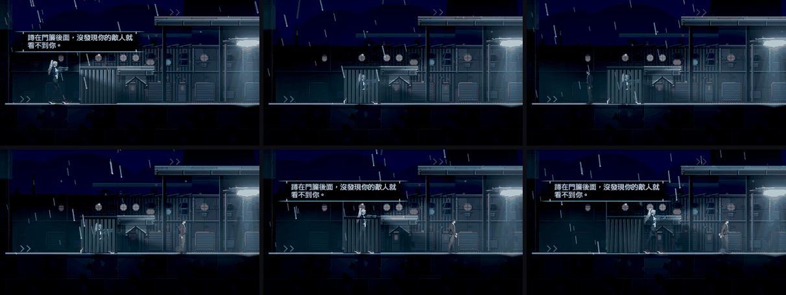

# [NE-426] 加入可以躲起來的門簾凹室

> 狀態：完成

## 內文

### 需求
潛行目前只有兩種手段：射暗燈縮短敵人的視野、用誘餌收音機把敵人引開，兩種都要開槍。這張票加入第一種「完全不開槍」的手段：牆邊掛著塑膠條門簾的凹室，玩家蹲在簾子後面時，還沒發現玩家的敵人看不到他，巡邏的敵人從面前走過去也一樣；等敵人走遠再出來，就能不被發現地通過。已經在戰鬥或被警報引來的敵人照常看得到，所以這是「先觀察、找時機」的手段，不是打架時的保命符。

要和「不被發現」的區域挑戰（NE-411）接得上：躲在簾子後面不會讓敵人進入戰鬥，挑戰不會失敗。

### 來源
2026-11-28，使用者指示「關卡的玩法跟內容可以更多變一點，不要只有枯燥的射擊」；主 session 指派玩法線的第二項「潛行的延伸：除了射暗燈與誘餌，再給一種不開槍通過的手段，要和 NE-411 接得上」。手法參考同類橫向潛行遊戲的「躲藏點」（只取手法）。

### 驗收條件
- [x] 凹室有門框與往裡變暗的凹洞，條簾畫在角色前面；人走過時條簾會晃，蹲在裡面時簾子變密，看得出「藏好了」；不是方塊
- [x] 蹲在簾子後面時，還沒進入戰鬥的敵人看不到玩家，巡邏的敵人從面前走過去不會發現
- [x] 站起來、蹲在簾子外面，或敵人已經在戰鬥（被打到、被警報引來）時，照常看得到
- [x] 玩家靠近時有一句提示（中、日、英），講清楚要蹲下、只對還沒發現你的敵人有效
- [x] 「減少介面動態」時條簾不晃，躲藏照樣有效
- [x] 沒有狀態要存；從檢查點重來（關卡重建）後只有地圖上那幾處，不會留下舊的
- [x] 寬度、高度與提示寫在資料裡，新增一處只要在關卡地圖放一個字元；資料不合理時指出是哪一項與哪一格
- [x] 第二章裝卸間（「不被發現」挑戰所在的區域）的入口段放了第一處，旁邊只有一名巡邏的敵人；蹲在裡面等他走過去，不開槍也能通過，挑戰照樣成立
- [x] 這一區巡邏的看守背後只看得到近處（正面照常），躲過之後可以跟在他後面走；其他敵人不受影響
- [x] 附原生畫面：起點的提示、蹲進去、敵人從面前走過、敵人走遠後出來；受影響範圍的測試全過，把「蹲著就藏住」關掉時測試會失敗

### 測試流程
1. 進第二章裝卸間，往右走到第一處門簾
2. 預期看到一句提示；按下蹲在簾子後面，簾子變密
3. 等巡邏的敵人走過來，預期他從面前走過去，沒有發現玩家，「不被發現」挑戰沒有失敗
4. 站起來被敵人看到，預期敵人照常進入戰鬥

---

# 跟其他票的關係

- Blocks：無
- Blocked by：無
- Related：NE-399、NE-404、NE-411

---

# Commit-1

## 內文

潛行原本只有射暗燈與誘餌收音機兩種手段，兩種都要先開槍；巡邏的敵人前後看得一樣遠，平地上就算躲過也沒辦法從他後面過去。
現在牆邊有掛著塑膠條門簾的凹室（3 格寬、3 格高，門框、往裡變暗的凹洞，條簾畫在角色前面、人穿過時會晃）。蹲在簾子後面就藏住了：簾子變密、凹室蒙上一層陰影；還沒進入戰鬥的敵人看不到你，從面前走過去也一樣，也不會撞傷你。站起來、蹲在簾子外面，或敵人已經在戰鬥時照常看得到。第二章裝卸間的看守（發傳單的人、護衛）另外改成背後只看得到平常的 35%，躲過之後可以等他轉身走遠、跟在後面走；其他敵人前後看得一樣遠，沒有改變。「減少介面動態」時條簾不晃。沒有狀態要存。
第一處放在第二章裝卸間的入口段（地圖字元 `⦀`，起點右邊 3 格）。原生情境：主角蹲進簾子，發傳單的人從面前走過去、走到牆邊轉身、又從面前經過，兩次都沒發現；等他背對著走遠，主角站起來跟在後面，「不被發現」挑戰沒有失敗。

### 測試結果

| 項目 | 結果 |
|---|---|
| 新行為的自動檢查 | 站著藏不住、蹲下藏住；巡邏的敵人看不到並從面前走過、不撞傷人；站起來與蹲在簾子外面看得到；已在戰鬥的敵人看得到；看守背後只看得到近處、一般敵人前後一樣；減少介面動態不晃、平常會晃；離開關卡清掉登記、從檢查點重建只有一處 |
| 把「蹲著就藏住」關掉 | 4 項檢查失敗（確認測試抓得到） |
| 受影響範圍的測試（77 個套件，3 個程序） | 106613 項中 31 項失敗，全部是任務地圖套件的「地圖索引與資料不符」（凹室改寬後沒重建索引）；重建後 QuestMapSuite 840 / 840 通過。先前一輪把背後視野做成全域時第三章巡檢器的預兆檢查失敗，改成敵人資料欄位後該套件與另外 9 個最相關的套件單獨重跑 32535 / 32535 通過 |
| 受影響的流程探針 | 23 / 24 通過；`run_controller_storage` 在 Windows 本機跑不了（要求 Linux 的獨立使用者資料夾，和改動無關，已排進測試與工具債） |
| 腳本錯誤 | 0 |

### 截圖

第二章裝卸間入口段，原生 Forward+。上排：走近時的提示 → 蹲進簾子 → 發傳單的人從面前走過；下排：他轉身回來又經過 → 背對著走遠後站起來 → 跟在後面。

