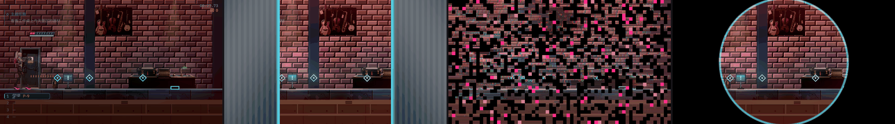
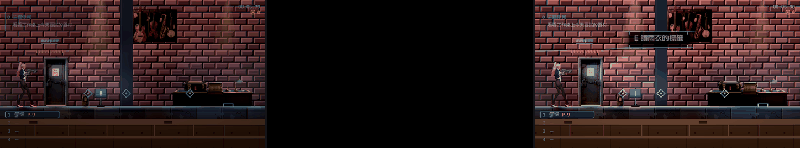
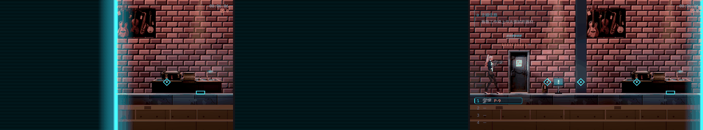
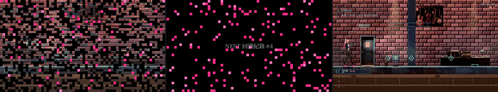

# [NE-427] 統一遊戲流程的轉場

> 狀態：完成

## 內文

### 需求

演出總檢（NE-425）第 1 項：遊戲流程用了五種互不相干的轉場——區域之間淡出、主選單進遊戲是青色掃描線、換章是兩片素面灰色電梯門、暫停選單重來與讀取是圓形光圈、到結算是百葉窗——沒有一致的語言，玩家每次換地方看到的都不一樣。

改成同一件事永遠是同一種轉場：

- 在世界裡換地方（區域之間、讀取、重來、換章、到結算）：很短的黑色淡出，單程不超過 0.3 秒。
- 選單與系統畫面之間（主選單、開始、繼續）：青色掃描線。
- 死亡重來：維持回溯轉場（下一張「死亡與重來」票重做）。
- 電梯門、光圈、百葉窗不再出現在遊戲流程；只留給過場資料裡有意義的時刻（例如真的在搭電梯）。
- 轉場蓋住時的一行字使用畫面標題的字體。

### 來源

- 2026-11-28 使用者：不要有濫竽充數的東西，參考其他遊戲的做法。
- `design/22-living-scenes/PRESENTATION_AUDIT.md` 第 1 項（NE-425）。

### 驗收條件

- [x] 遊戲流程只用三種用途的轉場（世界、系統、回溯），程式裡不直接指定轉場種類；有自動檢查
- [x] 區域之間、讀取、從暫停選單重來、換章、到結算都是黑色淡出，單程不超過 0.3 秒
- [x] 主選單、開始、繼續是掃描線
- [x] 電梯門、光圈、百葉窗不出現在遊戲流程中
- [x] 轉場上的一行字用畫面標題的字體
- [x] 「減少閃光」時回溯轉場仍降級為淡出
- [x] 受影響的測試與流程探針 0 個新失敗；票上附修前與修後的轉場截圖（開始、蓋住、揭開）

### 測試流程

1. 從當舖走到港區街道：短暫黑色淡出後就到，沒有掃描線或光圈
2. 打開暫停選單，選「重新開始區域」：黑色淡出
3. 打完第一章：章末畫面後淡入結算，沒有百葉窗；接到下一章時是淡入，沒有電梯門
4. 回主選單、按繼續遊戲：掃描線

---

# 跟其他票的關係

- Blocks：無
- Blocked by：無
- Related：NE-425

---

# Commit-1

## 內文

遊戲流程用了五種互不相干的轉場：區域之間淡出、主選單進遊戲掃描線、換章素面灰色電梯門、重來與讀取圓形光圈、到結算百葉窗。

參考：Hollow Knight 房間之間一律很短的黑色淡出，玩家幾乎不會注意到；Celeste 一章固定一種擦除。取「一種主要轉場，特殊的只用在有意義的地方」。

現在遊戲流程只用三種用途：在世界裡換地方（區域之間、讀取、從暫停選單重來、換章、到結算）是單程 0.3 秒的黑色淡出；選單與系統畫面之間（主選單、開始、繼續）是掃描線；死亡重來維持回溯轉場（下一張「死亡與重來」票重做）。電梯門、光圈、百葉窗不再出現在遊戲流程，只留給過場資料裡真的在搭電梯的兩段。轉場蓋住時的一行字改用畫面標題的字體。自動測試確認遊戲流程不直接指定轉場種類。

另外修正演出總檢的第 2、6 項：瀕死其實有邊緣暗紅脈動（在紅色調場景裡幾乎看不出來），受傷是約兩成落在中央的紅色閃光。

### 測試結果

| 項目 | 結果 |
|---|---|
| 轉場、介面畫面、存檔 | 2051 項檢查，0 個新失敗 |
| 死亡流程、連續性、第二章故事、章節過場、主流程 | 3386 項檢查，0 個新失敗 |
| 流程探針：序章完成、跳過、交接（含換章） | 全部通過 |
| 減少閃光時回溯降級為淡出 | 既有測試通過 |

### 截圖

修前：遊戲流程用到的淡出、電梯門、雜訊、光圈。

修後：在世界裡換地方（開始、蓋住、揭開）。

修後：選單與系統畫面（掃描線）。

修後：死亡重來（不變，下一張票重做；回溯編號改用標題字體）。

