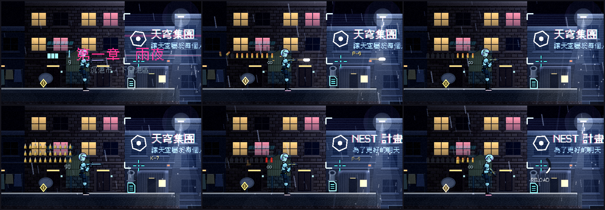

# [NE-42] 加入主角旁的動態彈匣介面

> 狀態：完成

## 內文

### 需求
彈藥目前是準星旁的弧線與數字。改成主角身旁一排排子彈圖示，隨射擊、換彈、彈量變化即時反應，閒置時淡出。

### 來源
2026-10-03，使用者於開發對話中提出：「子彈可以的話就用高解析度的Icon來代替，然後用dynamic ui放在主角旁邊」；「這些都可以去看看目前業界有哪一些最佳實例可以參考，我們盡可能設計的貼近完整實際的 Demo」。設計見 `design/10-presentation/DESIGN.md`、`design/04-story/`。

### 驗收條件
- [x] 主角身旁（與準星相反的一側）顯示彈匣：每排最多 10 發，滿匣是彩色圖示，用掉的是輪廓
- [x] 開槍時最上面一發的彈殼彈出並淡出；換彈時依序填回去，節奏與換彈時間一致
- [x] 彈量不到四分之一時圖示變紅並脈動；空匣整排變輪廓並出現換彈按鍵提示
- [x] 換武器時整排圖示換成新的彈種；能量武器顯示電池格
- [x] 超過 30 發的彈匣用一顆代表多發並標示倍率；備彈以小數字顯示，無限備彈顯示符號
- [x] 閒置一段時間後淡出，射擊、換彈、彈量變化、換武器、低彈量時彈出或常駐
- [x] 不遮擋瞄準，跟隨主角平滑移動不抖動
- [x] 準星保留換彈進度弧；不造成每影格的配置

### 測試流程
1. 連射一整匣，確認每發的動畫與低彈量
2. 換彈，確認依序填回
3. 換成每一種武器，確認彈種與排列
4. 執行完整測試套件，全部通過

---

# 跟其他票的關係

- Blocks：無
- Blocked by：NE-41
- Related：NE-43

---

# Commit-1

## 內文

原本彈藥只用準星旁的弧線與數字表示。
現在主角身旁（與準星相反的一側，不擋瞄準）有一排排子彈圖示：每排最多 10 發，滿的是彩色圖示、用掉的是空槽輪廓；開槍時最上面一發的彈殼彈出、旋轉並淡出；換彈時圖示依換彈進度一顆顆填回去並逐顆響一聲；不到四分之一時圖示變紅並脈動、常駐不淡出；換武器時整排翻轉成新的彈種；超過 30 發的彈匣一顆圖示代表多發並標示倍率；能量武器改用電池格；備彈用小數字顯示（無限備彈顯示符號）；閒置會淡出，射擊、換彈、換武器、低彈量時彈出。位置平滑跟隨主角，彈殼用固定大小的環形緩衝，不每影格配置。準星保留換彈進度弧與提示。
驗收：新增動態彈匣測試套件（排列與壓縮、位置在準星相反側、閒置淡出、開槍彈殼、低彈量常駐、換彈依序填回、能量武器），並用不同武器與狀態截圖。

### 測試結果

| 項目 | 結果 |
|---|---|
| 完整測試套件 | 通過 2482 / 2482 |
| 資料驗證 | 0 錯誤 |
| 執行 log | 無 ERROR |

### 截圖

