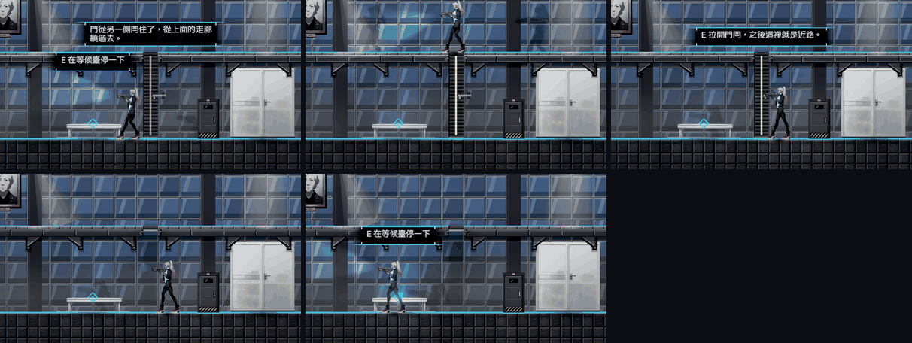
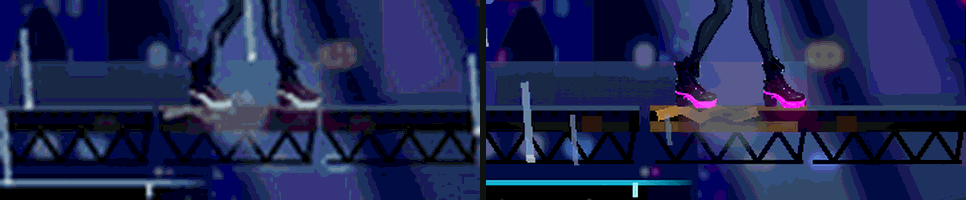
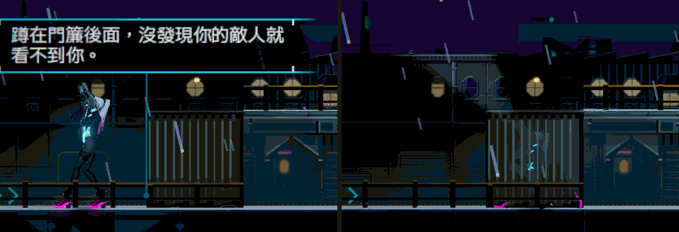

# [NE-430] 加入從另一側才拉得開的門閂捷徑

> 狀態：完成

## 內文

### 需求
現有的機關幾乎都要有敵人才有作用，地圖線在沒有敵人的安靜區（第三章後半、第四到六章）沒有東西可以擺。這張票先做第一種不靠敵人的互動元件：從另一側才拉得開的門閂門。站在門閂那一側按互動鍵就拉開，門從此一直開著，變成回頭的捷徑；站在另一側只看到一句「門從另一側閂住了」。沿用現有的閘門與開關，不另做一套門。

同一張票順便處理 NE-420 與 NE-426 的小修：會塌的走道預警時的裂痕與抖動加強到遊戲倍率一眼看得出「這片要掉了」，並加一聲短的金屬聲；門簾凹室的簾子改得像半透明的塑膠條門簾，蹲在裡面時主角身上的霓虹與自己的光壓暗。

### 來源
2026-11-28，主 session 轉達地圖線需求：「地圖線需要不靠敵人的機關，才能在對話區之間放移動或解謎」，第一項是「要操作才會開的門與捷徑：開關、拉桿、從另一側才能開的門閂（開了之後變成回頭的捷徑，狀態存檔）；專案已有開關與門的話先看能不能擴充，不要重做」。NE-420、NE-426 的小修來自主 session 的驗收意見。

### 驗收條件
- [x] 門閂門是資料驅動的：在閘門資料上指定門閂在哪一側與兩側的提示文字（中、日、英），新增一扇只要在地圖放一個字元；資料不合理時指出是哪一項
- [x] 站在門閂那一側靠近時出現「按互動鍵拉開門閂」的提示，按下後門打開並一直開著；站在另一側只出現「門從另一側閂住了」，按互動鍵沒有作用
- [x] 門閂那一側看得到門閂（不是方塊），打開後門閂收起；開門有聲音
- [x] 打開的狀態跟著檢查點、區域存檔與讀檔；重來或重新進區域後仍然是開的
- [x] 第三章天穹辦公接待廊（沒有敵人）示範一扇：地面被一扇從右側閂住的門擋住，左邊新增踏板可以上到原本的上層走廊，從上面繞過去、在右側拉開門閂，地面就成了回頭的捷徑；原本的人物、調查點、出入口與上層的信用點不變，主線走得過去
- [x] 會塌的走道預警時，裂痕更粗更亮、抖動更明顯（「減少介面動態」時不抖），並有一聲短的金屬聲；在遊戲倍率的截圖上一眼看得出哪一片要掉
- [x] 門簾凹室的簾子是一條條互相重疊、看得穿的塑膠條（有反光、髒的下襬與夾扣），蹲在裡面藏住時主角身上的霓虹與自己的光壓暗，站起來恢復
- [x] 附原生畫面（另一側的提示、繞上走廊、拉開門閂、門開著的回頭路；走道預警的放大對照）；受影響範圍的測試全過，把門閂關掉時測試會失敗

### 測試流程
1. 進第三章天穹辦公接待廊，往右走到門前，預期看到「門從另一側閂住了」，按互動鍵沒有反應
2. 從左邊的踏板上到上層走廊，往右走過門的上方，從右側下來
3. 在門的右側按互動鍵，預期門閂收起、門打開
4. 存檔重開或離開再回來，預期門還開著
5. 進第一章屋頂踩上會塌的走道，預期腳下那一片明顯抖動、裂開並有一聲金屬聲

---

# 跟其他票的關係

- Blocks：無
- Blocked by：無
- Related：NE-420、NE-426、NE-473

---

# Commit-1

## 內文

現有的機關都要有敵人才有作用，沒有敵人的安靜區沒有東西可擺；門只能用同色的開關打開，沒有「繞一圈回來打開捷徑」的門。
現在閘門可以設成門閂門：資料上指定門閂在左側或右側與兩側各一句提示。站在門閂那一側靠近，提示「拉開門閂，之後這裡就是近路」，按互動鍵門閂收起、門升上去，之後一直開著；站在另一側只顯示「門從另一側閂住了，從上面的走廊繞過去」，按互動鍵沒有作用。打開的狀態和一般閘門一樣跟著檢查點與區域存檔。
第一扇放在第三章天穹辦公接待廊（地圖字元 `⊓`，第 32 欄，6 格高頂到上層走廊）：左邊新增三格踏板（第 11～13 欄第 17 列）上到原本的上層走廊，從門的上方走過去、在右側拉開門閂，地面成了回頭的捷徑。原本的人物、調查點、出入口與走廊上的信用點都不變。
同時：會塌的走道預警時那一片走道面轉成鏽橘、裂痕加粗加亮、側樑泛琥珀光、抖動加大（減少介面動態時不抖），並有一聲短而高的金屬聲；門簾凹室的簾子改成互相重疊、看得穿的塑膠條（左緣反光、髒的下襬、夾在橫桿上的夾扣），蹲在裡面藏住時主角身上的霓虹與自己的光壓暗，站起來恢復。

### 測試結果

| 項目 | 結果 |
|---|---|
| 受影響範圍的測試（3 個程序） | 97690 項，0 個新失敗 |
| 新行為的自動檢查 | 另一側只有提示、按互動鍵沒作用；門閂那一側提示並拉得開；拉開後一直開著、在檢查點快照裡、重生後仍開著並能直接走過；非閘門設門閂與缺提示會報錯；藏住時主角變暗、站起來恢復 |
| 把門閂的互動關掉 | 5 項檢查失敗（確認測試抓得到） |
| 受影響的流程探針 | 22 / 23 通過；`run_controller_storage` 是已知的 Windows 環境問題（排在測試與工具債） |
| 原生情境 | 門閂：拉開後 open=true、走回左邊成功；會塌的走道：一路跑過去不掉、站著不動落下 96 像素；門簾凹室：守衛兩次經過都沒發現 |

### 截圖

第三章天穹辦公接待廊，原生 Forward+。上排：另一側的提示 → 從上層走廊走過門的上方 → 門閂那一側的提示；下排：拉開後門升上去 → 從右邊走回左邊。

會塌的走道預警（左：修改前，右：修改後）：那一片轉成鏽橘、裂痕與側樑泛琥珀光。

門簾凹室（左：走近時，右：蹲在裡面藏住，主角壓暗）。

