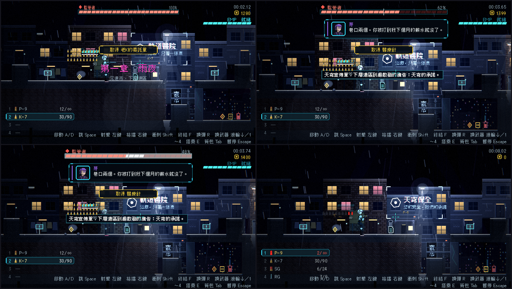

# [NE-43] 改版戰鬥介面

> 狀態：完成

## 內文

### 需求
生命、頭目血條、武器欄、信用點、義體電量與提示橫幅仍是舊風格。需要依新的視覺語言重做，並維持動態介面的淡出規則。

### 來源
2026-10-03，使用者於開發對話中提出：「也設計一個好看合適的UI，現在的設計都太簡略了」；「這些都可以去看看目前業界有哪一些最佳實例可以參考，我們盡可能設計的貼近完整實際的 Demo」。設計見 `design/10-presentation/DESIGN.md`、`design/04-story/`。

### 驗收條件
- [x] 生命與護盾改成分段的切角條，受傷時掉落的段落有殘影，低血量常駐並脈動
- [x] 頭目血條有名牌與階段刻度，登場時從兩側展開，階段轉換時閃一下
- [x] 武器欄顯示武器與彈種圖示，手上武器高亮
- [x] 信用點與義體電量套用新元件；取得、檢查點、警告使用橫幅
- [x] 通訊對話框改版：側邊滑入的頭像框、打字機效果、講者名字帶顏色條
- [x] 所有元素維持原有的淡出與常駐規則；每個元素有一句說明（滑鼠移上去）

### 測試流程
1. 進入戰鬥，確認每個元素的外觀與行為
2. 受傷到低血量，確認常駐與脈動
3. 打頭目，確認血條與階段
4. 執行完整測試套件，全部通過

---

# 跟其他票的關係

- Blocks：無
- Blocked by：NE-35
- Related：NE-42

---

# Commit-1

## 內文

原本生命、頭目血條、信用點、義體電量與提示都是舊風格。
現在頭目血條有名牌、百分比與分段血條，登場時從中間往兩側展開，跨過進入第二階段的刻度時閃一下，擊敗後收起；信用點是黃色晶片加數字，增加時數字往上跳動並閃白、花費時閃紅；義體電量改成分段電量條，就緒時發亮脈動，冷卻用一條細線表示；取得、警告與一般提示改成從上方滑入的橫幅（依文字分類顏色）；通訊對話框改成帶講者顏色條的切角面板、頭像框與打字機效果，從側邊滑入；武器欄顯示彈種圖示並高亮手上武器；生命與護盾沿用分段條、受傷殘影與低血量常駐脈動。所有元素維持原有的淡出與常駐規則，滑鼠移上去都有一句說明。
驗收：新增戰鬥介面測試套件（頭目血條展開與階段閃光與收起、信用點跳動與閃紅、橫幅分類與置中、每個元素有說明、通訊面板滑入），並讓測試可以用逗號一次指定多個套件。以頭目戰、受傷、低彈量、通訊等情境截圖。

### 測試結果

| 項目 | 結果 |
|---|---|
| 完整測試套件 | 通過 2508 / 2508 |
| 資料驗證 | 0 錯誤 |
| 執行 log | 無 ERROR |

### 截圖

