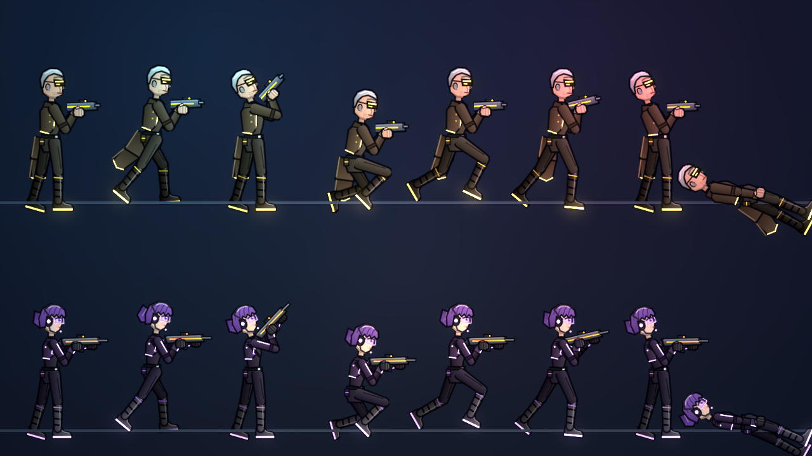
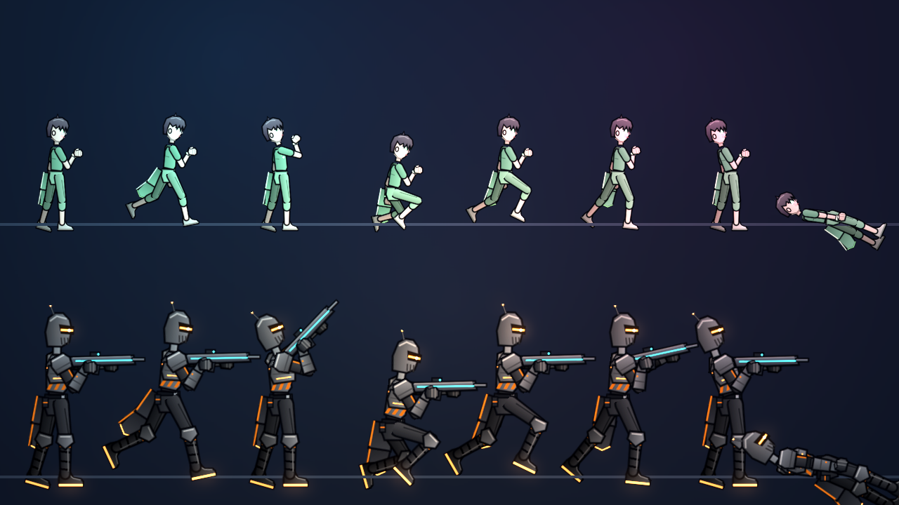
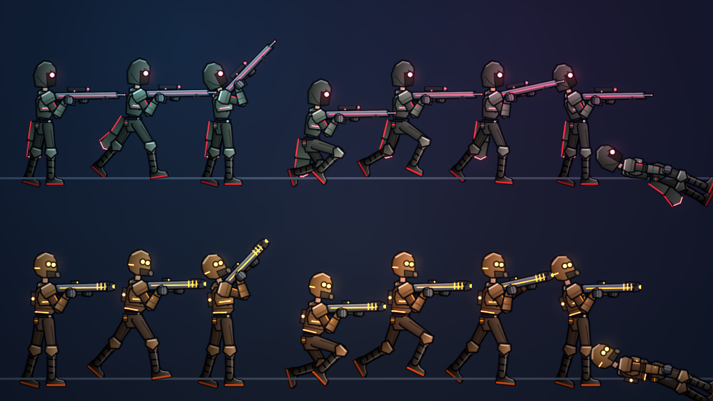
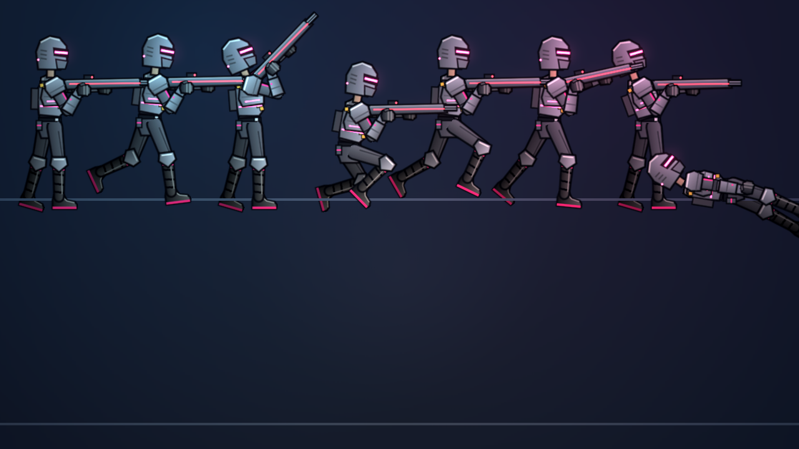
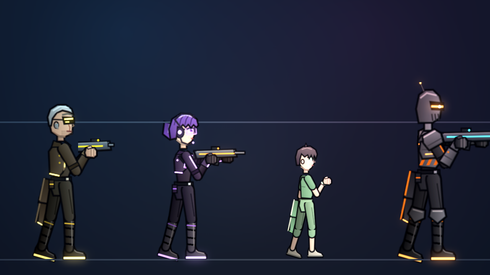
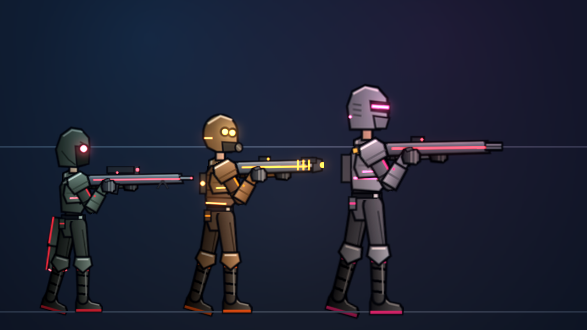
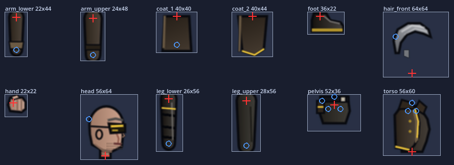
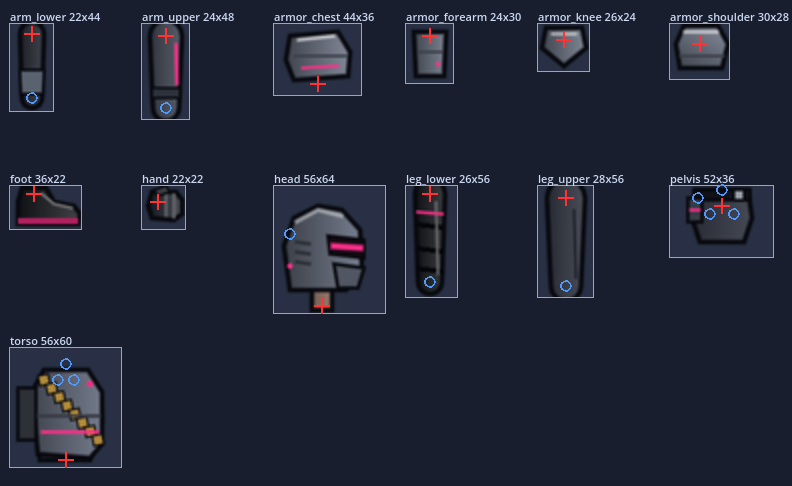
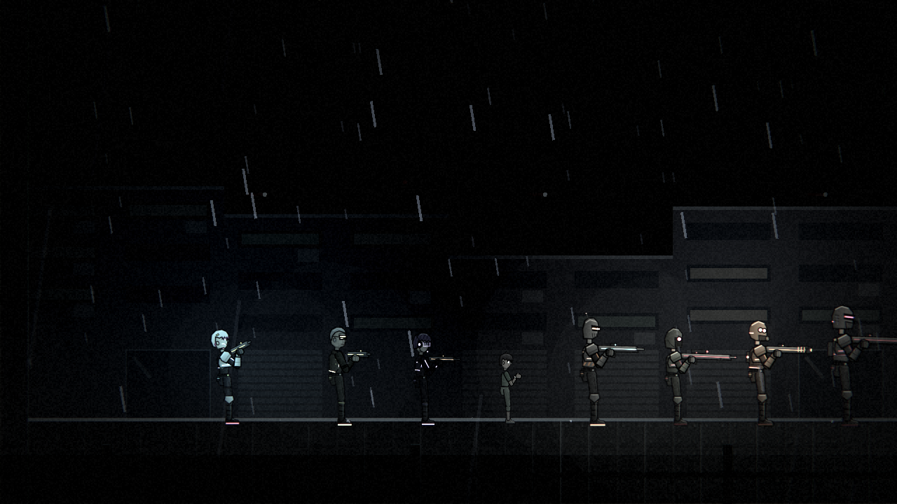
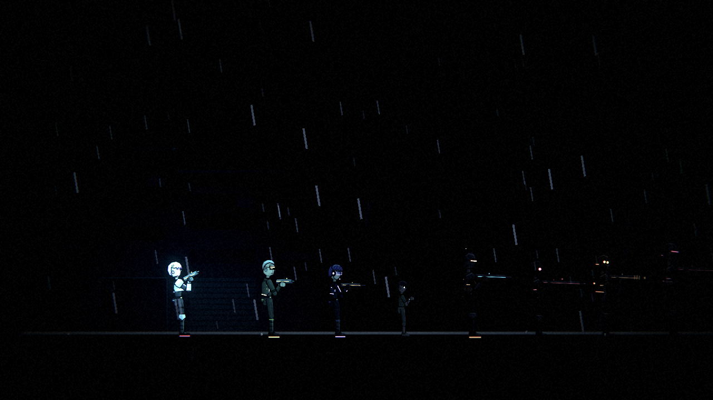

# [NE-44] 新增角色骨架外觀

> 狀態：完成

## 內文

### 需求
老 K、芽、航、回收員與新敵人需要和主角同品質的骨架外觀，才能在遊戲、對話與過場裡出現。

### 來源
2026-10-03，使用者於開發對話中提出：「幫我設計一些動畫跟轉場進去，還有過場動畫，就交給你設計了，發揮你的想像力」；「多設計幾種不同的敵人」；「這些都可以去看看目前業界有哪一些最佳實例可以參考，我們盡可能設計的貼近完整實際的 Demo」。設計見 `design/10-presentation/DESIGN.md`、`design/04-story/`。

### 驗收條件
- [x] 新增老 K、芽、航（比例較小）、回收員的骨架外觀，與各自頭像的髮色與服裝一致
- [x] 新增狙擊手、火焰兵、重裝機槍手的骨架外觀
- [x] 新外觀以與現有角色相同的規格繪製（4 倍解析度、法線、自發光層），動畫與裝甲脫落正常
- [x] 每個外觀有預覽，並有一份對位檢查通過

### 測試流程
1. 在預覽工具逐一檢視每個外觀的站、跑、跳、射擊、受傷
2. 放進遊戲確認光影與法線
3. 執行完整測試套件，全部通過

---

# 跟其他票的關係

- Blocks：NE-45、NE-46、NE-47、NE-52、NE-53
- Blocked by：無
- Related：NE-18

---

# Commit-1

## 內文

場景人物、劇情與新敵人都需要和主角同品質的角色外觀，但目前只有凜、保全、擲彈兵、鎮暴員與監管者五個外觀。
現在新增七個外觀：老 K（灰色油頭、黃色鏡片墨鏡、深棕長大衣）、芽（紫色鮑伯、耳機麥克風、半透明護目鏡）、航（只有主角七成多的身高，蓬鬆深色短髮、淡綠病號服、手腕的醫療手環會發淡綠光）、回收員（窄長頭盔、橘色單眼視窗、長風衣），以及狙擊手（披斗篷、一枚紅色鏡片）、火焰兵（圓形耐熱頭盔、橘色護目鏡）、重裝機槍手（方正重盔、洋紅視窗、巨大胸甲）。髮色與服裝以各自的頭像為準，測試會比對色相與亮度。三位平民沒有裝甲；回收員與三個敵人各有四件可破壞裝甲。另外新增狙擊槍與火焰噴射器兩種手持武器外觀。
所有外觀都是 4 倍解析度、附法線與自發光層，動作與受傷脫甲沿用同一套骨架。預覽工具可以逐角色檢視八種動作並放大看細節，另外可以輸出每個角色的對位檢查圖（支點、下一個關節、畫布邊界）。把七個外觀放進第二章轉運站光影與近乎全黑的停電光影，確認法線、輪廓光與補光都正常，暗處仍看得見。

### 測試結果

| 項目 | 結果 |
|---|---|
| 完整測試套件 | 通過 3003 / 3003 |
| 資料驗證 | 0 錯誤 |
| 執行 log | 無 ERROR |

### 截圖

