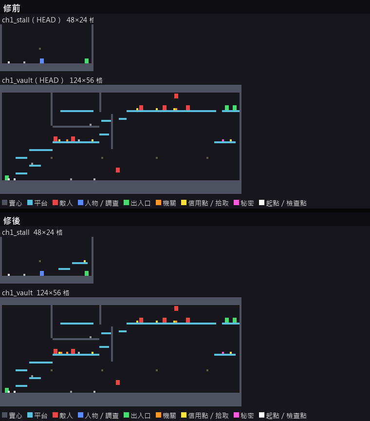
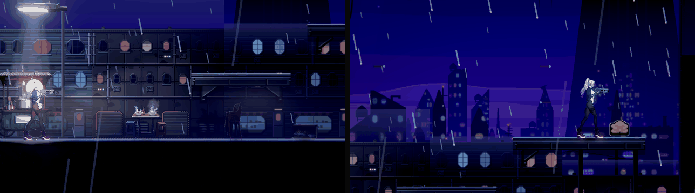
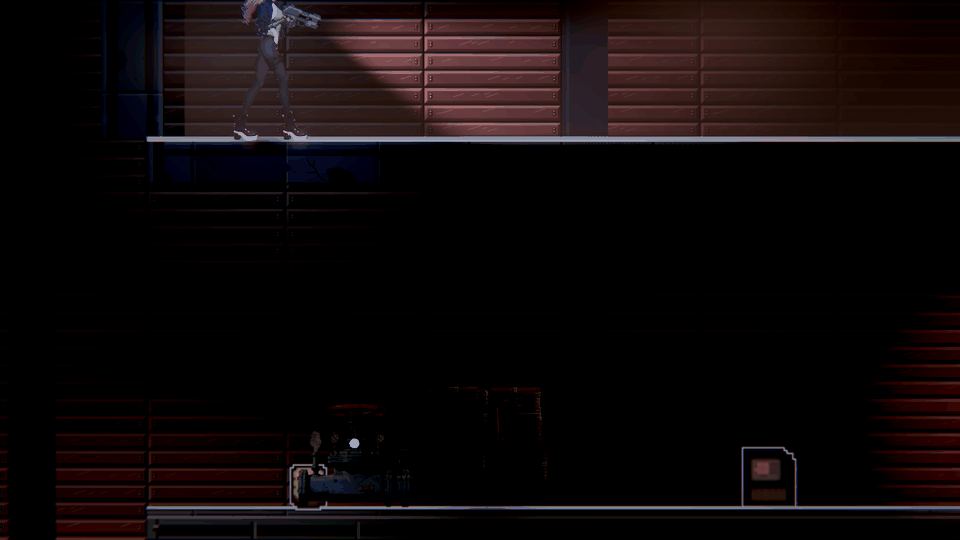

# [NE-450] 改第一章的章末動線與倉庫深處

> 狀態：完成

## 內文

### 需求
盤點（NE-416）裡第一章的問題：章末的復原館外交接櫃、復原館、宵夜麵攤連續三區都是平地對話；倉庫深處的戰鬥除了一面裂牆沒有任何機關，有敵人的畫面一半只有戰鬥。第一章有主光的五區（當舖、屋頂、街道、電話亭巷、倉庫）在畫面線改好光影系統之前不加高層，所以這張只動沒有主光的區域：讓章末同一種內容不連續超過兩區、倉庫深處的戰鬥多一個可以利用的機關，並讓第一章的地圖產生器重跑時能還原已經手擺的機關與遭遇翻譯。

### 來源
2026-11-28，使用者指示：「關卡的玩法跟內容可以更多變一點，不要只有枯燥的射擊。」見[畫面與玩法的後續待辦](../../design/22-living-scenes/BACKLOG.md)地圖第 2 項與[關卡多樣性盤點](../../design/22-living-scenes/LEVEL_VARIETY.md)的修改順序。

### 驗收條件
- [x] 重跑第一章產生器，除了玩法線還沒寫回的屋頂，沒有改到的區域沒有內容差異（只容許資源編號、鍵順序、清單換行）
- [x] 主線上同一種主要內容不連續超過兩個區域（盤點工具量）
- [x] 倉庫深處的戰鬥多一個機關，放在玩家用得到的位置
- [x] 新路線玩家實際走得上去、拿得到獎勵、走得回主線（實走工具）
- [x] 劇情觸發點、任務目標、地圖標記、檢查點與出入口位置不變（任務與地圖稽核）
- [x] 第一章流程探針、場景合理性與可達性檢查、導航索引、暗場可讀性通過
- [x] 附修前修後的整區俯覽圖與實機截圖；受影響範圍的測試 0 個新失敗

### 測試流程
1. 跑盤點工具，看第一章的主要內容順序
2. 跑第一章流程探針、任務與地圖稽核、場景報告、實走工具
3. 實機進宵夜麵攤，從凳子堆旁踩上雨棚，走到出口頂上的鐵皮棚拿到信用點再落回巷口
4. 實機進倉庫深處的保險箱平台，射蒸汽閥，看蒸汽牆擋在槍手與督察之間

---

# 跟其他票的關係

- Blocks：無
- Blocked by：無
- Related：NE-416、NE-398、NE-397、NE-420

---

# Commit-1

## 內文

第一章章末的復原館外交接櫃、復原館、宵夜麵攤連續三區都是平地對話；倉庫深處的戰鬥除了一面裂牆沒有任何機關。第一章的地圖產生器重跑會丟掉後來手擺的東西（屋頂會塌的走道、街道的蒸汽閥與兩位街坊、倉庫的吊掛貨箱、遭遇的日英文）。

宵夜麵攤：凳子堆旁多一段矮雨棚，再上出口頂上的鐵皮棚，盡頭是野貓藏東西的角落，有一包信用點（從地面看得到、要繞上去才拿得到），從棚子右端落回巷口。凳子堆留在地面上。章末的主要內容變成：對話 → 對話 → 移動。

倉庫深處：保險箱平台上、槍手與督察之間加一個蒸汽閥。射開後蒸汽牆擋住督察那一側的子彈，可以先專心處理槍手；這是蒸汽閥在港區街道之後第二次出現，第一章一區只引入一種新東西的原則不變。

產生器：屋頂會塌的走道、街道的蒸汽閥與街坊（觸發第 27 欄、人在第 29、32 欄）、倉庫的吊掛貨箱、遭遇與競技場閘門的日英文都寫回產生器，重跑整章只剩資源編號的差異。屋頂的信用點被搬到對面小平台時，存檔用的舊格位對照沒有跟著改（產生器自己的測試會抓到）；現在舊格位對照指到新位置，撿過的記錄才對得上。

有主光的五區照約定不加高層。港區街道、碼頭倉庫、倉庫深處三個戰鬥區連在一起、用同一套敵人，留給敵人線整理種類之後再處理，寫在關卡多樣性盤點裡。

### 測試結果

| 項目 | 結果 |
|---|---|
| 受影響範圍的測試（57 個套件） | 64146 / 64146 通過，0 個新失敗；rebase 後再跑任務地圖、第一章地圖、場景合理性 3728 / 3728 |
| 第一章流程探針（留下、離開兩條路線） | 都是 0 失敗 |
| 新路線實走 | 宵夜麵攤的雨棚路線走得上去、撿到信用點、落回巷口 |
| 任務與地圖稽核 | 通過 |
| 場景合理性與可達性（麵攤、倉庫深處、屋頂） | 0 錯誤、0 警告 |
| 暗場可讀性 | 麵攤、鐵皮棚、倉庫深處、上層走道、保險箱平台全部達標 |
| 產生器的單元測試 | 第一、二、三章都通過（屋頂舊格位對照修好後） |
| 蒸汽閥 | 無頭載入倉庫深處，蒸汽閥在第 31 欄、第 28 列生成並顯示 |

倉庫深處的實機截圖一開始沒有拍成（截圖工具的鏡頭在上下兩層的高房間裡對不到保險箱平台）；NE-451 讓截圖的取樣點可以指定鏡頭中心之後補拍，見下方最後一張。

### 截圖

修前修後的俯覽：麵攤右邊的兩段雨棚與盡頭的信用點，倉庫深處保險箱平台上的蒸汽閥（橘色，信用點旁）。

左：宵夜麵攤，右邊是矮雨棚。右：出口頂上的鐵皮棚與野貓角落的信用點。原生 Forward+。

倉庫深處的保險箱平台（NE-451 補拍）：左下是蒸汽閥，旁邊是信用點，右邊是資料盤；主角站在上一層走道。原生 Forward+。

