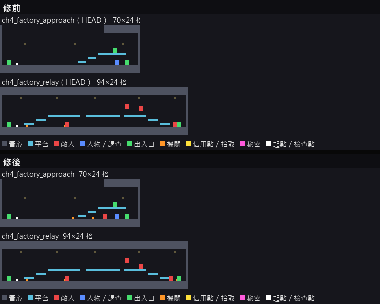
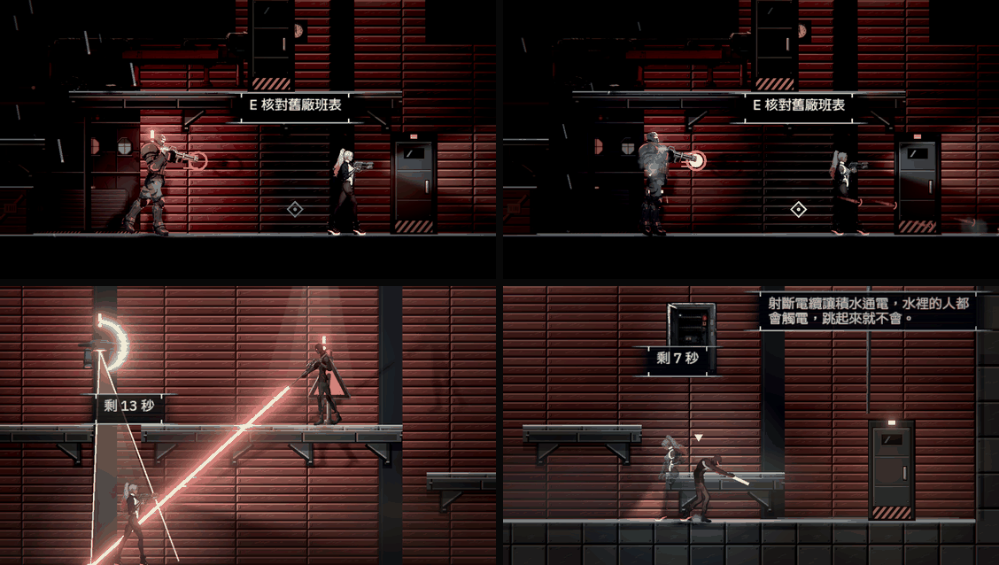

# [NE-451] 第四章舊廠擺上天穹清理隊

> 狀態：完成

## 內文

### 需求
敵人線把舊關卡裡行為完整的天穹敵人整理成可以進章節的狀態（NE-470），第四章的舊廠是天穹清理隊的地盤，但目前主線上只有接線廊一場正式戰鬥，舊廠外廊與裝卸帶一路都是跳台。這張票把適合的新種類擺進第四章舊廠，照每種的對付方法給場地條件（掩體、繞到背後的路、可以斷線的高低差），並讓接線廊東端「只有戰鬥」的那一段多一個不用開槍的解法。新種類的紅色預兆在第四章的光影下要看得到。

另外補上截圖工具的缺口：上下兩層的高房間裡，鏡頭跟著主角對不到要拍的平台（NE-450 倉庫深處沒拍成），讓截圖取樣點可以指定鏡頭中心，並補拍倉庫深處。

### 來源
2026-11-28，使用者指示：「關卡的玩法跟內容可以更多變一點，不要只有枯燥的射擊。」敵人線 NE-470 的擺放表見 [敵人與頭目盤點](../../design/22-living-scenes/ENEMY_ROSTER.md)；地圖線的順序見[關卡多樣性盤點](../../design/22-living-scenes/LEVEL_VARIETY.md)。

### 驗收條件
- [x] 第四章舊廠至少擺上兩種新的天穹敵人，各自的場地照擺放表的條件（掩體、繞後路線、斷線的高低差）
- [x] 新種類的紅色預兆在第四章的光影下看得到（實機截圖）
- [x] 接線廊東端的切割者有一個不用對牠開槍的解法
- [x] 主線上同一種主要內容不連續超過兩個區域（盤點工具量）
- [x] 第四章流程探針、場景合理性與可達性、任務與地圖稽核、暗場可讀性通過；繞後的路線實際走得通
- [x] 截圖工具的取樣點可以指定鏡頭中心；補拍倉庫深處的保險箱平台
- [x] 附修前修後的俯覽圖與實機截圖；受影響範圍的測試 0 個新失敗

### 測試流程
1. 跑盤點工具，看第四章的主要內容順序與敵人種類
2. 跑第四章流程探針、任務與地圖稽核、場景報告、實走工具
3. 實機進舊廠外廊，看重裝機槍手轉管的預兆；從維修架走到他頭頂、落到背後
4. 實機進接線廊東端，把切割者引到積水裡，射斷電纜

---

# 跟其他票的關係

- Blocks：無
- Blocked by：無
- Related：NE-470、NE-424、NE-423、NE-450

---

# Commit-1

## 內文

第四章的舊廠是天穹清理隊的地盤，主線上卻只有接線廊一場正式戰鬥，外廊、裝卸帶、安全臺一路都是跳台；接線廊東端的切割者只能硬拚。

舊廠外廊：貨門前加一場「外門守衛」。重裝機槍手站在維修架底下守著貨門，地面路上有兩個掩護箱，槍管轉起來就躲到箱子後面（箱子擋住視線時他根本不會轉管）；或從左邊的階梯上維修架，走到他頭頂、從維修架右端落到他背後。

接線廊：上層走道的兩台探照無人機換一台成狙擊手，雷射掃過下層的長路，站到走道底下就斷線。東端出口前加一灘積水與斷電纜，把切割者引進水裡再射斷電纜，不用和牠硬拚；背後是積水時牠也翻不過來。

舊廠的主要內容變成戰鬥（外廊）→ 移動（裝卸帶）→ 戰鬥（接線廊）→ 移動（安全臺）→ 限時（工作帶）。第四章擺上的新種類：重裝機槍手 1 隻（外廊）、狙擊手 1 隻（接線廊）；切割者 1、探照無人機 1、清掃兵 1 照舊。敵人名單（chapter_rosters.json）照協調不動，由敵人線依實際擺放整理。

新種類的預兆在第四章的光影下看得到：重裝機槍手轉管時槍口的粉紅圓環與頭上的白色提示（牆面是紅光，對比中等），狙擊手的紅色雷射很清楚。第四章的故事測試原本把接線廊寫死成兩台無人機，跟著改成一台無人機加一台狙擊手。

截圖工具：取樣點可以寫站立的列與鏡頭中心的格子，有天花板的室內不再把指定的列改掉；可以讓敵人照常行動並連拍，拍出手前的預兆。補拍了第一章倉庫深處的蒸汽閥（補進 NE-450）。

### 測試結果

| 項目 | 結果 |
|---|---|
| 受影響範圍的測試（58 個套件） | 64910 項，2 項新失敗：第四章故事測試寫死接線廊的敵人組成（已跟著改，單獨重跑通過）；落地貨箱掩護的「被包抄就起身」（用自己的測試場地，與地圖無關，單獨重跑通過，是負載相關的計時） |
| 單獨重跑 | 第四章故事、道具兩個套件 399 / 399 通過 |
| 第四章流程探針（病房→舊廠→接線廊→安全臺，寫檔與冷讀檔） | 都是 0 失敗 |
| 新路線實走 | 外廊維修架繞到守衛背後走得通；之前的五條路線也重跑通過 |
| 任務與地圖稽核 | 通過 |
| 場景合理性與可達性（外廊、接線廊） | 0 錯誤、0 警告 |
| 暗場可讀性 | 外門守衛、維修架、接線廊上層走道、出口積水全部達標 |

### 截圖

修前修後的俯覽：外廊貨門前的守衛與兩個掩護箱，接線廊上層的狙擊手與東端的斷電纜。

左上：重裝機槍手轉管的預兆（槍口圓環、頭上提示）。右上：掃射後過熱冒煙。左下：接線廊狙擊手的雷射。右下：東端積水旁的斷電纜提示，切割者正在接近。原生 Forward+。

