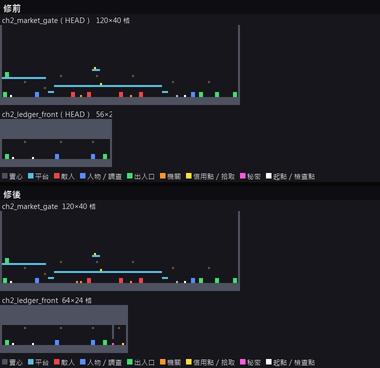
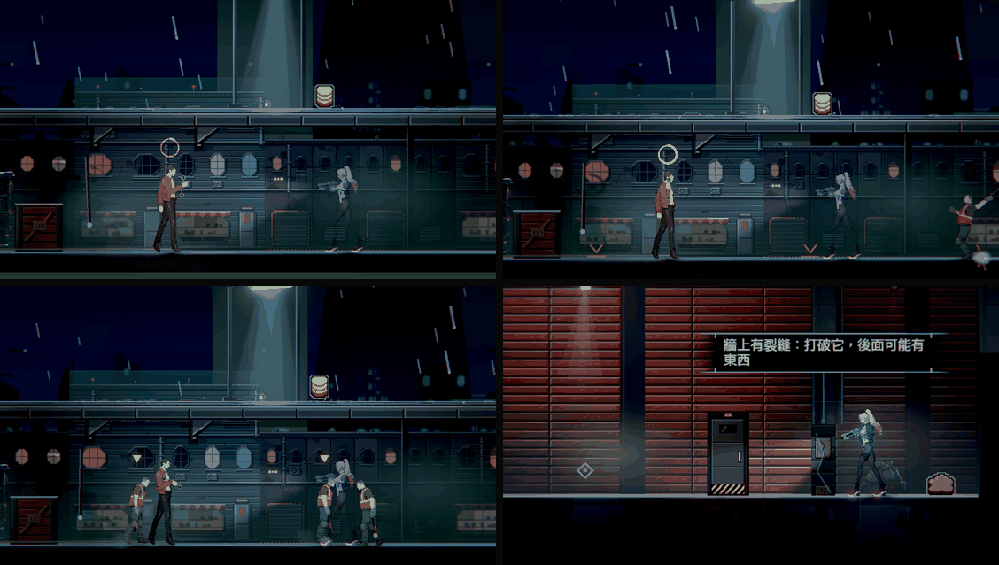

# [NE-452] 改第二章的產生器與市集入口

> 狀態：完成

## 內文

### 需求
第二章的地圖產生器重跑不出目前的地圖：後來直接改地圖的東西（裝卸間的門簾凹室、吊掛貨箱、可射暗的燈、「不被發現」挑戰，市集入口的斷電纜與「只用環境擊倒」挑戰，白天港區街道的街坊與早晨氣泡，客人簿的接續場景）都會被洗掉。先把產生器補到重跑後沒有改到的區域沒有內容差異。

內容上：敵人線做好的收帳人·聯絡員（看到玩家就打電話叫增援）第一次出現要單獨、場地簡單、牠和玩家之間有掩體；第二章整章沒有一個藏起來的房間。這張票讓聯絡員在第二章第一次出現，並加一個藏起來的房間（獎勵用既有的信用點，留位置給故事線放東西）。

### 來源
2026-11-28，使用者指示：「關卡的玩法跟內容可以更多變一點，不要只有枯燥的射擊。」聯絡員的擺放條件見 [敵人與頭目盤點](../../design/22-living-scenes/ENEMY_ROSTER.md)；地圖線的順序見[關卡多樣性盤點](../../design/22-living-scenes/LEVEL_VARIETY.md)。

### 驗收條件
- [x] 重跑第二章產生器，沒有改到的區域沒有內容差異（只容許資源編號、鍵順序、清單換行）
- [x] 聯絡員在第二章第一次出現：單獨一隻、牠和玩家之間有掩體、背後有增援落點的空地
- [x] 第二章有一個藏起來的房間，不擋主線
- [x] 劇情觸發點、任務目標、地圖標記、檢查點與出入口位置不變（任務與地圖稽核）
- [x] 第二章流程探針、場景合理性與可達性、暗場可讀性通過；新路線實際走得通
- [x] 附修前修後的俯覽圖與實機截圖；受影響範圍的測試 0 個新失敗

### 測試流程
1. 重跑第二章產生器，比對地圖
2. 跑第二章流程探針、任務與地圖稽核、場景報告、實走工具
3. 實機進市集入口，看聯絡員打電話；躲到貨箱後面讓回報中斷
4. 實機進北棟二樓前室，打破帳房門右邊的裂縫牆

---

# 跟其他票的關係

- Blocks：無
- Blocked by：無
- Related：NE-476、NE-426、NE-405、NE-410、NE-411、ST-60

---

# Commit-1

## 內文

第二章的地圖產生器重跑會洗掉後來直接改地圖的東西：裝卸間的門簾凹室、吊掛貨箱、可射暗的燈與「不被發現」挑戰，市集入口的兩條斷電纜與「只用環境擊倒」挑戰，白天港區街道的三位街坊與早晨氣泡，客人簿中途離開後回來接著播的場景。現在全部寫回產生器，重跑後沒有改到的區域只剩資源編號、鍵順序、清單換行的差異；當舖的傘架從第 76 欄移到第 79 欄，和第一、三章同一個店面一致。各章共用的機關與新敵人字元整理成一張表（`design/22-living-scenes/MAP_GLYPHS.md`）。

市集入口：入口那場原本是兩名押運手，改成收帳人·聯絡員第一次出現。他單獨站在第 44 欄，玩家和他之間有一個貨箱；貨箱擋住視線時他看不到玩家，看到了才拿起話筒，頭上的圓環填滿前躲到貨箱後面就能打斷回報。沒打斷的話，背後的空地出現兩個落點記號，進場的就是原本站在這裡的兩名押運手——打得好這一場比原本少，打不好和原本一樣。旁邊第 40 欄就是斷電纜，叫來的押運手正好可以拿來做「只用環境擊倒」挑戰。

北棟二樓前室：帳房門右邊多一面裂縫牆，後面是阿勇藏舊帳的暗櫃，有錢袋與一包信用點；地圖加寬 8 格，不擋主線。

聯絡員原本只在第二章的保留名單裡；這次是第一次正式擺進第二章，所以把它在 `chapter_rosters.json` 第二章從保留移到正式名單（只動這一筆），第二章敵人測試裡寫死的本章身份清單也加上「收帳人·聯絡員」。

### 測試結果

| 項目 | 結果 |
|---|---|
| 受影響範圍的測試（第一輪） | 64967 項，3 項新失敗，全是名單檢查：聯絡員還在保留名單、本章身份清單沒有牠 |
| 名單轉正後重跑（第一章地圖、第二章敵人、可讀性目標、劇本檢查、打擊敵人） | 2887 項只剩 1 項：第二章敵人測試寫死的身份清單；加上聯絡員後第二章敵人 171 / 171 通過 |
| 第二章流程探針（cut、keep 兩條路線） | 都是 0 失敗 |
| 新路線實走 | 北棟前室打破裂縫牆進暗櫃、撿到信用點、走回帳房門前 |
| 任務與地圖稽核 | 通過 |
| 場景合理性與可達性（市集入口、北棟前室） | 0 錯誤、0 警告 |
| 暗場可讀性 | 市集入口巡帳員、地面戰區、聯絡員、上層攤道、B3 電話亭，北棟前室、暗櫃全部達標 |
| 重跑產生器 | 沒改到的區域只剩資源編號、鍵順序、清單換行的差異 |

### 截圖

修前修後的俯覽：市集入口的兩名押運手換成聯絡員與他前面的貨箱，北棟前室右邊多出裂牆後的暗櫃。

左上：聯絡員看到主角，頭上的圓環開始填滿。右上：圓環快滿，背後地上出現兩個落點記號。左下：沒打斷，兩名押運手進場。右下：北棟前室的裂縫牆與後面的暗櫃。原生 Forward+。

