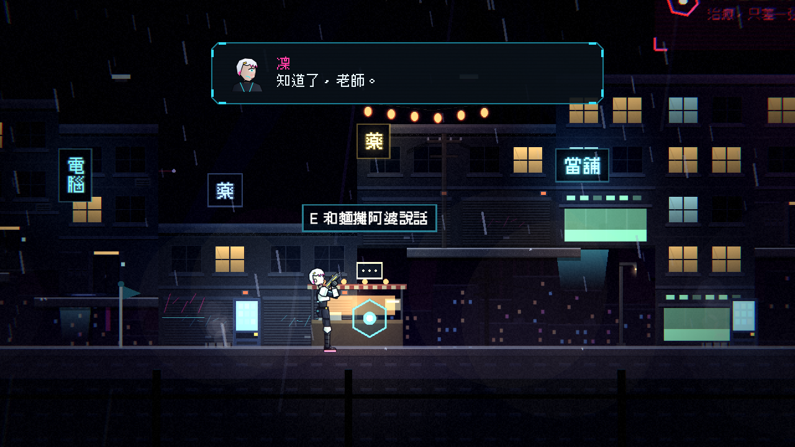
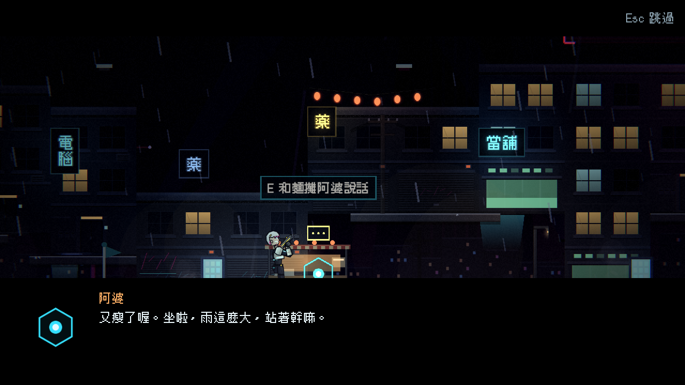
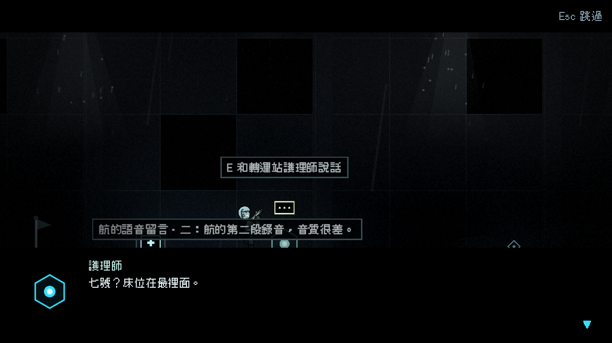

# [NE-45] 加入可對話的場景人物

> 狀態：完成

## 內文

### 需求
關卡裡只有敵人與機關，沒有可以說話的人。需要場景人物：站在場景裡，玩家靠近按互動鍵就會對話，並可帶出劇情、補給與收集品。

### 來源
2026-10-03，使用者於開發對話中提出：「完善目前的劇情設計，整體起承轉合可以參照邊緣行者、尼爾之類類似宿命論這種」「劇情最好要有暗線、伏筆等等更有深度的設計」；「劇情內容可以更多一點」。設計見 `design/10-presentation/DESIGN.md`、`design/04-story/`。

### 驗收條件
- [x] 場景人物是關卡裡的物件，靠近時顯示提示，按互動鍵開始對話（遊戲暫停、對話框演出）
- [x] 同一個人可以有多段對話：第一次、之後、特定劇情之後各不同；已經談過的不重複給獎勵
- [x] 對話結束可以給補給、信用點或收集品
- [x] 人物在戰鬥中不受傷害，也不會被敵人當作目標
- [x] 死亡重來時，已經領過的獎勵不會再給
- [x] 新增一個人物只需要資料與地圖字元

### 測試流程
1. 在測試場景與關卡裡找到人物並對話，確認提示與演出
2. 領取獎勵後死亡重來，確認不重複
3. 執行完整測試套件，全部通過

---

# 跟其他票的關係

- Blocks：NE-49、NE-50、NE-54
- Blocked by：NE-44
- Related：NE-26

---

# Commit-1

## 內文

關卡裡只有敵人與機關，沒有可以說話的人。
現在關卡裡有場景人物：玩家靠近時頭上出現一行提示（例如「E 和麵攤阿婆說話」），沒說過話的人頭上有個對話泡泡；按互動鍵開始對話，遊戲暫停、用過場的對話框一句一句演出（互動鍵、確認鍵、射擊鍵都能推進，Esc 跳過整段）。同一個人可以有多段對話：第一次、之後再來、某個劇情場景播過之後各說各的；每一段說完可以給信用點、補給或收集品，每一段的獎勵只領一次，補給帶滿時整份保留、騰出空間再說話才補領。人物沒有受擊盒、不在敵人群組、不會被子彈或敵人當成目標，地圖上周圍 8 格內不放敵人。
談過幾次與已領的獎勵跟著檢查點存檔：死亡重來後人物記得說過什麼，已領的獎勵不會再給一次；檢查點之後才領的獎勵，會和信用點、補給一起回到檢查點的樣子，不會多領也不會少領。新增一個人物只需要一份人物資料、一個對話場景與地圖上的一個字元；沒有骨架外觀時自動退回頭像剪影，牆上的刻痕這類可調查物用同一套資料。
第一章放了麵攤阿婆（給航的蠟筆畫與零錢）與貨運站夜班工人（給交班紙條與醫療針），第二章放了維修員老陳、夾層區住戶、轉運站護理師與牆上的刻痕。第一章收集品增加到 5 件、第二章增加到 7 件（由人物給的文件算進同一份收集進度）。
驗收了人物的提示、對話暫停與推進、多段對話的挑選、獎勵只領一次、檢查點回溯前後的一致性、壞資料與缺外觀的容錯，以及兩章地圖的人物擺放與可通行檢查，全部通過。

### 測試結果

| 項目 | 結果 |
|---|---|
| 完整測試套件 | 通過 2730 / 2730 |
| 資料驗證 | 0 錯誤 |
| 執行 log | 無 ERROR |

### 截圖

