# [NE-46] 新增偵察與狙擊型敵人

> 狀態：完成

## 內文

### 需求
探照無人機與狙擊手。探照無人機掃光，被照到會引來警報；狙擊手用很長的紅色雷射先掃再停再開火。新增後第一、二章的戰鬥種類更豐富。

### 來源
2026-10-03，使用者於開發對話中提出：「多設計幾種不同的敵人」；「這些都可以去看看目前業界有哪一些最佳實例可以參考，我們盡可能設計的貼近完整實際的 Demo」。設計見 `design/10-presentation/DESIGN.md`、`design/04-story/`。

### 驗收條件
- [x] 探照無人機：光束掃過、發出嗶聲，被照到時警報加速並引來附近的敵人；可以躲進陰影、打掉它或切電
- [x] 狙擊手：很長的紅色雷射先掃後停，閃三下才開火；能躲在牆後或衝刺閃避
- [x] 每種敵人的攻擊都有明確預兆，預兆在暗處自帶光、看得清楚
- [x] 每種敵人有敗北圖鑑卡片與攻略，數值在資料檔
- [x] 三種難度下都能擊敗，任何難度的預兆都不少於 0.3 秒
- [x] 已配置到關卡（第一章後半與第二章夾層區），並有第一次遭遇時的安全空間

### 測試流程
1. 在測試場地逐一遭遇，確認預兆與應對方式成立
2. 被每種敵人擊敗一次，確認圖鑑解鎖並顯示攻略
3. 在關卡裡確認配置
4. 執行完整測試套件，全部通過

---

# 跟其他票的關係

- Blocks：NE-54
- Blocked by：NE-44
- Related：NE-28

---

# Commit-1

## 內文

第一、二章的戰鬥缺少「光」與「長距離壓迫」的敵人。
現在新增探照無人機與狙擊手。探照無人機在空中來回巡邏，光束左右掃過地面；玩家被光束照到就會鎖定：光束追著玩家、嗶聲越來越急、機身的圓環逐漸填滿，填滿就拉警報，半徑內的敵人全部被引來、視野變大。躲到牆後讓圓環退回去，或打掉它，或切斷電力讓它墜落、光束熄滅，恢復供電後才重新升空。狙擊手看見玩家後，一條很長的紅色雷射先慢慢掃向玩家，接著停住閃三下，才沿著停住的那條線開火；雷射停住前橫移、衝刺、跳起或躲到牆後都能避開，開槍後有一段收槍的空檔。兩種敵人的預兆（光束、圓環、雷射）都自帶光，在偏暗的場景裡看得清楚。
兩種敵人都有敗北圖鑑卡片與攻略，數值在資料檔；任何難度的預兆都不少於 0.3 秒。已配置到第一章貨運站（無人機、狙擊手的高台）與第二章夾層區（無人機、隱藏房間屋頂上的狙擊手），第一次遭遇的左邊都留有空間。
驗收了什麼：在測試場地逐一遭遇，確認預兆與應對方式成立（光束鎖定與退回、警報範圍內外、掩體擋光、切電墜落與重啟、狙擊手的掃描、鎖定不動、三次閃爍、開火、閃避與掩體）；被每種敵人擊敗一次會解鎖對應的圖鑑卡片；三種難度都能擊敗；關卡配置與安全空間。結果全數通過。

### 測試結果

| 項目 | 結果 |
|---|---|
| 完整測試套件 | 通過 3169 / 3169 |
| 資料驗證 | 0 錯誤 |
| 執行 log | 無 ERROR |

### 截圖

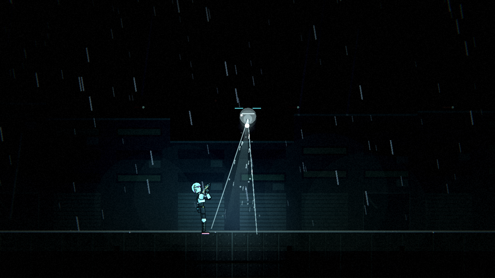

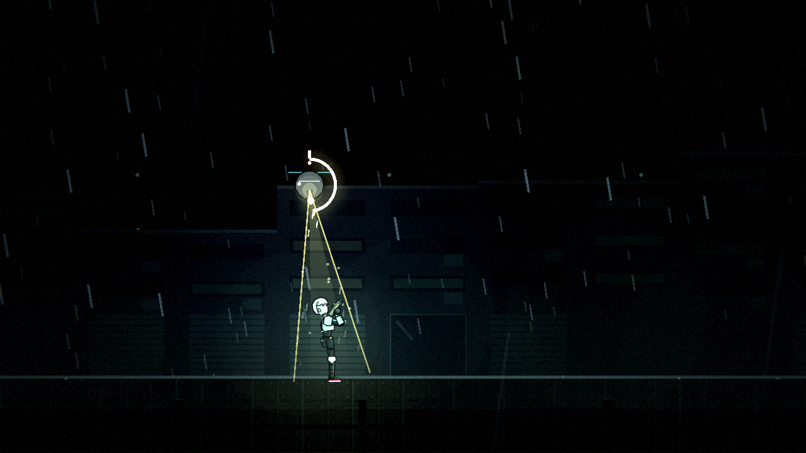

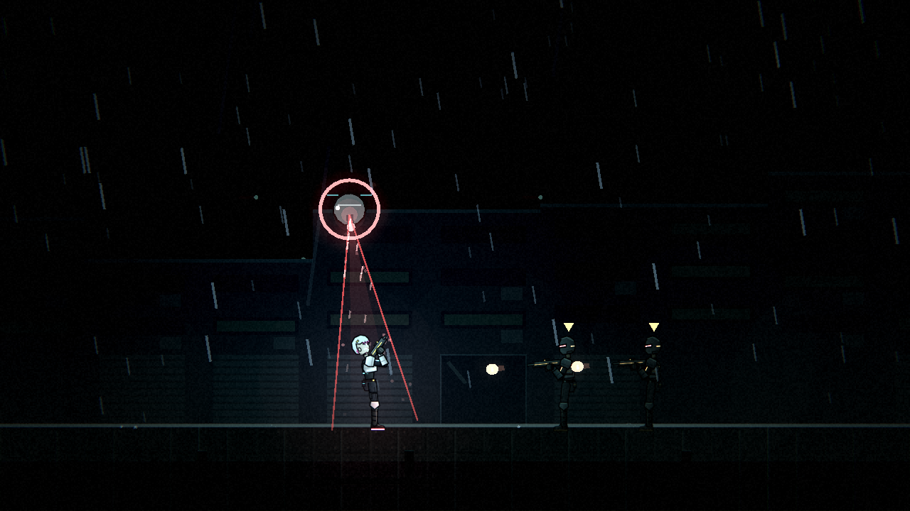

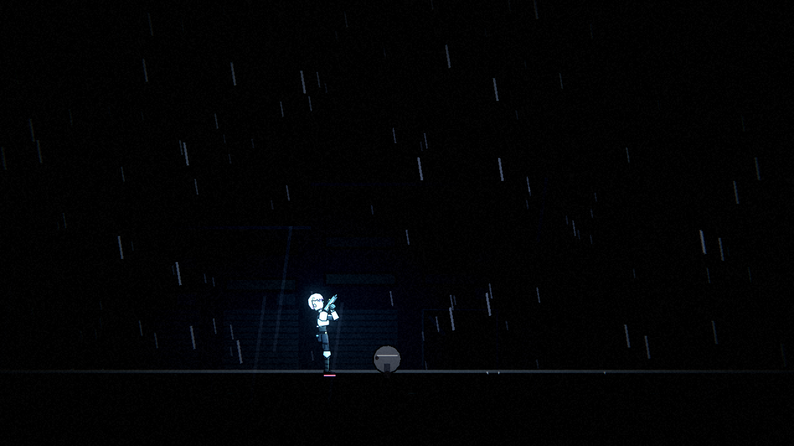

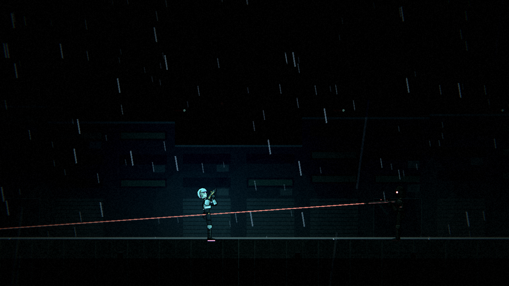

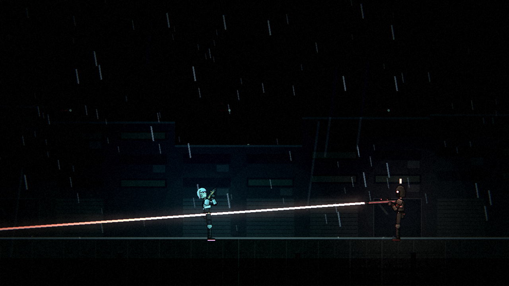

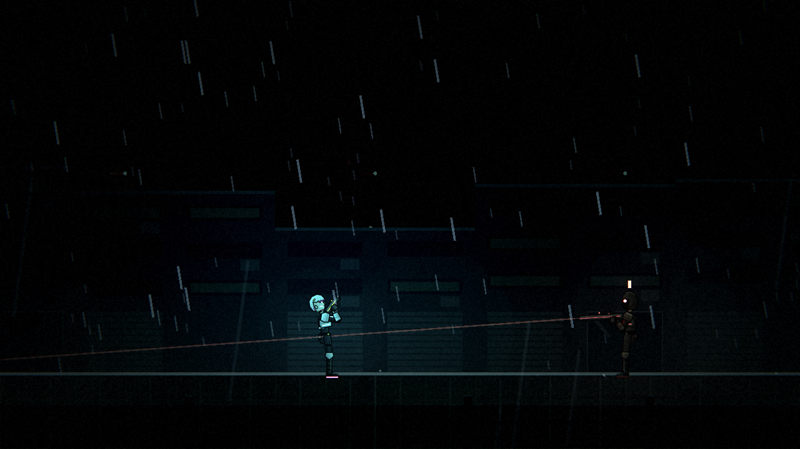

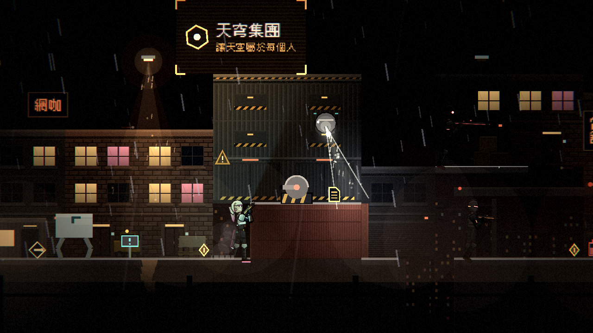

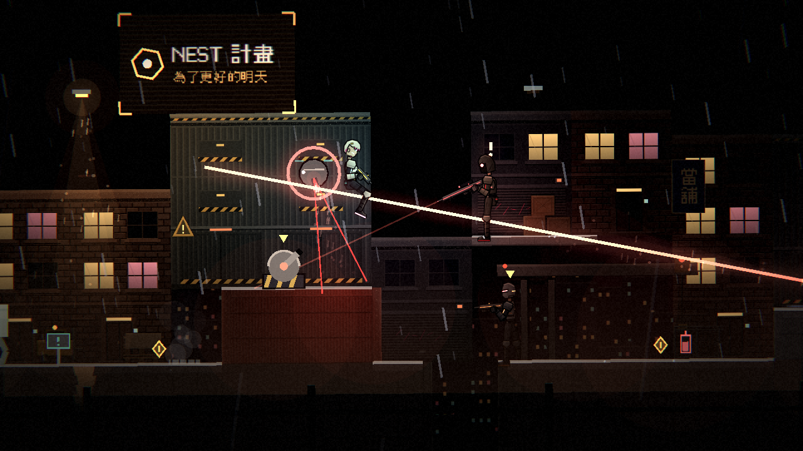

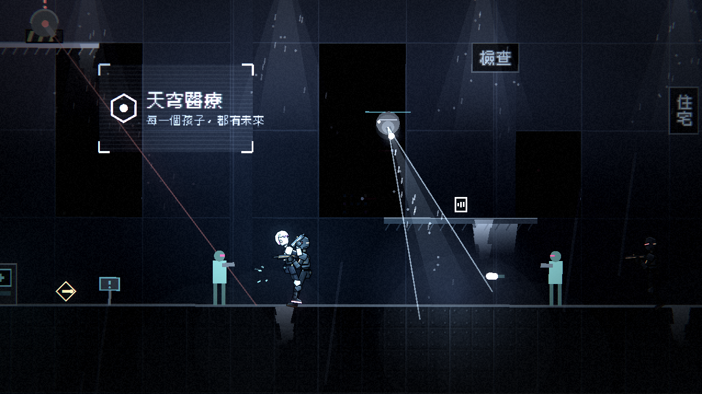

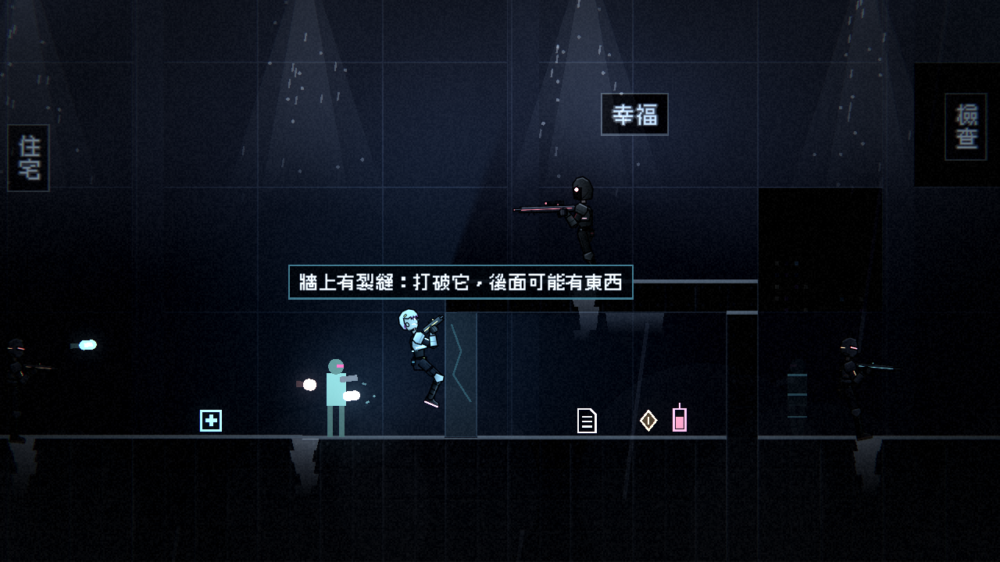
