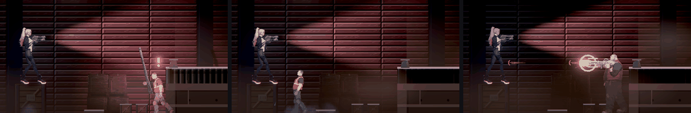
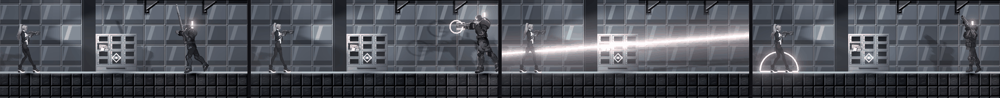

# [NE-470] 讓舊關卡的完整敵人可以放進章節

> 狀態：完成

## 內文

### 需求
盤點（NE-417）發現 26 種行為完整的敵人只擺在舊開發關卡，正式章節碰不到；其中鎮暴員（持盾衝鋒）、重裝機槍手（遠距壓制）、狙擊手、擲彈兵正好補上章節缺少的角色。先讓這些敵人可以直接擺進章節，再做全新的行為：
- 和這一輪加進來的機關、挑戰與存檔相容：避開通電的積水、被蒸汽擋住視線、落地貨箱當掩護、誘餌收音機、可射暗的燈、區域挑戰（不被發現、只用環境擊倒、限時）、存檔與檢查點重來。逐種列出相容與否，不相容的修掉或寫明不適用。
- 每種一句話的對付方法，至少一種不是「打更多子彈」；預兆與反應時間符合現在章節敵人的標準。
- 外觀是天穹保全：寫出每種能合理出現在哪幾章哪些區域；其他章節需要換皮的列出來，能用資料換配色與裝備的就做，需要新美術的開美術票。
- 給地圖線一張表：種類、對付方法、適合的地形、建議的組合、不要一起出現的組合。
- 鎮暴員是不是「持盾推進」：檢查它夠不夠好，不夠就寫出差在哪裡。

### 來源
2026-11-28，主 session 看過[敵人與頭目盤點](../../design/22-living-scenes/ENEMY_ROSTER.md)後調整順序：「先讓已經做好的敵人能進正式章節，再做全新的行為。」後續清單見[畫面與玩法的後續待辦](../../design/22-living-scenes/BACKLOG.md)「敵人與頭目」第 1 項。

### 驗收條件
- [x] 鎮暴員、重裝機槍手、狙擊手、擲彈兵（以及其他判斷值得的種類）逐種實際跑過，列出與積水、蒸汽、落地貨箱、誘餌收音機、射暗的燈、三種區域挑戰、存檔與檢查點重來的相容結果
- [x] 不相容的地方修掉並有自動測試，或寫明不適用的理由
- [x] 每種有一句話的對付方法，至少一種不是打更多子彈；三種難度下預兆與攻擊間隔符合章節敵人的標準
- [x] 每種寫出適合出現的章節與區域；需要換皮的列出來，資料能做的做完，需要新美術的開美術票
- [x] 盤點文件有給地圖線的表：種類、對付方法、適合的地形、建議組合、不要一起出現的組合
- [x] 鎮暴員是否符合持盾推進有結論
- [x] 盤點裡寫錯的地方已更正
- [x] 受影響範圍的測試沒有新的失敗；附實機畫面

### 測試流程
1. 用截圖情境把每種敵人放進一個正式章節的區域，分別試積水、蒸汽、落地貨箱、誘餌收音機、射暗的燈
2. 預期行為符合相容表

---

# 跟其他票的關係

- Blocks：無
- Blocked by：無
- Related：NE-417、NE-408、NE-409、NE-415、NE-404、NE-410、NE-411、NE-418

---

# Commit-1

## 內文

鎮暴員、重裝機槍手、狙擊手、擲彈兵的行為都做好了，卻只擺在舊開發關卡；沒人檢查過它們和這一輪新加的機關、挑戰是否合得來，外觀也都是天穹保全，放不進港區章節。
逐種在測試場地與正式章節實際跑過，相容表、對付方法、適合的章節與地形、組合建議寫進[敵人與頭目盤點](../../design/22-living-scenes/ENEMY_ROSTER.md)的「舊關卡敵人放進章節」一節。跑的過程中修了這些：
- 擲彈兵原本完全不看視線：隔著牆、蒸汽、射暗的燈都照樣開砲，玩家還沒被看到就讓「不被發現」挑戰失敗。現在要先看到玩家才開砲；看到之後 4 秒內玩家躲到掩體後，牠照樣越過掩體拋過去，逼玩家換位置；很久沒看到就停手。
- 重裝機槍手看到玩家、正在走近時還算「放鬆」，要等槍管轉起來才算發現；現在走近時就算，戰鬥配樂與「不被發現」挑戰跟著正確。
- 重裝機槍手掃射時槍口的火光與光環亮度太高，在 Forward+ 下疊成一大團白光（過曝）；壓低後只剩看得見的槍口光環，光環顏色跟著自己的子彈。
- 鎮暴員的圖鑑卡片寫的是「盾衛犬」、還說牠在搖尾巴，和實際的人形鎮暴員對不上；改成描述持盾衝撞，並寫出撞牆或撞上落地貨箱的對付方法。
新增兩種用資料換外觀的收帳人變體給港區章節用：收帳人·重槍手（重裝機槍手的行為、打手的外觀拿轉管機槍、橘色子彈、沒有正面裝甲）與收帳人·盾手（鎮暴員的行為、押運手的外觀）。兩者列在第二章的保留名單，等地圖線決定擺放。
鎮暴員不是「持盾推進」：它是看到就蓄力直衝的衝鋒者。另外實機畫面裡擋板只畫出伸縮滑軌，看起來像舉著一根長棍，讀不出是盾，盾手沿用同一套外觀也一樣；擋板修好之前這兩種先不要擺，持盾推進與擋板外觀另開票。
第三章辦公大廳的冷白光把紅色預兆（擲彈兵的落點圈、狙擊手的雷射、頭上的驚嘆號）洗成白色，這是光影的問題，已轉給畫面線。

### 測試結果

| 項目 | 結果 |
|---|---|
| 完整測試 | 見下方 |
| 新增檢查 | 六種敵人的資料、圖鑑卡片、三種難度的預兆與攻擊間隔；擲彈兵沒看到玩家不開砲也不算交戰、看到就開砲、看到後越過掩體拋射、很久沒看到就停手；重裝機槍手走近時算交戰；收帳人·重槍手正面打得進去、天穹版本擋得住；衝鋒停在通電積水邊；衝鋒撞上貨箱大小的障礙會暈眩、暈眩時正面打得進去；兩種變體三種難度都打得倒 |
| 負控制 | 擲彈兵與重裝機槍手換回原本的程式：5 項失敗（三項擲彈兵察覺、走近算交戰、重槍手沒有正面裝甲） |
| 原生情境 | 第一章倉庫：盾手蓄力、撞上落地貨箱暈眩；重槍手掃射。第三章辦公大廳：鎮暴員蓄力 192 像素、重裝機槍手轉管 240 像素、狙擊手鎖定 307 像素、擲彈兵落點圈 224 像素 |

### 截圖

第一章倉庫，收帳人變體：盾手蓄力（擋板畫成一根長棍，這就是上面說的外觀問題）、撞上落地貨箱暈眩、重槍手掃射。原生 Forward+；其他敵人停下並隱藏，操作提示關掉。

第三章辦公大廳，天穹的四種敵人各自的預兆：鎮暴員蓄力、重裝機槍手轉管、狙擊手鎖定、擲彈兵落點圈。

