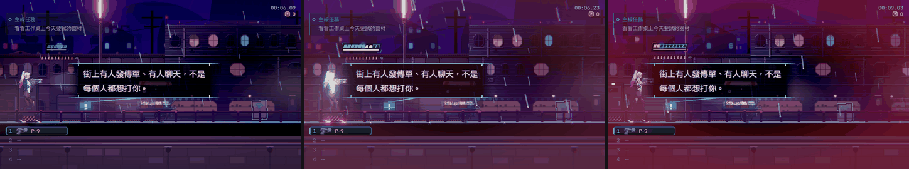
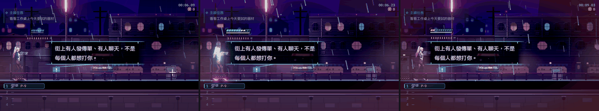
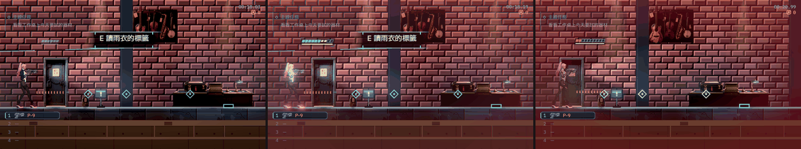
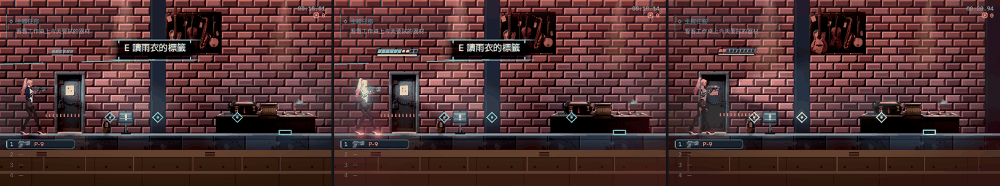

# [NE-471] 受傷與瀕死回饋只留在畫面外圈

> 狀態：完成

## 內文

### 需求

演出總檢（NE-425）第 2、6 項：被打中時整個畫面疊一層紅（約兩成落在畫面中央）並加色散；生命剩三分之一以下時，整個畫面染成一層粉紅並脈動。兩者都蓋到畫面中央的角色、敵人與提示，戰鬥中每次被打都影響判讀；而在紅色調的場景（當舖磚牆）裡，瀕死的紅色反而幾乎看不出來。

改成：

- 受傷：只在畫面外圈閃一下紅，強度約減半；畫面中央不受影響。既有的短暫停格、震動與角色閃白保留。
- 瀕死：只在畫面外圈去飽和並壓暗，紅色只留一點；不論場景是什麼色調都看得出來，中央保持乾淨；脈動維持，「減少閃光」時脈動較小。
- 光影設定自己的暗角不受影響。

### 來源

- 2026-11-28 使用者：判讀永遠優先；特效克制、不過曝。
- `design/22-living-scenes/PRESENTATION_AUDIT.md` 第 2、6 項（NE-425）。

### 驗收條件

- [x] 被打中時畫面中央（中間 40% 的區域）幾乎不變；有修前修後的量測
- [x] 瀕死時畫面中央不染色；外圈去飽和並變暗，在紫色調（港區街道）與紅色調（當舖）的場景都看得出來
- [x] 光影設定的暗角、格擋與頭目死亡的全螢幕效果不受影響
- [x] 受影響的測試 0 個新失敗；票上附兩個場景的修前修後截圖（平常、被打中、瀕死）

### 測試流程

1. 在港區街道被打一下：只有畫面邊緣閃紅，角色閃白，中間的路與敵人看得清楚
2. 生命剩三分之一以下：畫面邊緣變灰變暗並慢慢脈動，中間保持原色
3. 在當舖重複一次：邊緣的變化一樣看得出來

---

# 跟其他票的關係

- Blocks：無
- Blocked by：無
- Related：NE-425

---

# Commit-1

## 內文

被打中時整個畫面疊一層紅（約兩成落在中央）；瀕死時整個畫面染成粉紅並脈動，在紫色的港區街道最明顯、在紅磚的當舖反而看不出來。兩者都蓋到中央的角色與提示。

參考：Hollow Knight 被打中是短暫停格、角色閃白、畫面邊緣的裂痕；Dead Cells 只讓畫面邊緣短暫泛紅；多數動作遊戲不整片染色，因為會蓋掉判讀。取「中央永遠乾淨，回饋只在外圈」。

現在被打中只在外圈閃一下紅（強度約減半、色散減半），既有的停格、震動與角色閃白保留；瀕死時外圈去飽和並壓暗、只留一點紅，任何色調的場景都看得出來，中央保持原色。光影設定的暗角照舊；格擋、頭目死亡等其他全螢幕效果的暗角維持原本的顏色，只有低血量時才偏紅。

量測（被打中那一格和平常比，畫面中間 40% 區域每個像素平均改變多少，0～255）：當舖 4.6 → 0.5；港區街道 25.6 → 19.0（這一格大部分是主角被擊退後鏡頭移動，不是染色）。外圈的平均飽和度在瀕死時下降（當舖 0.578 → 0.551），修前是上升（染紅）。

### 測試結果

| 項目 | 結果 |
|---|---|
| 開發選單、環境、手感、劇本檢查、主流程（含低血量暗角的檢查） | 11990 項檢查，0 個新失敗 |
| 截圖情境執行 log | 無 SCRIPT ERROR、無 shader 錯誤 |

### 截圖

港區街道修前（平常、被打中、瀕死）：整片染紅、染粉紅。

港區街道修後：中央乾淨，只有外圈。

當舖修前：瀕死的紅在紅磚上幾乎看不出來。

當舖修後：外圈變灰變暗，看得出來。

