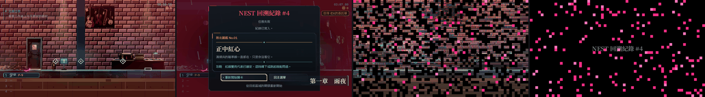
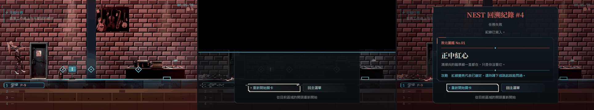
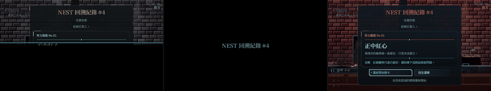

# [NE-472] 死亡與重來做成同一段回溯

> 狀態：完成

## 內文

### 需求

演出總檢（NE-425）第 3 項：死亡到重來是三段各說各的——倒地後整個畫面變紅、死亡畫面以洋紅色方塊雜訊進場、重來時整面洋紅像素雜訊。洋紅色塊整面閃爍很誇張，和「NEST 回溯紀錄」的世界設定也沒有關係。

改成同一段「回溯」：

- 死亡畫面進場與死亡重來的轉場用同一種語言：畫面褪成冷色、幾條細的錄影帶追蹤線往上捲、暗部從下往上蓋住（揭開時也是往上讓出），蓋住時置中顯示回溯編號；沒有色塊、沒有閃光。
- 倒地時不再整片染紅（NE-471 已讓低血量回饋只留在外圈）。
- 「減少動態」時回溯改成淡出、死亡畫面直接出現；「減少閃光」時死亡畫面單純淡入。
- 死亡重來的轉場總長維持約 1 秒內。

### 來源

- 2026-11-28 使用者：不要濫竽充數、特效克制。
- `design/22-living-scenes/PRESENTATION_AUDIT.md` 第 3 項（NE-425）。

### 驗收條件

- [x] 死亡畫面進場與死亡重來都是回溯（冷色、往上捲的追蹤線、從下往上蓋住），畫面上沒有洋紅色塊
- [x] 蓋住時顯示回溯編號，用畫面標題的字體
- [x] 死亡重來的轉場約 1 秒內結束
- [x] 「減少動態」時回溯改成淡出、死亡畫面直接出現；「減少閃光」時不閃
- [x] 劇情裡其他用到雜訊效果的地方不受影響
- [x] 受影響的測試 0 個新失敗；票上附修前修後截圖（倒地、死亡畫面進場、重來的蓋住與揭開）

### 測試流程

1. 在第一章死亡兩次以上（第一次是劇情的診間場景）：倒地後死亡畫面從下往上讓出，帶冷色與細追蹤線
2. 選「從檢查點重來」：畫面褪成冷色、暗部從下往上蓋住、顯示「NEST 回溯紀錄 #N」、再往上讓出
3. 開啟「減少動態」重複一次：死亡畫面直接出現、重來是淡出

---

# 跟其他票的關係

- Blocks：無
- Blocked by：無
- Related：NE-425、NE-427、NE-471

---

# Commit-1

## 內文

死亡到重來是三段各說各的：倒地後畫面變紅、死亡畫面以洋紅方塊雜訊進場、重來時整面洋紅像素雜訊，和「NEST 回溯紀錄」的設定沒有關係。

參考：Katana ZERO 把死亡做成錄影帶倒帶，和世界設定綁在一起；Celeste 死亡到重來不到一秒。取「死亡就是回溯，短而一致」。

現在死亡畫面進場與死亡重來是同一段回溯：畫面褪成冷色、幾條細的錄影帶追蹤線往上捲、暗部從下往上蓋住，蓋住時置中顯示「NEST 回溯紀錄 #N」（畫面標題字體），再往上讓出。沒有色塊、沒有閃光、亮度只會往下降。倒地時不再整片染紅（NE-471）。「減少動態」時回溯改成淡出、死亡畫面直接出現；「減少閃光」時死亡畫面單純淡入。原本的洋紅雜訊保留給劇情過場裡本來就用它的段落。

### 測試結果

| 項目 | 結果 |
|---|---|
| 轉場、死亡流程、死亡反應、介面畫面、過場 | 3666 項檢查，0 個新失敗 |
| 死亡重來的轉場總長 | 1.3 秒內（既有測試，用實際時間量） |
| 減少動態、減少閃光的降級 | 新增測試通過 |

### 截圖

修前：倒地後整片變紅、死亡畫面的洋紅雜訊進場、重來的洋紅雜訊（蓋住一半、蓋住）。

修後：倒地、死亡畫面以回溯進場（一半）、死亡畫面。

修後：重來的回溯（蓋住一半、蓋住並顯示回溯編號、揭開一半）。截圖情境沒有真的重來，揭開後看到的仍是死亡畫面。

