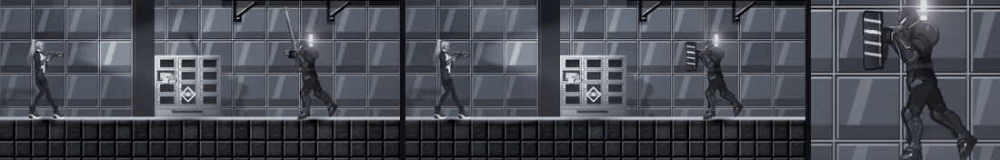

# [NE-474] 讓鎮暴員的盾看得出是盾

> 狀態：完成

## 內文

### 需求
NE-470 實機截圖發現，鎮暴員（以及用同一套行為的收帳人·盾手）蓄力時手上只看到一根斜舉的長棍，讀不出是盾；玩家不知道牠正面擋子彈，也看不出暈眩時盾已經放下。查出原因：是零件圖缺了、圖層被蓋住，還是資料沒接上。資料或圖層的問題就修掉；真的缺美術就開美術票寫清楚缺哪一件、尺寸、掛點，不自己硬做。

### 來源
2026-11-28，主 session 看過 NE-470 的結論後要求：「擋板外觀……請開一張票查原因……持盾推進的行為等擋板看得出來之後再做。」

### 驗收條件
- [x] 寫出原因：是缺圖、圖層、還是資料或程式
- [x] 原因是資料或程式的部分已修好：鎮暴員在章節光影下蓄力時看得出手上拿著盾
- [x] 暈眩時看得出盾已經失效
- [x] 真的缺美術的部分開了美術票，寫明缺哪一件、尺寸、掛點
- [x] 有自動測試，把修正拿掉時會失敗；附修前修後的實機畫面

### 測試流程
1. 第三章辦公大廳放一名鎮暴員，讓牠看到主角
2. 預期蓄力時手上是一面盾，不是長棍；撞牆暈眩時盾上的燈熄掉、手臂放下

---

# 跟其他票的關係

- Blocks：無
- Blocked by：無
- Related：NE-470、NE-475、NE-332、NE-79

---

# Commit-1

## 內文

原因不是缺圖：鎮暴員的外觀本來就有一面手持盾（盾面、發光層、法線都有，NE-79 交付並有測試）。2026-11-24 前臂格擋改版（NE-332）時，鎮暴員也改用主角的前臂偏折板，程式在牠生成時把手持盾藏起來，改畫偏折板的三段伸縮滑軌。滑軌是給主角前臂設計的細長零件，伸到全長斜舉著就像一根長棍；NE-332 的驗收圖裡鎮暴員已經是這個樣子，主角那邊同樣的問題後來改成收在前臂上，鎮暴員沒有跟著改。
現在外觀有手持盾的敵人就顯示手持盾、不畫滑軌；防守時盾上的燈亮著，暈眩時燈熄掉、手臂放下（原本的姿勢資料）。外觀沒有手持盾的才退回偏折板。收帳人·盾手用的押運手外觀沒有手持盾，這部分真的缺美術，開了 NE-475。
持盾推進的行為等盾手的美術到位後再做。

### 測試結果

| 項目 | 結果 |
|---|---|
| 受影響範圍的測試 | 通過 49997 / 49997（22 個套件：挑選工具選出的，加上所有用到鎮暴員或舊開發關卡的套件，挑選工具在敵人資料那一層會停） |
| 新增檢查 | 鎮暴員的手持盾看得到；押運手外觀沒有手持盾；防守時盾燈亮、暈眩時熄掉 |
| 負控制 | 換回原本的程式：3 項失敗 |
| 原生情境（第三章辦公大廳） | 蓄力時手上是一面盾 |

### 截圖

左：修前，蓄力的鎮暴員手上是一根斜舉的長棍。中：修後，同一個位置拿著盾。右：放大。第三章辦公大廳，原生 Forward+。

