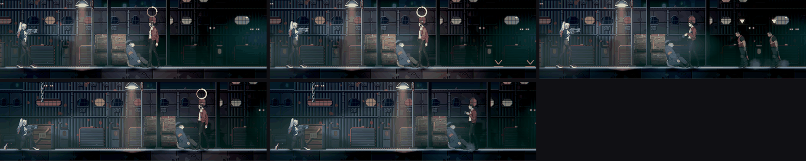

# [NE-476] 加入會叫增援的收帳人·聯絡員

> 狀態：完成

## 內文

### 需求
盤點（NE-417）發現整個專案沒有會叫出新敵人的一般敵人：探照無人機只會把已經在場的敵人引過來。加一種「要先處理」的敵人：牠看到玩家就拿起話筒回報位置，講完增援就趕來；不處理，戰鬥會越打越大。對付方法一句話講得清楚，而且有不是打更多子彈的解法：躲到牠看不到的地方讓回報斷掉。用現有的外觀加上資料差異，不做新美術。

### 來源
2026-11-28，使用者指示：「關卡的玩法跟內容可以更多變一點，不要只有枯燥的射擊。」後續清單見[畫面與玩法的後續待辦](../../design/22-living-scenes/BACKLOG.md)「敵人與頭目」第 1 項；缺少的角色見[敵人與頭目盤點](../../design/22-living-scenes/ENEMY_ROSTER.md)。

### 驗收條件
- [x] 聯絡員看到玩家就停下、把話筒拿到耳邊，頭上有一個慢慢填滿的圓環；後半段在增援會出現的地方畫出落點記號
- [x] 一直看得到玩家時，講完就在牠背後（遠離玩家那一側）叫出兩名增援，增援知道玩家在哪
- [x] 講到一半玩家躲到牆、貨箱或蒸汽後面，回報斷掉、沒有增援；被打暈也會斷
- [x] 每名聯絡員最多叫一次；講完之後保持距離、不出手
- [x] 講話中與講完之後都算已經發現玩家（戰鬥配樂、「不被發現」挑戰）
- [x] 三種難度下預兆不短於章節敵人的標準；越難講得越快
- [x] 圖鑑卡片寫出對付方法；有自動測試，把「看不到就斷」拿掉時測試會失敗
- [x] 附第二章實機連續畫面（講話、落點記號、增援到場、躲到貨箱後、掛斷）；受影響範圍的測試沒有新的失敗

### 測試流程
1. 第二章裝卸區打下吊掛貨箱，讓聯絡員看到主角
2. 預期牠拿起話筒、頭上圓環填滿、背後出現落點記號，講完兩名押運手從那裡過來
3. 再試一次，講到一半蹲到貨箱後面，預期牠掛斷、沒有增援

---

# 跟其他票的關係

- Blocks：無
- Blocked by：無
- Related：NE-417、NE-470、NE-409、NE-415

---

# Commit-1

## 內文

整個專案沒有會叫出新敵人的一般敵人，「先處理誰」從來不是問題。
新增收帳人·聯絡員：外觀用收帳人·槍手，手上拿的是話筒而不是槍（資料差異，不做新美術），講話時把話筒拿到耳邊（新的專屬動作，放大看過手在耳邊、話筒不蓋住臉）。牠巡邏時看到玩家就停下回報：頭上一個圓環在 2 秒內填滿（輔助難度 2.8 秒、困難 1.6 秒），講到一半時在牠背後的地面畫出兩個落點記號；講完兩名押運手從那兩個位置過來並知道玩家在哪。講話的過程要一直看得到玩家：中間隔了牆、落地貨箱或蒸汽超過 0.35 秒就掛斷；被打暈也會掛斷。每名聯絡員只叫一次，講完往後退、和玩家保持距離、不出手。增援落點會避開牆、懸崖與通電的積水，背後放不下就改放在近一點，再不行才放到玩家那一側。
圖鑑卡片「被聯絡員推開」寫出對付方法：看到他拿起話筒就先處理他，躲到他看不到的地方或衝過去打倒他。聯絡員列在第二章的保留名單，等地圖線擺放；適合放在有掩體或蒸汽閥的地方，讓玩家有「切斷視線」的選擇。

### 測試結果

| 項目 | 結果 |
|---|---|
| 受影響範圍的測試 | 114527 項；新失敗中 2 項是這張的（特效資料沿用槍手的「瞄準」狀態與相同的死亡特效，已改並重跑通過），其餘 36 項是關卡索引過期（另一條線改了兩個舊開發關卡的名稱，索引的重建在之後才推上 main），rebase 後由那個 commit 修正 |
| 新增檢查 | 資料、圖鑑卡片、三種難度的預兆；看到玩家就拿起話筒並算交戰；落點記號先出現；講完叫出兩名增援、在背後那一側；只叫一次；躲到牆後、蒸汽擋住、被打暈都會掛斷且沒有增援 |
| 負控制 | 把「看不到就斷」拿掉：牆後與蒸汽兩項失敗 |
| 原生情境（第二章裝卸區） | 講完叫出 2 名增援；第二次講到一半蹲到貨箱後，掛斷、0 名增援 |

### 截圖

上排：拿起話筒、圓環過半與背後的落點記號、兩名押運手到場。下排：講到一半蹲到落地的貨箱後面、掛斷。第二章裝卸區，原生 Forward+；其他敵人停下並隱藏。

