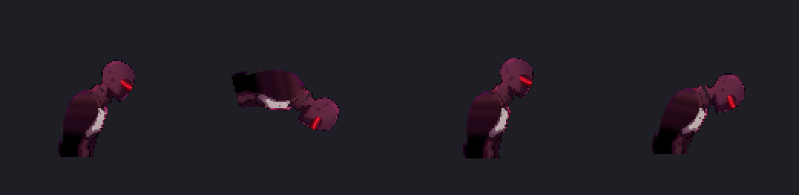

# [NE-478] 修好切割者頸部的接縫

> 狀態：待辦

## 內文

### 需求
切割者（第四章中繼站的繞後敵人）的頭和軀幹在頸部接不起來：頭往前或往後轉的動作裡，頸部前側會出現小缺口或凹口。這不是新動作造成的，切割者原本的跳躍、倒地、仰射就有，NE-424 的翻越也會碰到。要從零件本身（頸部的重疊、頭與軀幹零件的切割與支點）修，讓所有動作的頸部都接得起來，而不是靠避開某些角度。

接點稽核（`rig_joint_audit`，頸部，30 格、兩個面向、遊戲倍率 1 與過場倍率 3.4，2026-11-28）：

| 動作 | 失敗筆數 | 其中有實際缺口 |
|---|---|---|
| 倒地 | 50 | 20 |
| 跳躍 | 18 | 0（都是邊緣凹口） |
| 仰射 | 12 | 0 |
| 格擋 | 4 | 0 |
| 蹲 | 2 | 0 |
| 受擊硬直 | 2 | 2 |
| 翻越（NE-424 的專屬動作） | 22 | 4 |

### 來源
2026-11-28，NE-424 的翻越姿勢做接點稽核時發現；主 session：「它原本的跳躍與倒地就有幾十筆缺口，代表這個角色從以前就有接縫問題，開票時把三個動作的數字都寫進去。」

### 驗收條件
- [ ] 先寫出原因：零件圖頸部重疊不夠、切割位置、支點，還是綁定資料
- [ ] 切割者所有戰鬥姿勢（站、跑、仰射、蹲、跳、格擋、硬直、倒地）與專屬動作（蓄力、撲斬、翻越、收招）在兩個面向、遊戲與過場倍率下，頸部沒有實際缺口
- [ ] 邊緣凹口逐格放大看過，看得出來的都處理掉
- [ ] 其他接點（腰、髖、膝、踝、肩、肘、腕）不因此變差：修前修後同條件的稽核數字並排
- [ ] 不靠遮暗、放寬稽核門檻或避開角度通過；需要重畫零件就依 `character-art-pipeline` 處理
- [ ] 附修前修後同一格的放大截圖

### 測試流程
1. `godot --path . res://tools/rig_joint_audit.tscn -- --out=<資料夾> --chars=slasher --joints=neck --frames=30`，再用 `--action=slasher.vault --airborne` 等專屬動作各跑一次
2. `python tools/check_joint_frames.py <資料夾>`，預期頸部沒有實際缺口

---

# 跟其他票的關係

- Blocks：無
- Blocked by：無
- Related：NE-424

---

### 截圖

過場倍率下頸部失敗最嚴重的一格（由左到右：跳躍、倒地、仰射、翻越），頸部前側的凹口與缺口。

