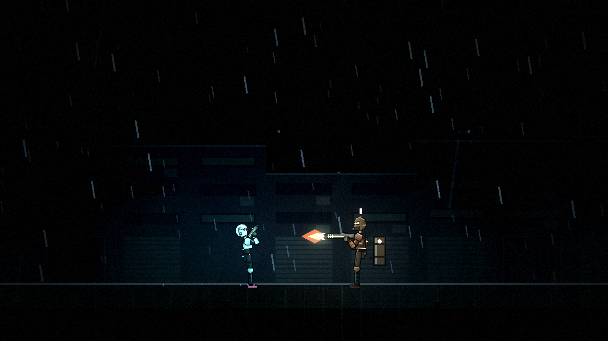
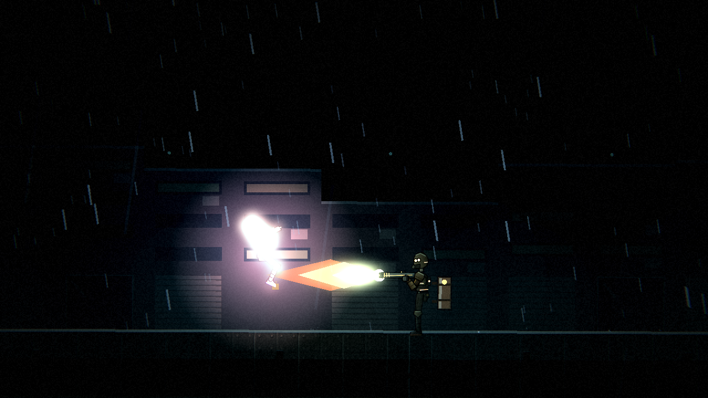
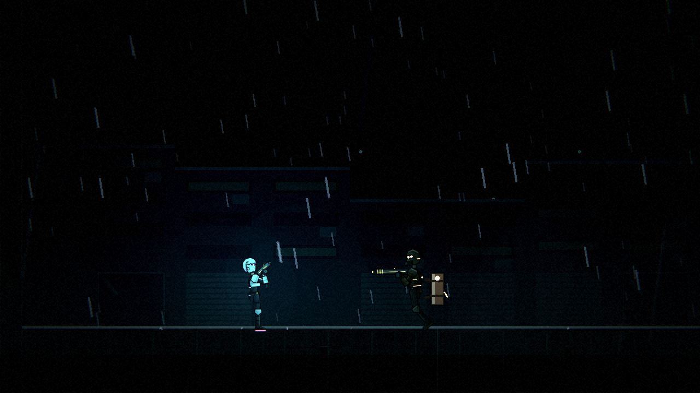
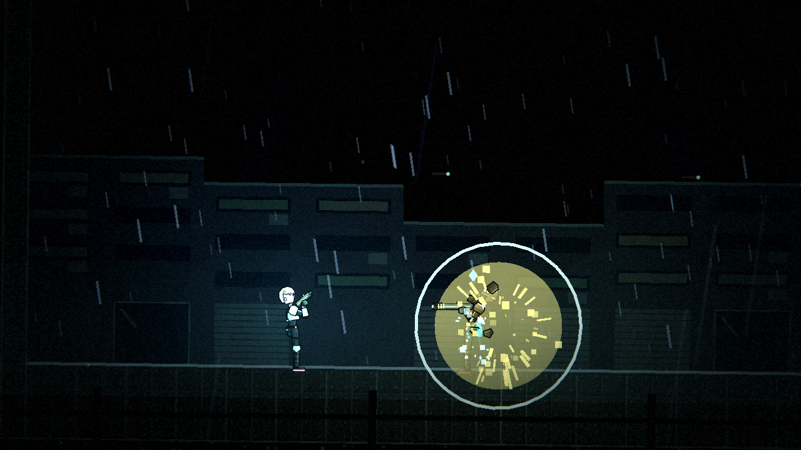
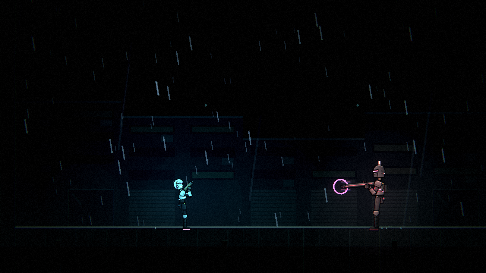
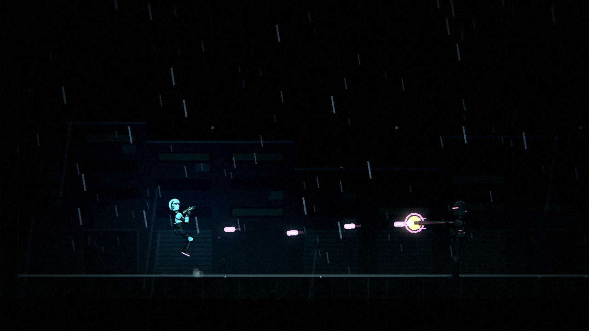
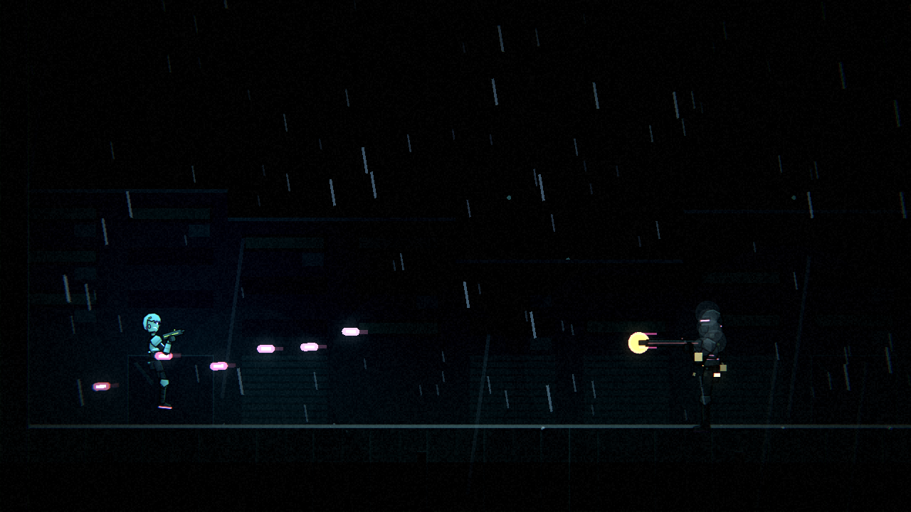
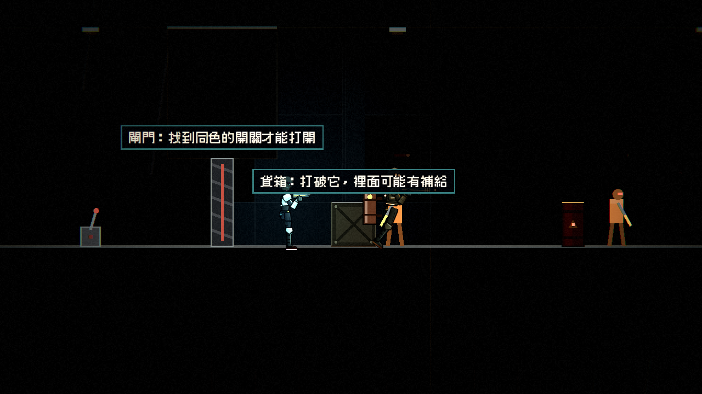
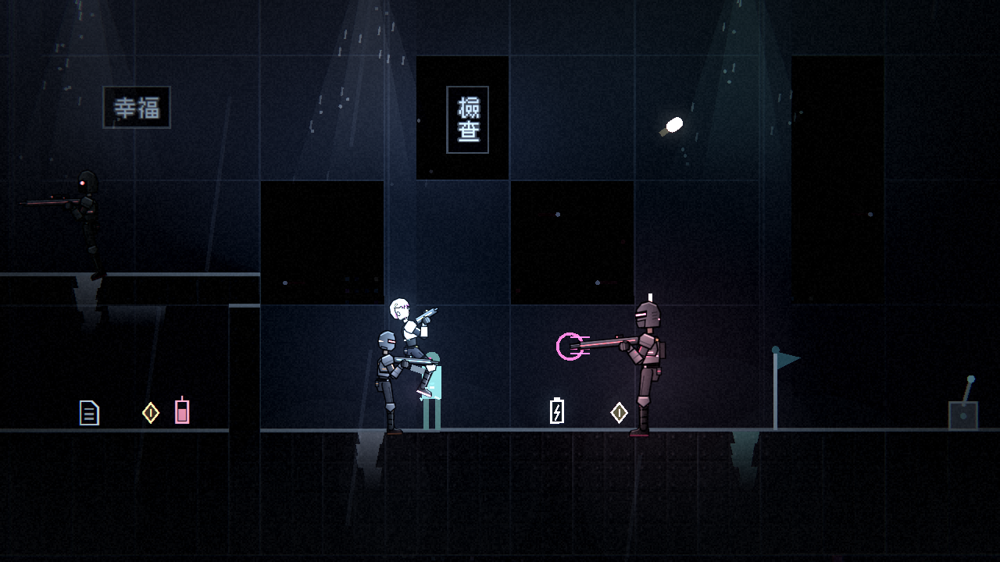

# [NE-47] 新增重裝型敵人

> 狀態：完成

## 內文

### 需求
火焰兵與重裝機槍手。火焰兵有範圍與持續時間、背後有可引爆的燃料罐；重裝機槍手槍管加速旋轉、射擊時停下腳步、過熱後有空檔。新增後第一、二章的戰鬥種類更豐富。

### 來源
2026-10-03，使用者於開發對話中提出：「多設計幾種不同的敵人」；「這些都可以去看看目前業界有哪一些最佳實例可以參考，我們盡可能設計的貼近完整實際的 Demo」。設計見 `design/10-presentation/DESIGN.md`、`design/04-story/`。

### 驗收條件
- [x] 火焰兵：噴口點火預熱，噴射有範圍與持續時間；背後的燃料罐被打中會爆炸
- [x] 重裝機槍手：槍管旋轉加速，射擊時停下，過熱後停火；爆炸可以無視護甲
- [x] 每種敵人的攻擊都有明確預兆，預兆在暗處自帶光、看得清楚
- [x] 每種敵人有敗北圖鑑卡片與攻略，數值在資料檔
- [x] 三種難度下都能擊敗，任何難度的預兆都不少於 0.3 秒
- [x] 已配置到關卡（第二章升降井、夾層區後段與電力室），並有第一次遭遇時的安全空間

### 測試流程
1. 在測試場地逐一遭遇，確認預兆與應對方式成立
2. 被每種敵人擊敗一次，確認圖鑑解鎖並顯示攻略
3. 在關卡裡確認配置
4. 執行完整測試套件，全部通過

---

# 跟其他票的關係

- Blocks：NE-54
- Blocked by：NE-44
- Related：NE-28

---

# Commit-1

## 內文

第二章的戰鬥缺少「必須保持距離」與「靠時機和掩體」的重裝敵人。
現在新增火焰兵與重裝機槍手。火焰兵逼近到射程內停下點火：噴口亮起、火舌逐漸變長（預兆），接著朝面向方向噴射一段固定時間、火焰有固定的長度，噴射時緩慢前進，噴完收火有一段空檔；玩家的格擋可以擋火焰，完美格擋讓牠暈眩。牠背後掛著燃料罐，打中兩下就爆炸，連牠自己、旁邊的敵人與靠太近的玩家一起炸，並讓牠暈眩；從背後來的子彈會先打中罐子。重裝機槍手發現玩家後停下腳步，槍管旋轉加速（長前搖，嗡嗡聲越來越尖、槍口光環越轉越亮），接著原地掃射，射速由慢到快、瞄準只能慢慢轉；掃射結束槍管過熱、噴出蒸汽並打開裝甲，這段空檔受到的傷害變多。正面裝甲會擋掉一般攻擊，從背後或過熱空檔才打得進去，爆炸與終結技無視裝甲。重裝機槍手的外觀顏色調亮一些，暗處也看得清楚。
兩種敵人都有敗北圖鑑卡片與攻略，數值在資料檔；任何難度的預兆都不少於 0.3 秒。已配置到第二章升降井（火焰兵）、夾層區後段（重裝機槍手）與電力室（兩種各一隻），第一次遭遇的左邊都留有空間，也避開了機關示範區。
驗收了什麼：在測試場地逐一遭遇，確認預兆與應對方式成立（點火預熱與火舌變長、噴射的長度與持續時間、射程外不受傷、暈眩中斷、燃料罐的位置與爆炸對各方的傷害、子彈從前面與背後各打中哪裡、槍管加速與停步、射速隨進度加快、過熱空檔與傷害加成、正面裝甲與爆炸無視裝甲）；被每種敵人擊敗一次會解鎖對應的圖鑑卡片（火焰、燃料罐爆炸、機槍子彈）；三種難度都能擊敗；關卡配置與安全空間。結果全數通過。

### 測試結果

| 項目 | 結果 |
|---|---|
| 完整測試套件 | 通過 3338 / 3338 |
| 資料驗證 | 0 錯誤 |
| 執行 log | 無 ERROR |

### 截圖

