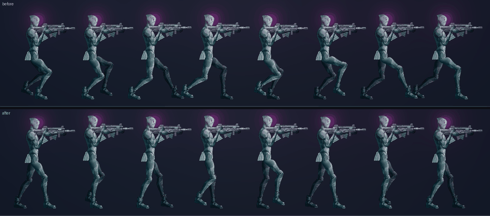
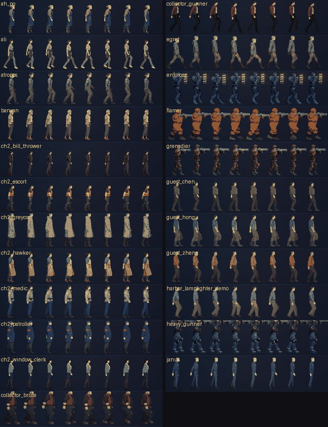
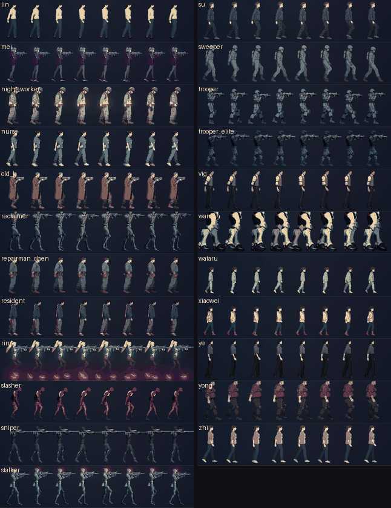
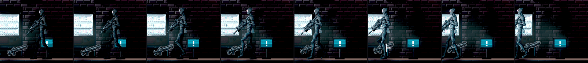

# [NE-480] 修好像坐著往前挪的走路姿勢

> 狀態：完成

## 內文

### 需求
使用者回報：一個瘦長的青灰色人形機器人敵人（頭部有洋紅色的燈、雙手端長步槍平舉在胸前）走路姿勢很怪——兩腿彎得很深、幾乎併在一起像半蹲碎步，上身直立略後仰，像坐在看不見的椅子上往前挪。找出是哪一種敵人與原因，修到像走路；再把所有會走路的敵人與場景人物各拍一條走路連續圖排成總表逐隻檢查；並讓移動動作的測試擋得住這類問題（支撐中段膝角上限、兩腳前後分開的最小距離、骨盆基準高度下限、上身後仰上限），這一隻修前要是失敗的。

### 來源
2026-11-28，使用者親自回報，主 session 轉達並列為敵人與頭目線的最優先。

### 驗收條件
- [x] 寫出是哪一種敵人、原因是什麼
- [x] 那一隻走起來像走路：骨盆高度、支撐中段膝蓋、步幅、上身角度在門檻內，連續圖看得出正常的步伐
- [x] 所有會走路的敵人與場景人物以各自實際的走路速度量過、拍過一條走路連續圖，排成總表逐隻看過；有同樣問題的一起修
- [x] 移動動作的測試加上四項量測與門檻，所有角色通過；用修正前的動作資料當負控制，測試會失敗
- [x] 跑步的骨盆起伏與腳滑照舊在門檻內（不能為了走路把跑步弄抖）
- [x] 受影響範圍的測試沒有新的失敗

### 測試流程
1. `godot --headless --path . res://tools/gait_survey.tscn`：每個角色一行，沒有被標出的項目
2. 看走路總表：每個角色的走路連續圖
3. 跑移動動作測試，全過

---

# 跟其他票的關係

- Blocks：無
- Blocked by：無
- Related：NE-208、NE-209、NE-470、NE-479

---

# Commit-1

## 內文

是迷彩獵手（`stalker`）。同樣的毛病還有狙擊手、擲彈兵、精銳保全、回收者、裁、示範用的港區點燈人與三位客人，老 K 的膝蓋也彎得偏深。
原因：這幾個角色的動作資料都開了「等高跑法」（骨盆固定在腿剛好搆到最大步幅的高度，跑步時才不會上下抖）。等高跑法的骨盆高度由步幅決定：步幅越大，骨盆越低、膝蓋越彎。這幾個角色的步幅又不隨速度縮短，慢慢走的時候也用跑步的大步，於是骨盆壓到 0.66～0.77 L（站立時骨盆高度的倍數）、踩地中段膝蓋彎到 57～82 度，看起來就像坐在看不見的椅子上往前挪。這幾個角色一開始加等高跑法，是為了修跑步時骨盆抖動 0.10～0.16 L 的問題，所以不能直接拿掉。
改法：動作資料新增一個選項，讓等高跑法隨速度淡入：走路時用自然的步態（骨盆在支撐腳正上方時最高），速度到跑速的六成以上才逐漸變成等高；沒寫這個選項的角色完全不變。同時讓步幅隨速度縮短。客人與老 K 另外把腿伸直一點（搆地的長度從 0.96 提高到 0.99～0.995）。
修好之後，以每個角色實際走路的速度量（敵人用自己的移動速度、跑速兩倍；場景人物與過場演員用每秒 60 像素、跑速 150）：迷彩獵手骨盆 0.70 → 0.85 L、膝蓋 78 → 24 度、兩腳前後分開 0.94 → 0.57 L（原本是大步但蹲著，現在是正常步幅、腿打直）；其他被修的角色骨盆都在 0.82～0.87 L、膝蓋 23～39 度。跑步的骨盆起伏與腳滑照舊在原本的門檻內。
移動動作的測試加上四項走路量測：骨盆平均高度 ≥ 0.78 L、踩地中段膝蓋 ≤ 40 度、兩腳前後至少分開 0.3 L、上身後仰 ≤ 8 度；每個有動作資料的角色（46 個）以自己的走路速度量，另外把迷彩獵手改回修正前的資料當負控制，確認會被擋下。另做了一個總表工具（`tools/gait_survey.tscn`），一次印出所有角色的數字。
沒有處理、要決定的兩件事：一、主角凜慢走時同樣偏蹲（骨盆 0.73 L、膝蓋 62 度），主角的動作另外有自己的測試與定案，這張沒有動，測試也先跳過主角；二、不少場景人物（阿婆、榕樹、押運手、灰衣人、攤販、醫護、巡查員、窗口職員、守門人、林小姐等）以每秒 60 像素走時步子很小（兩腳只分開 0.29～0.40 L），看起來像小碎步，阿婆是老人家，小步是角色設定，其他人要等確認過場實際的走路速度再決定要不要調。

### 測試結果

| 項目 | 結果 |
|---|---|
| 受影響範圍的測試 | 通過 69296 / 69296（60 個套件），0 個新失敗 |
| 流程探針 | 9 個中 8 個通過；手把存檔探針是已知的 Windows 設定檔路徑問題（玩法線處理中），和這張無關 |
| 移動動作測試 | 185 / 185（含 46 個角色的走路姿勢與負控制） |
| 走路總表（修正前→後） | 被標出的角色 15 → 1（主角，見上） |

| 角色 | 骨盆（L）前→後 | 踩地中段膝蓋（度）前→後 |
|---|---|---|
| 迷彩獵手 | 0.70 → 0.85 | 78 → 24 |
| 狙擊手 | 0.66 → 0.83 | 82 → 25 |
| 擲彈兵 | 0.71 → 0.83 | 71 → 26 |
| 精銳保全 | 0.72 → 0.84 | 70 → 25 |
| 回收者 | 0.71 → 0.84 | 72 → 23 |
| 裁 | 0.77 → 0.83 | 59 → 33 |
| 港區點燈人（示範） | 0.73 → 0.85 | 70 → 32 |
| 客人陳／洪／鄭 | 0.77／0.78／0.81 → 0.84／0.84／0.87 | 58／57／57 → 30／30／29 |
| 老 K | 0.82 → 0.83 | 46 → 39 |

### 截圖

迷彩獵手以實際的走路速度走一個步伐週期，上：修前（蹲著大步往前挪），下：修後。

走路總表：46 個有動作資料的角色，各自以實際走路的速度走一個步伐週期（骨架預覽）。

# Commit-2

## 內文

第一次交付只有骨架預覽圖，使用者當初看到的是實機畫面，所以補一條實機連續圖：迷彩獵手目前只擺在升降井與夾層區（舊開發關卡 level_02），在那裡讓牠以平常的速度（每秒 46 像素）朝主角走過來，遊戲倍率每 0.1 秒拍一張、共 8 張。拍照時不讓牠開火、強制現形（平常隱形時幾乎看不見），其他敵人停下並隱藏。畫面上是直立、腿打直的正常步伐，沒有蹲著往前挪。

### 截圖

迷彩獵手在升降井與夾層區走路，遊戲倍率，約一個步伐週期。

